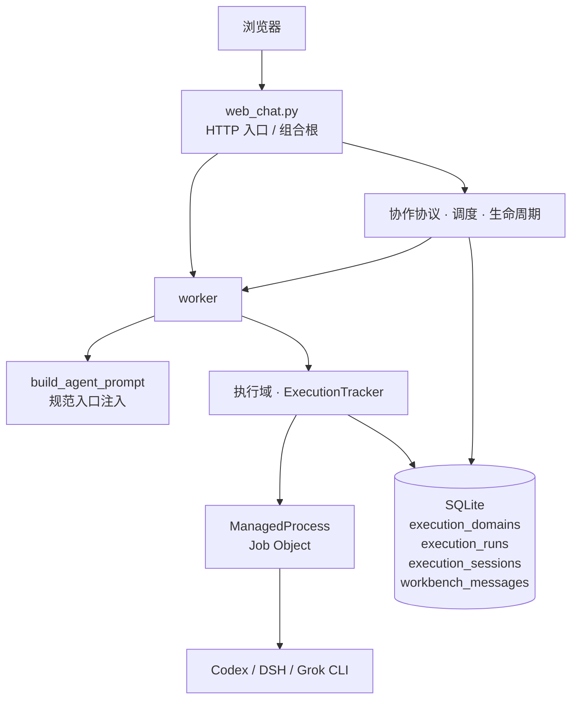

<!--
本文件是 README 的候选稿 v2（提案），不是现行入口文档。
现行 README.md 保持不动，供对比。

示例说明：仓库地址占位符须替换为实际公开地址。占位符不能原样执行。

v2 相对 v1 的修正（依据源码核对与三方评审）：
  1. 修正事实错误：协议拒收落 failed，不是留在 pending；补全四种终态
  2. 收窄标语：只承诺"不互相写坏"，不承诺崩溃后自动恢复
  3. 披露实现状态：generation 数据层已实现但生产未启用；6B 人工解除未实现
  4. 去掉 docs/USER_GUIDE.md 死链
  5. 快速开始上移；SQL 收进折叠块
  6. 补测试导航

待补数据处用 __ 标出，不要凭印象填。
-->

# CoAgent

让多个命令行 Agent 在同一台机器上协作，**而不互相写坏**。

一个 Agent 一天能接进工作流；三个 Agent 协作一周，你会先撞上状态问题，而不是模型问题。这个项目做的是状态这一层。

---

## 快速开始

需要一个能独立完成对话的 CLI 后端（Codex / DeepSeek Harness / Grok 任选其一，各自安装并登录）：

```powershell
git clone <repo-url>
cd CoAgent
python -m venv .venv
.\.venv\Scripts\python.exe -m pip install -r requirements.txt
.\.venv\Scripts\python.exe .\web_chat.py
```

打开 <http://127.0.0.1:8765>，发送 `@Codex 请用一句话介绍你自己。` 端口占用时加 `--port 8766`。

Python 依赖只有 `mcp` 一个。完整安装、配置、权限、停止与排障见用户手册（随本次重构从现行 README 拆出，路径 `docs/USER_GUIDE.md`）。

<!-- 截图占位：补上后再放开
截图尚未制作，拟补工作台截图；当前无图片文件。
-->

---

## 它解决的具体问题

| 现象 | 真正的原因 |
|---|---|
| `thread-store conflict: already has an active writer` | 两个执行同时写同一个后端 session |
| 任务已经取消，日志还在增长 | 取消只是"意图"，进程还活着 |
| 重启后页面显示"忙"，却没有任何进程在跑 | 数据库里的占用登记，不等于进程存活 |
| Agent 回复了一整段，却判定失败 | 有正文输出，不等于协议合法 |

这些全部不是模型问题。

---

## 三个机制

### 1. 单写者执行域

同一个 `(agent, conversation)` 同一时刻只允许一个执行者持权。约束由三个字段共同表达：

- `instance_id` —— 哪个服务实例持有
- `fence` —— 该域被占用的代次，每次占用递增
- `generation` —— 后端 session 绑定关系的代次

**为什么三层都要**：实例锁防不住第二个执行域；执行域防不住两个域绑同一个后端 session；session 绑定防不住旧代次的迟到结果。三者分别约束"哪个服务实例""哪个域""哪次绑定"。

认领走 CAS，不是"先查后写"——`rowcount` 就是答案，抢到的一方拿到 `RunToken(run_id, instance_id, fence)`，此后所有写回都带这个三元组校验；代次一变，旧执行就无法覆盖新绑定（`StaleRun`）。

<details>
<summary>CAS 语句</summary>

```sql
UPDATE execution_domains
   SET owner_run_id = ?, instance_id = ?, fence = fence + 1, state = 'reserved'
 WHERE agent_id = ? AND conversation_id = ? AND state = 'idle' AND fence = ?
```
</details>

### 2. 结构化退出证据

判断"进程没了"，不能靠进程名，也不能靠一个布尔值。

Windows 上用 Job Object 托管子进程，每次启动产出一个 `exit_evidence` 枚举（`confirmed` / `unknown` / `not_started`），**只有 `confirmed` 和 `not_started` 允许放行**。拿不到证据时保留占用——宁可卡住，也不为了可用性重新打开并发写入的口子。

两个细节都是踩出来的：

- 子进程 stdout 不接管道，落临时文件。管道的 EOF 会被后代进程持有的句柄拖住，读取方死锁。
- `cancel()` 只置 Event，不等进程、不拿数据库锁。取消是**意图**，不是事实；事实只能由退出证据给。

### 3. 三阶段写入

Agent 回复不是"写完就算成功"，中间隔着一次协议校验：

```
pending 暂存 → 接收事务（协议校验）→ 四种终态之一
```

| 处置 | 落库状态 |
|---|---|
| `accepted` | `completed` |
| `rejected`（协议不合法） | `failed`，并附 `[协作回复未接收] 原因` |
| `cancelled` / `superseded` | `cancelled` |
| 接收事务之前服务退出 | 停在 `pending`（恢复窗口，见"已知限制"） |

**不把"有正文输出"当成成功**——这条边界是本项目里最容易忽略、也最容易出错的。

---

## 一次被自己证伪的设计

最初方案：用命名 Job Object 托管进程；重启后 `OpenJobObjectW` 返回 `ERROR_FILE_NOT_FOUND (2)`，说明进程树已终止，可以安全释放占用。

看起来很合理。实测不成立。

同用户的受管进程可以清除 `KILL_ON_JOB_CLOSE`，也可以开 breakaway。这两种情况下 Job 名字消失了，**但进程还活着**——`error == 2` 会把一个仍然存在的写入者误判成"已退出"，直接放行。

代价是三轮验证、两次观点反转；结论是整个"跨崩溃自动恢复"被否，降级为保守方案。

完整记录（含证据边界和走过的弯路）：[postmortem/P0-2_POSTMORTEM.md](postmortem/P0-2_POSTMORTEM.md)

---

## 架构



控制面（协议、调度、生命周期、事务接收）与执行面（执行域、受管进程、退出证据）分离，两者通过 SQLite 事务交接。

现状与改进方向（含尚未实施的拆分方案）：[docs/architecture/ARCHITECTURE.md](docs/architecture/ARCHITECTURE.md)

---

## 验证范围

写清楚做了什么、没做什么，比写"已完成"有用。

**已做：**

- 执行域验收 17 项、回归 51 项
- 隔离数据库 + 假适配器下的并发、拒绝、取消、恢复路径
- 一次针对 Job 语义的对抗性实验（结论：原方案不成立，见上）

**未做：**

- 真实后端下的"任务跑到一半再派活"，没有人工复现过
- 跨崩溃自动恢复未实现；并发容量与 p99 延迟未压测（当前 __ 并发下 __）
- 仅在 Windows 10+ 验证

这些不是待办清单，是**当前边界**。按边界来用，比按 README 想象来用安全。

---

## 已知限制

- **崩溃后没有自动恢复，也没有解除工具。** 服务在接收事务之前退出时，占用和消息都可能停在中间态；6B（人工解除/恢复）未实现，目前只能人工处理数据库。这是最需要注意的一条。
- **session 绑定代次未在生产启用。** `generation` 的数据层已实现，但 `SESSION_CONFIGURATION_RESOLVER` 默认为 `None`，默认工作台路径不走统一 session 校验。
- **适配层没有注册表**：新增后端仍要改 `web_chat.py` 的分发逻辑。
- **`web_chat.py` 职责过载**：组合根、编排、worker、prompt、适配器五件事挤在 130KB 单文件里；拆分边界已在架构文档定好，尚未实施。
- **仅 Windows**：其它平台需要等价退出证据，不能把进程组返回码直接映射成 `confirmed`。

---

## 项目结构与测试

| 入口 | 作用 |
|---|---|
| `web_chat.py` | HTTP 入口、组合根、prompt 构造 |
| `execution_tracking.py` | 执行域 / run / session 的状态与代次 |
| `managed_process.py` | Windows Job Object 托管与退出证据 |
| `collaboration_protocol.py` | 协作协议校验与归一化 |
| `collaboration_lifecycle.py` | 接收事务与状态迁移 |
| `collaboration_service.py` | 调度与调用 |
| `agent_bridge.py` | 可选 MCP 消息桥 |
| `specs/` | 项目自身的行为规范 |
| `postmortem/` | 事故复盘 |

测试按主题分散，**没有一条"全仓测试"命令**：

- 执行域：`test_execution_tracking.py`、`test_managed_process.py`、`test_execution_sessions.py`、`test_execution_wiring.py`
- 协作：`test_collaboration_*.py`、`test_issue8.py`
- 冒烟：`smoke_test.py`、`test_capabilities.py`

具体用例和覆盖边界以各文件与 `docs/testing/` 为准。

---

## 文档

| 文档 | 内容 |
|---|---|
| 用户手册 `docs/USER_GUIDE.md` | 安装、配置、权限、停止、排障、FAQ（待从现行 README 拆出） |
| [docs/architecture/ARCHITECTURE.md](docs/architecture/ARCHITECTURE.md) | 架构现状与改进方向 |
| [postmortem/P0-2_POSTMORTEM.md](postmortem/P0-2_POSTMORTEM.md) | 并发冲突复盘（含证伪过程） |
| [specs/README.md](specs/README.md) | 生效规范索引 |
| [BACKLOG.md](BACKLOG.md) | 已确认但暂缓的需求 |

---

> 本项目由一个人类和三个 Agent 共同开发。设计决策记录、验证日志、事故复盘都在仓库里——包括走错的那条路。

---

<!--
待办（合并本稿前）：
1. 补三个数字：并发压测（N / p99 / 拒绝率）、故障注入恢复耗时、单任务成本
2. 补一张截图或 10 秒 GIF
3. 从现行 README 拆出 docs/USER_GUIDE.md（安装/配置/权限/停止/排障/协作示例）
4. <repo-url> 替换为实际地址（确认已 public 且无痕窗口可访问）
5. 添加 LICENSE（候选 Unlicense）
6. 移除原候选清单中10份文档的个人本机路径（历史待办，不代表当前仍有10份残留）
7. 根目录 P0-2_* / TEST_* / ISSUE8_* / WEB_COLLABORATION_ACCEPTANCE.md
   迁到 docs/postmortem/ 与 docs/testing/
8. 修正 managed_process.py 首行 docstring（仍写 "not yet wired into production"）
-->

## 变更历史

| 时间 | 版本／议题 | 原状态或决定→新状态或决定 | 原因与证据 | 提出／决定者及来源 | 影响范围 |
|---|---|---|---|---|---|
| 2026-11-16 12:24:58 +08:00 | entry-3327／验收返修 | 首轮清理→补语义及交付链接检查 | 主题草稿§12；Python本机时钟 | Codex | 作者静态检查；返修版本待独立复核 |
| 2026-11-16 12:24:09 +08:00 | entry-3327／语义返修 | 首轮替换→修正示例及历史语境 | 主题草稿§12；Python本机时钟 | Codex | 仅文档静态检查，独立复核待完成 |
| 2026-11-16 12:15:57 +08:00 | entry-3327／交付引用清理 | 具体本地定位→可交付摘要或通用占位符 | 用户要求；主题草稿§12；Python本机时钟 | Codex | 保留历史事实与版本范围；作者检查，待独立复核 |
