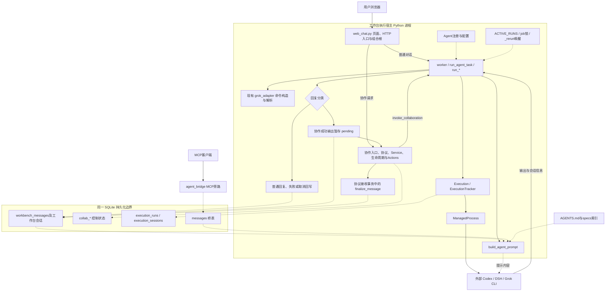

# 架构现状与改进方向

> 本文档是「现状记录定稿」与「改进方向提案」的汇总，遵循 [design-decision-record-spec](../../specs/DESIGN_DECISION_RECORD_SPEC.md) 与 [document-management-spec](../../specs/DOCUMENT_MANAGEMENT_SPEC.md)。
> 三方收敛来源：`docs/drafts/architecture-review/` 的 CODEX / DEEPSEEK_HARNESS / GROK 原稿、第二轮修订及 SUMMARY，本轮 Codex 提案 CX-F01/F02/F03，经 Grok 与 DeepSeek Harness 逐项复核后收敛。

| 元信息 | 值 |
|---|---|
| 文档状态 | 现状记录已定稿；改进方向为提案、未实施 |
| 收敛基线 | feat/architecture，HEAD `1266e5b895fbe3e1eee6b1ad2986a0209f0e14ef`（与 main 一致） |
| 代码事实基线 | 与 `32b1de7` 比较 Python 无差异，沿用第二轮已核对代码事实 |
| 验证范围 | 未做 Mermaid 渲染、崩溃/重启注入、真实 CLI、浏览器走查 |

---

## 1. 官方现状架构图（已核对事实，控制流视角）

本图是**逻辑控制流**，`web_chat.py` 当前仍同时承担组合根、协作编排、worker、提示构造与适配器多项职责。实线表示主要调用、控制或结果传递；虚线表示数据、配置、内存或提示关系。图中仅保留现有 `grok_adapter`，其余后端的对等适配属于改进提案。

### 职责边界（已核对事实）

- 浏览器普通对话经 HTTP → worker/`run_*` → Execution；MCP 是 `agent_bridge` 旁路，写 `messages` 桥表后参与提示上下文，普通对话不经 MCP。
- `AGENTS.md` 与 specs 索引经 `build_agent_prompt` 提示注入；协议 JSON 由宿主校验；规范正文由 Agent 按需读取遵从。
- 三条消息写路径：普通/失败/取消 → `update_workbench_message`；协作成功 → `stage_collaboration_reply`（仍 pending）；协议接收事务 → `finalize_message`。
- 内存登记（`ACTIVE_RUNS` / job 锁 / `_rerun`）与执行占用、退出证据分开；占用登记不能证明 OS 进程存活。
- `_rerun` 表示同进程 job 锁争用的唤醒合并；启动已有 `interrupt_running`，恢复的是控制状态。
- `execution_sessions` 是 SQLite 表，由 `execution_tracking.py` 操作，仓库无 `execution_sessions.py`。

---

## 2. 改进方向优先级（全部为提案、未实施）

下表合并三方原编号（DSH/CX/GK 的 D/O/M）去重后按成本收益排序，属于本轮收敛建议，未实施、未写入 `BACKLOG.md`（除非用户另行授权）。

| 优先级 | 合并项及原编号 | 建议与成本收益依据 |
|---|---|---|
| 高，当前交付 | 架构入口，DSH-M03 | 完成现状图、职责和证据入口；文档成本低，已由本文档承载 |
| 高，后续首选 | 只读执行诊断，CX-M01、DSH-M01 诊断部分、GK-D02/M01 | 先盘点已有 inspect/API/UI，再补关联与最近活动；摘要分列占用、内存、OS 存活、最后活动、业务接收，摘要非重试或杀进程授权；注意脱敏及时效 |
| 高，后续首选 | 状态所有权及恢复接收契约，CX-D02/O02、DSH-D03/M02、GK-D03/O02 | 已有 `interrupt_running`，缺取消、迟到结果、重启窗口的运行验证；先明确契约再验证，不先加持久调度队列；测试与故障注入成本中高 |
| 中 | 宿主渐进拆分与纯适配器，三方 D01、CX-O01、DSH-D02/O01、GK-O01/O03 | 合并为一个方向分步推进，保留命令、HTTP、会话、取消及事务语义；迁移成本中等 |
| 中 | 就绪判定纯函数化，DSH-O02 | 限定依赖、就绪与授权判定，保持串行行为；先确认输入快照及副作用边界 |
| 中 | 后端兼容样本，CX-M02 | 复用已有测试，盘点版本、权限、续接及终态样本，为适配抽取提供基线；不宣称无测试 |
| 中 | 协议语义与入口覆盖，GK-M02 | 已有重复任务/依赖检查与 status/邀请 XOR 作为基线；补检对象是混合计划语义与入口覆盖 |
| 低，条件性 | job 工作区隔离，GK-M03 | 适用于有实际冲突压力的编码任务，文档协作不必隔离；合并、清理与路径成本较高 |

**重要区分**：三方一致把「宿主职责集中」评为**高结构债（事实）**；其实施顺序放在「只读执行诊断 + 恢复接收契约」之后，理由是后两者能先明确迁移需保持的行为。本文档同时记录两层含义——**事实严重度高 / 实施顺序中**，不作为降级。

---

## 3. 分歧与未决项

### 3.1 adapter 的 execute 职责：已收敛（三方一致）

正式结论：adapter 承担**纯命令构造 + 输出解析 + 诊断边界**；`Execution` / `ExecutionTracker` / `ManagedProcess` 负责占用、PID、取消、会话代次与退出证据；业务接收终态由 `finalize_message` 所在接收事务处理。`run_*` 的会话写回是**现状**，收到 Execution 是**目标**。方法命名可后续再议。此项不再提交用户裁决。

### 3.2 普通文件退路验收：延后到 skill 议题（三方一致延后）

共享流程成功与 skill 机制成功**分开验收**。DSH 的 `read` 能力是已核对事实、是机制验证前的现实替代，本文档如实记录一句，但不把它写成 skill 加载成功。具体验收归属随 skill 机制验证再定。

### 3.3 共享适配唯一性：保留分歧（需用户裁决或 skill 验证后裁决）

- **已核对事实**：三后端 skill 发现机制不同构（Codex `.agents/skills` 扫描、Grok 项目 `.grok/skills`、DSH 宿主注入 `available_skills`，且当前工作台 `web_chat.py` 未见项目 skill 注入逻辑）。
- **DSH 立场**：因不同构，故「一份权威正文 + 各后端薄适配」在事实层面是必须的，候选的只是薄适配的具体实现方式。
- **Grok / Codex 立场**：不同构推出「必须薄适配」是推断、不是已核对事实；「一份权威正文 + 各后端薄适配」保持**候选**，其他候选还包括各后端各持一份正文副本、仅走普通文件共享流程、或验证后确认某端原生扫描即可。
- 此项延后到 skill 机制验证（V02/V09）后裁决，必要时交用户。

---

## 4. 验证范围与缺口

- 现状图尚未渲染；恢复、并发、真实 CLI、浏览器场景未运行验证。
- skill 注册链、链接/引用、版本同步仍待机制探测。
- 原稿与第二轮修订历史保留于 `docs/drafts/architecture-review/`。
