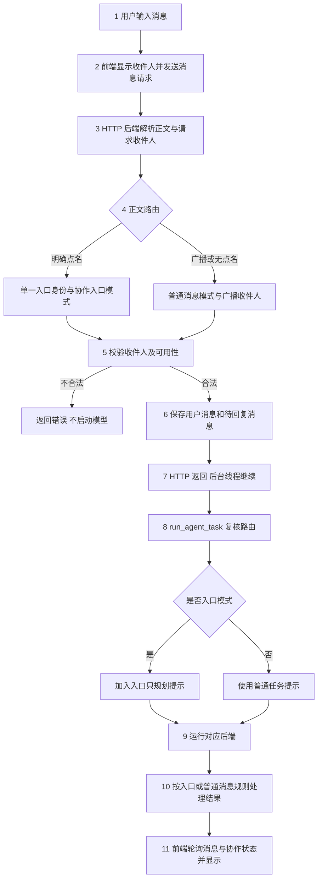
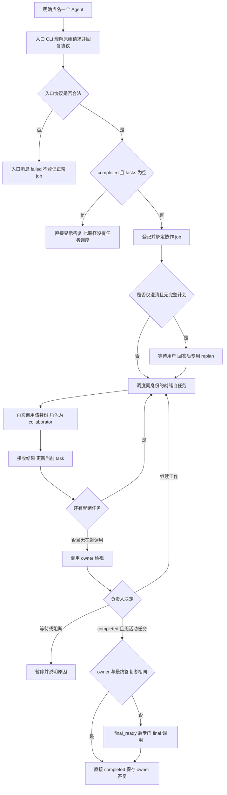
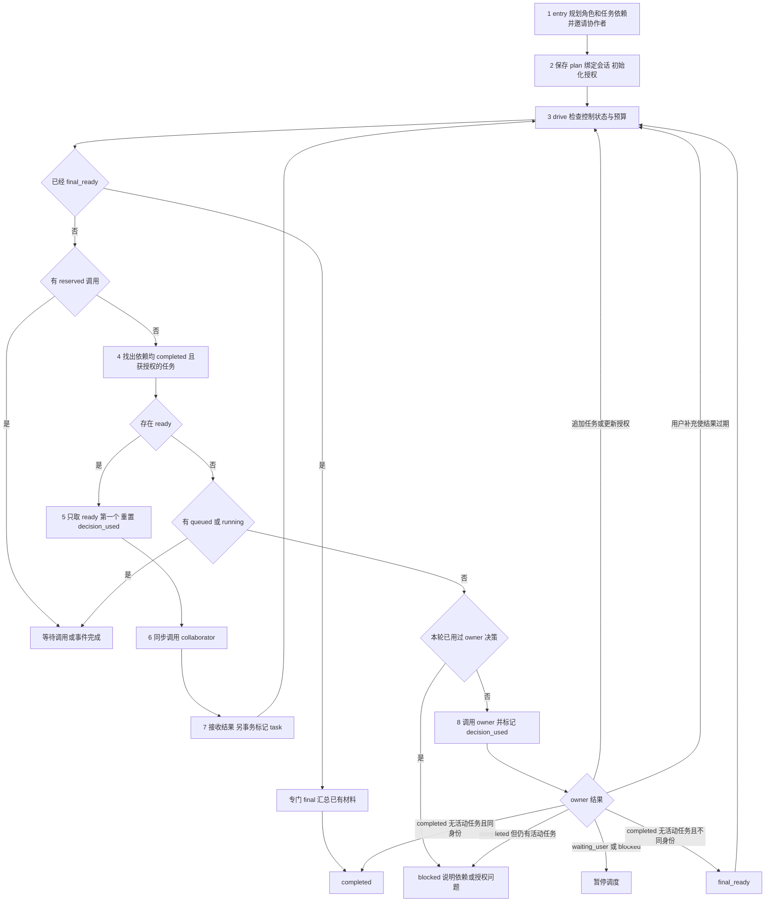
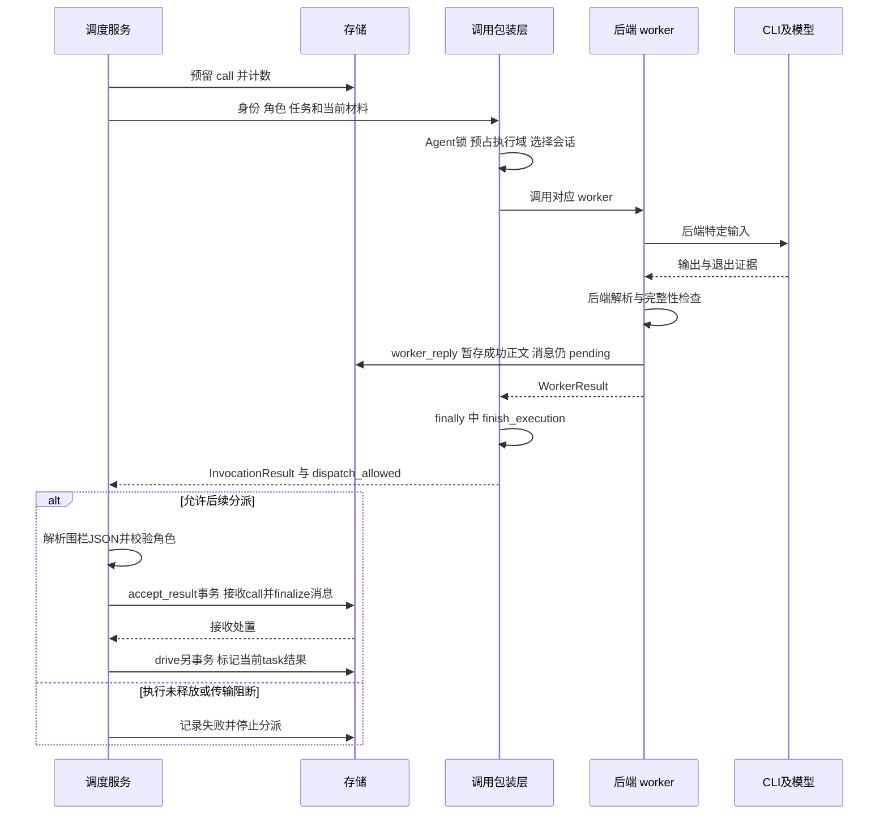
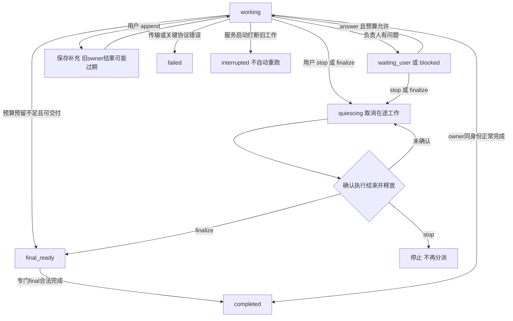

# 工作台调用流程：单 Agent 与多 Agent 协作

| 项目 | 说明 |
|---|---|
| 状态 | 三端终审通过，已形成统一版；共识范围为源码静态核对 |
| 整理者 | Codex，依据三端独立原稿与互审 |
| 来源 | entry-2903，用户要求三端分别绘图、互审讨论、汇总，使项目新读者也能理解 |
| 基线 | 2026-11-11，HEAD `209446f0408d32fc005b7036543ab79a2c2d53f3`；行号指本轮查阅的工作树 |
| 范围 | 描述当前代码，不改变调用机制、权限或 Grok 启动参数 |
| 验证 | 静态源码核对；未运行真实模型、浏览器或故障注入；Mermaid 未渲染 |

配套：[架构总览](ARCHITECTURE.md)、[三端原稿与互审入口](../drafts/workbench-call-flow/README.md)、[逐项处理表](../drafts/workbench-call-flow/RESOLUTION.md)。原稿保留当时观点；本稿按处理表纠正，DeepSeek Harness 与 Grok 已终审同意，Codex 已完成收口，无阻断异议。

## 1. 先从用户看到的行为理解

“调用单个 Agent”可以是问一句立即回答，也可以是同一身份分几轮完成工作。“多 Agent 协作”则有任务清单、先后依赖和负责人审核。参与者多，并不表示系统同时运行这些任务：当前同一协作 job 的主调度每次只取一个就绪任务。

还有一种相似但不同的行为：不写点名或写 `@all`，工作台可以把消息广播给多个后端，各自回答。广播本身不建立协作计划，也没有 owner 审核闭环。

| 术语 | 面向新读者的解释 |
|---|---|
| Agent 身份 | Codex、DeepSeek Harness、Grok，代表后端类型，不是一台物理机器，也不是永久不变的进程 |
| CLI | 工作台在本机启动的命令行程序；它再与模型服务交互，可以按权限调用工具 |
| entry | 首次理解用户意图、给出角色与计划的入口角色 |
| owner | 负责人，检查结果、安排后续任务、决定是否交付 |
| collaborator | 当前任务的执行者；即使身份也是 owner，此轮仍按协作者规则执行 |
| final_responder / final | 前者是最终答复者身份；后者是某些情况下额外启动的交付角色，两者不能混为一谈 |
| job / task / call | 一次协作整体 / 计划中的一项工作 / 一次后端调用。一个 task 和一个 job 不是同一层级 |
| handoff | 回复 JSON 中的六项交接说明，保存结果、证据、未决项及下一步 |
| 执行域 | 按 Agent 身份与工作台会话标识预占的执行位置；工作目录是运行快照，不是域键 |
| 协议接收 | 工作台确认回复格式、角色、当前状态都合法，才将其作为有效协作结果 |

逻辑角色可以由同一身份担任。单 Agent 自任务可能依次启动 entry、collaborator、owner 多次 CLI，而不是整项工作只启动一个进程。

## 2. 两类调用共用的用户入口

1–4：前端的收件人提示帮助用户预览，后端仍重新判断。入口识别会排除代码块、URL 等不应当作点名的内容；多个提及的机械路由与模型随后按语义确定 owner 是两个步骤。

5–8：客户端可以缩小广播收件人范围，不能把明确点名改投其他 Agent。先计算收件人再落库；线程内复核决定传入哪种提示，不是在模型回答以后猜测它是否为 entry。

9–11：HTTP 请求结束不代表模型已完成。后台运行和前端轮询分离，消息与任务视图来自存储。服务器监听本机地址与应用层请求校验是不同概念：协作 action 有 Host、Origin、token 校验，不能据此宣称普通 messages 入口也具有同一校验。

依据：`web_chat.py:534`、`:953`、`:2133`、`:2391`、`:2498`；`collaboration_entry.py:11`；`grok_adapter.py:58`；`collaboration_http.py:8`。

## 3. 第一类：调用单个 Agent

图中“继续工作”只表示返回调度器重新评估；不是无条件存在可运行任务。没有 ready 但仍有 reserved/queued/running 时等待，不能抢先调用 owner。owner 决策后依然无可运行工作，则按第 4 节的有界机制 blocked。

### 3.1 无需查证的纯问答

示例：`@Codex 1+1 等于几？`。入口可直接给可读答案，协议 `completed`、空任务数组；合法校验后完成消息，无需再调用一次 collaborator。若问题需要读仓库文件，例如“仓库用了什么语言”，按入口约定应列执行任务，不能套用无需查证的例子。

### 3.2 有实际工作的单身份计划

示例：`@Codex 阅读 README 并说明启动步骤`。入口仅规划；调度器再次调用 Codex 执行读文件任务。任务结果返回后，owner 再检查是否满足请求。若 owner 与最终答复者均为 Codex，正常完成直接保存 owner 的回复，不会为了“最终答复者”这个身份再额外启动 final。

入口“只规划”是提示中的执行义务，不等于三种 CLI 通过同一种原生禁工具机制强制实现了它。工作台调度调用与 CLI 内部读文件、执行命令、网络请求也不是同一层：模型内部工具使用不会自动生成新的工作台 task 或 call。

无计划的 waiting_user/blocked 入口会使用系统澄清占位任务；用户回答后 replan 校验其来源，并可形成完整计划或直接解决澄清。它与普通已确定计划只追加新任务的路径不同。

依据：`web_chat.py:2145`、`:2170`、`:2183`、`:2200`；`collaboration_entry.py:57`；`collaboration_service.py:233`、`:306`；`collaboration_lifecycle.py:180`。

## 4. 第二类：多个 Agent 协作

1–2：entry 从完整用户语义确定 owner 和 final_responder，计划记录 `task_id`、`agent_id`、`instruction`、`depends_on`。末行邀请初始化授权名单。此后工作中的 owner 用 request_collaboration 和末行邀请替换授权名单。邀请的身份必须在计划中有任务。名字出现在普通说明段落不等于合法末行邀请。

3–5：依赖只认 task 的 completed；failed 不算依赖满足。自任务不需外部邀请，其他身份要获授权。即使三个任务都无依赖，当前主循环仍取 `ready[0]`，在共享工作区中保守串行。底层批处理设施存在，不代表这条产品主链实际并行。

6–7：一次 call 先预留并计入预算，再准备任务和上下文。正常路径同步等待该调用返回、接收并标记任务，然后同一个 drive 循环继续，不依赖浏览器触发下一步。协作调用另有 `COLLAB_AGENT_LOCKS[agent_id]`，执行域还限制 Agent+会话；这些约束不应泛化成整个产品只允许一个进程。普通广播线程和其他 job 是不同并发层。

8：执行者完成当前 task，不代表整个 job 完成。owner 依据交接材料审核，必要时只追加新任务；旧角色和旧任务定义（包括 depends_on）不可改，省略旧任务表示保留。一个 owner 决策后仍无 ready 且无在途工作，drive 转 blocked；有任务实际运行会重置该轮的 decision_used。

正常 completed 检查“无活动任务”，不保证失败 task 所代表的用户目标已经达成。负责人仍须明确报告失败与缺口，不能因数据库允许收尾而声称工作全部成功。

示例：用户让三端独立画图并互审。三个原稿任务无依赖；每个互审任务依赖全部原稿；统一稿依赖全部互审；终审依赖统一稿。主链仍逐项执行。Codex 可以先以 collaborator 写稿，再以 owner 审核；逻辑角色与身份分开。当前 job 的 owner=final=Codex，正常收口使用 owner 回复即可。

依据：`collaboration_service.py:59`、`:175`、`:221`、`:249`、`:265`；`collaboration_protocol.py:68`；`collaboration_lifecycle.py:167`、`:180`；`web_chat.py:164`。

## 5. 放大一次协作 call：输出如何成为有效结果

这张图描述有正常输出时的先后；取消、超时、解析失败另走失败或取消处置。成功退出只是第一层证据：协议还要有唯一可解析的协作 JSON、正确字段与角色规则，以及与当前 job 一致的计划。非法协议不能被当作成功结果。

`accept_result` 事务内可以一并确认 call、消息，以及相应生命周期或新增计划；当前 collaborator task 的终态由 drive **另开事务**更新，不是“call/message/task 全部一次原子提交”。协议失败的协作者 task 会被记为 failed；owner/final 的非法回复还会导致 job failed。重复提交、冲突迟到回复、取消后的回复都有单独接收处置。

owner 调用开始时会记住用户补充数量。若回复回来时新增补充，结果可以 superseded：保留旧调用记录但不据此结束 job，使用新材料重新判断。

依据：`web_chat.py:1385`、`:154`、`:200`、`:209`；`collaboration_service.py:152`、`:175`、`:259`；`collaboration_lifecycle.py:99`。

## 6. 提示、会话与三后端的边界

提示不仅含当前一句话。`build_agent_prompt` 注入项目 AGENTS 与规范索引，并结合工作台近期上下文、消息桥材料、当前请求；上下文有筛选和截断，不能视为全部历史原文。规范索引进入提示后，Agent 仍须判断适用性并读取适用正文。协作 call 另附 view、tasks、calls 等当前材料。

工作台 conversation_id 与 CLI 的 thread/session 标识不同。执行前选择新建或续聊会话，有 session resolver 与既有兼容路径；本轮没有确认实际部署选择哪条。CLI 会话续聊与数据库里的工作台消息记录也不是同一份存储。

| 项目 | Codex | DeepSeek Harness | Grok |
|---|---|---|---|
| 输入 | stdin，命令末尾 `-` | stdin，JSON 模式与 `-` | 临时 prompt 文件与 `--prompt-file` |
| 可显示最终正文 | `--output-last-message` 指定文件 | stdout 中 `type=final` 事件 | stdout 的 text 事件累积 |
| 完成证据 | 返回码、新会话 thread_id、非空 answer 等 | 返回码及后端 final 解析等 | 无 error，end、支持的 stopReason、唯一合法 sessionId |
| 会话 | exec 或 exec resume | 按函数的会话参数选择 | 可加 `--resume` |
| 权限参数 | 普通调用仅在解析后的工作目录匹配本机指定的 step1 根目录时请求 `step1-git`。迁至其他路径后使用 `--sandbox CODEX_SANDBOX`。专门 final 请求 `--sandbox read-only` | 不具有与另外两端相同的显式 final 拒绝参数 | 普通为 `dontAsk`，允许 `Read`、`Grep` 和绑定获准工作目录的 MCP 文件工具。仅在 entry-3917 获准仓库与分支额外允许 `Bash(git *)`。专门 final 为 `dontAsk`，加 `--deny *` 和 `--disable-web-search`。常驻 `--no-subagents` |

表格记录静态启动参数。entry-3917 为测试分支记录的允许项是 `Bash(git *)`、`Read` 和 `Grep`。entry-4088 两端均复现两条权限参数断言失败。后续授权与真实 CLI 生效范围待确认。[Grok 设计记录](../design/GROK_ADAPTATION_DESIGN.md#entry-3917-测试分支权限) · [修订记录](../drafts/CODEX_GIT_PROFILE.md#entry-4095-检视说明修订)

三个超时默认值为 1200 秒，可配置。正常 owner 同身份收尾不设置 `final_delivery`。

模型内部工具调用发生在 CLI 运行期间，例如读文件或执行命令，由后端权限决定。上述流程只说明工作台如何启动、等待、记录和接收；不展开模型推理内部步骤，也不声称能观测全部服务端行为。

依据：`web_chat.py:97`、`:1717`、`:1801`、`:1940`、`:2047`；`grok_adapter.py:14`、`:47`；`execution_tracking.py:128`。

## 7. 状态、异常、取消与恢复

先区分三层状态：消息的 pending/completed/failed/cancelled；call 的 reserved/completed/failed/cancelled；job 的 working/waiting_user/blocked/final_ready/quiescing/completed/failed/interrupted，以及 stopped 视图。某一层 completed 不等于其余层或用户目标也成功。

| 情况/操作 | 当前实现及读者应如何理解 |
|---|---|
| waiting_user / blocked | 停止正常调度。answer 仅在这两态可用，预算须留继续与交付空间；澄清占位走专用 replan |
| append | working/waiting_user/blocked 可保存补充，不等于自动把 waiting 状态改成 working；owner 过期结果不可收口 |
| set_limit | 整数 2..100，新额度必须大于已用数；不等于恢复所有终态。操作有 operation_id 幂等检查和会话归属校验 |
| 无 ready | 先辨别在途调用，再允许一次 owner 决策；仍无工作则 blocked，避免无界空转 |
| 预算 | call 预留计数与收尾容量检查；额度不足可 prepare_final 取消待执行任务并交付已有材料，不能假装余下工作完成 |
| stop / finalize | 写入持久事件，进入 quiescing；finalize 在确认静止后进入 final_ready，stop 不再继续分派 |
| 取消链 | stop_active_run → Execution.cancel → ManagedProcess.cancel；协作取消还等待 execution.done 与 released。UI 已显示 stopped 不是进程已确认退出的证据 |
| 未确认退出/占用 | dispatch_allowed 可阻断后续调用。不能把运行记录仍在就等同进程活着，也不能因控制状态 stopped 就认定进程已死 |
| 重启 | interrupt_running 标记控制状态 interrupted 等，不证明旧 OS 进程不存在，不自动重放业务；旧占用与会话须另核验 |
| 非零退出/超时/无有效输出 | worker 生成失败/取消结果；接收层仍检查当前状态。已有文件修改不会由调度器自动回滚 |
| 迟到/重复 | 接收层区分 duplicate、rejected、superseded、cancelled，避免覆盖已确定结果 |
| 失败依赖 | failed 不是 completed，后继不会因此就绪。负责人可追加有依据的后续任务或说明阻断；不是原 task 自动重试 |

专门 final 阶段按提示只能汇总已有材料；Codex/Grok 还传入各自的权限收紧参数。普通 owner 直接交付同样负有准确说明证据与缺口的义务，但不能将其误写成经历了专门 final 的技术限制。

依据：`collaboration_actions.py:29`、`:55`、`:99`；`collaboration_lifecycle.py:50`、`:99`、`:191`、`:227`；`collaboration_service.py:81`、`:221`、`:306`；`web_chat.py:138`、`:1564`；`execution_runtime.py:159`。

## 8. 核查依据与文档形成记录

本稿采用“用户路径 → 两类主流程 → 一次调用放大 → 异常表”的分层方式，避免把所有分支塞入一张巨图。没有采用 DSH 单一 stdin/final 公共节点，也没有采用“总要额外 final”的实例；原因与代码证据在[处理表](../drafts/workbench-call-flow/RESOLUTION.md)。不改写原稿以保持独立观点和修订历史。

| 核查范围 | 源码定位 |
|---|---|
| 前端收件人与提交 | `web_chat.py:534`、`:953` |
| HTTP、路由、entry结果 | `web_chat.py:2391`、`:2498`、`:2133`；`collaboration_entry.py:11`、`:57` |
| 调度、授权、澄清、owner循环 | `collaboration_service.py:59`、`:175`、`:221`、`:306` |
| 接收、预算、完成与启动打断 | `collaboration_lifecycle.py:50`、`:99`、`:191`、`:227` |
| 协议与计划不可变性 | `collaboration_protocol.py:68`；`collaboration_invitation.py` |
| 用户操作与安全边界 | `collaboration_actions.py:29`；`collaboration_http.py:8` |
| 暂存、执行包装与三CLI | `web_chat.py:1385`、`:154`、`:1801`、`:1940`、`:2047` |
| 进程与执行域 | `execution_runtime.py:159`；`execution_tracking.py:128` |

源码文件位于项目根目录；行号只用于定位，不保证以后版本不变。相关源文件链接：[web_chat.py](../../web_chat.py)、[service](../../collaboration_service.py)、[lifecycle](../../collaboration_lifecycle.py)、[protocol](../../collaboration_protocol.py)、[actions](../../collaboration_actions.py)、[Grok适配器](../../grok_adapter.py)。

适用性复核：must_follow 为 agent-discussion-spec v1.2.0（独立观点、证据、异议、预算）、design-decision-record-spec v1.2.0（期望与修订理由）、document-management-spec v1.0.0（状态、索引、历史）、task-execution-spec v1.0.0（充分查证、边界与准确交付）；正文位于 specs/ 同名大写文件，本会话已全文读取，本阶段复读索引与文档/设计两份正文。code-review-spec v1.2.0 不适用，无代码变更；uncertain 无，读取失败无。相关规范从[索引](../../specs/README.md)进入。

验收对照：已提供两类流程、术语、逐步解释、新手例子、实际异常与源码依据，符合当前文档任务范围；两端终审均确认图文与源码一致、适合新读者理解。没有把本稿描述的现有实现再记成新增实现。

验证边界：未运行浏览器/真实CLI/取消超时重启注入；未动态观察 queued/running 的全部写入路径；未确认部署环境 session resolver 选择。当前未找到 PATH 中的 mmdc，未执行 Mermaid 解析器或渲染，图的语法与视觉布局仍待验证。只做文本与链接检查，不以围栏数量代替渲染成功。

变更记录：2026-11-11，entry-2903 完成三份独立原稿 → 三份互审 → 本统一稿与逐项处理表 → DeepSeek Harness、Grok 终审同意 → Codex 收口；所有原稿保留，修正在本稿体现。两端提出的“纠正并终审前不宣布最终共识”条件已满足，无阻断异议；源码静态核对层面的共识已形成，上述验证边界继续保留。entry-2916 依据该终审及收口记录同步正文与索引状态。

## 变更历史

| 时间 | 版本／议题 | 原状态或决定→新状态或决定 | 原因与证据 | 提出／决定者及来源 | 影响范围 |
|---|---|---|---|---|---|
| 2026-11-21 17:31:51 +08:00 | entry-4095 | 旧说明→与实现及检视结果对齐 | entry-4088；Python 本机时钟 | 用户；Codex | 权限说明及部署范围，见[修订记录](../drafts/CODEX_GIT_PROFILE.md#entry-4095-检视说明修订) |
