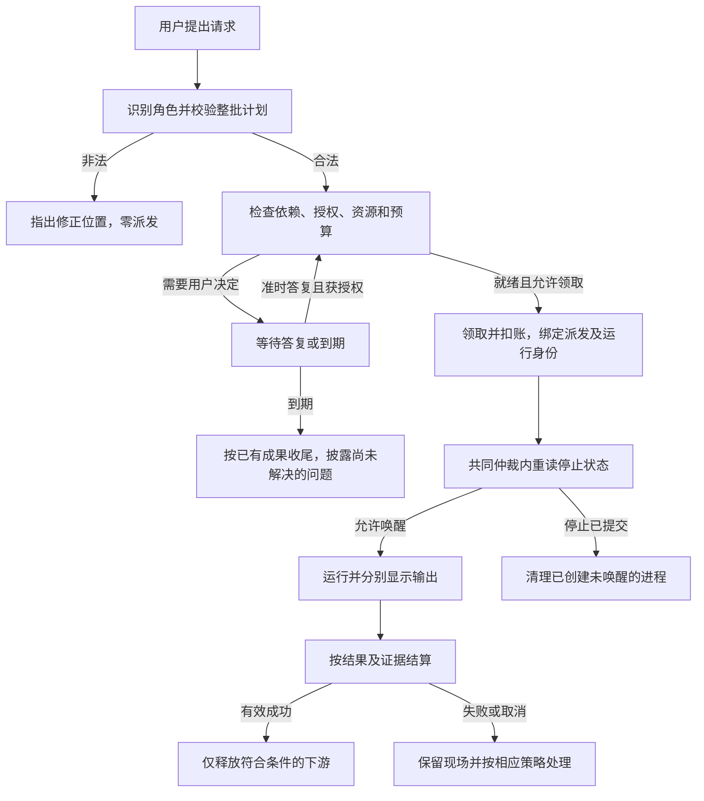
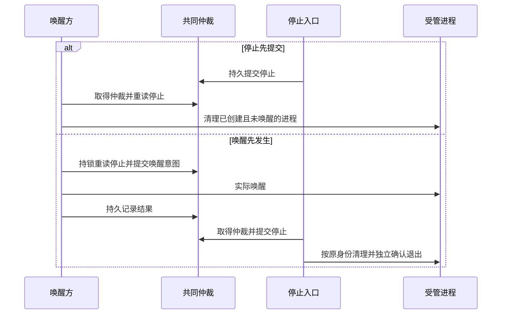

# 协作路由设计

| 字段 | 值 |
|---|---|
| 版本 | 1.1.0 |
| 文档状态 | 已落盘的重写候选，待 DeepSeek Harness 与 Grok 同版检视 |
| 方案状态 | REQ-004 仍为设计中。产品实施授权与验收待取得 |
| 需求依据 | [REQ-004 1.5](../requirements/COLLABORATION_ROUTING_REQUIREMENTS.md) |
| 形成记录 | [开发交接审计](../drafts/COLLABORATION_ROUTING_DESIGN_DISCUSSION.md#459-正式稿开发交接审计) · [本次重写](../drafts/COLLABORATION_ROUTING_DESIGN_DISCUSSION.md#462-面向用户重写) |

## 1. 摘要、目标与范围

你可以在一条消息里交代谁来做、谁要等哪项结果，以及谁给最终答复。工作台应理解这些分工，安排能独立推进的任务，并把确实需要你决定的问题问清楚。遇到失败或停止时，最终答复要告诉你已经拿到了哪些成果、哪些任务没有完成，以及原因。

例如，你请两位 Agent 分别检查方案的完整性和可读性，再由 Codex 汇总。如果两项检查互不依赖，且执行环境能保证安全，两路可以同时运行，各自显示进度。其中一路失败，另一路已经取得的成果仍可交付。失败的一路能否再试，取决于该次调用的退出、文件、外部动作、授权和预算证据。

本设计覆盖角色识别、成果复用、等待、失败恢复、停止、并行、输出归属与协议校验。首批实现在隔离环境进行。任意共享目录下的无条件并行、跨轮次直接依赖、自动回退及无条件重试均在范围之外。

## 2. 现状与主要取舍

角色误判会把工作交给错误的人，跨轮次依赖无法解析时会导致计划停等。现行主入口保守地选取第一个就绪任务，已有调用与运行记录可用于追踪身份，现行唤醒仍使用进程内锁。代码落点见 §4.1，静态观察的来源和边界见[实施前证据](../drafts/COLLABORATION_ROUTING_DESIGN_DISCUSSION.md#454-实施前证据综合)。

| 选择 | 解决的问题 | 代价或备选 |
|---|---|---|
| 复用入口和持久账本，按批校验计划、按尝试绑定运行 | 保持任务与结果归属一致，避免部分接纳与重复扣账 | 接纳路径须核对原身份和存量关联 |
| 同主机优先使用命名互斥量统一停止和唤醒顺序 | 停止请求和实际唤醒即使来自不同进程，也能依据同一个顺序作决定 | 需要验证会话、权限、锁序与遗弃锁。共同对象不可用时，可用独占且不可绕过的统一执行服务 |
| 允许安全的独立任务并行，分路显示并结算 | 两路进度均可见，单路失败时仍能保存另一路成果 | 共享或无法核实的写域默认串行，不能独占则阻止派发。共享写并行依赖强制隔离 |
| 逐通道取证后才允许自动重试 | 避免重复发送请求或扩大已有修改 | 缺证时暂停相关重试并保留原账 |

关键反例、保留意见和范围取舍可追溯至[限制性契约归位](../drafts/COLLABORATION_ROUTING_DESIGN_DISCUSSION.md#450-限制性契约归位)、[首批简化](../drafts/COLLABORATION_ROUTING_DESIGN_DISCUSSION.md#456-首批设计简化)和[依赖与部署取证](../drafts/COLLABORATION_ROUTING_DESIGN_DISCUSSION.md#458-正式稿依赖与部署取证)。

## 3. 方案总览与关键时序

工作台接到请求后先校验整批计划，再调度满足依赖、授权、资源、预算和停止条件的任务。需要用户答复时，仅暂停依赖该决定的工作。每路输出和结算都能追溯到原任务及此次尝试。

未就绪或授权被拒的任务按 §4.2 处理。上图的停止分支也适用于领取之后才提交停止的场景。下图把这个竞争放大，展示唤醒和停止之间的先后关系。

若记录了唤醒意图但结果未知，恢复方按可取得的持久证据判定，禁止补唤醒。两张图均为目标设计，完整约束见 §4。

## 4. 详细设计

### 4.1 系统入口和组件职责

本设计解决工作台中的错派发、跨轮次依赖失配、失联后误重试及输出混流。主入口目前保守选取首个就绪任务，因此需要在保留停止与唯一领取约束的前提下接入可验证的并行调度。下表的接口是目标行为，源文件是改动定位。

| 组件及现有落点 | 输入和前置条件 | 输出、职责和拒绝路径 |
|---|---|---|
| [协作入口](../../workbench/collaboration/collaboration_entry.py)、[协议解析](../../workbench/collaboration/collaboration_protocol.py)、[邀请解析](../../workbench/collaboration/collaboration_invitation.py) | 用户原文、当前角色与 job、单个协议对象及邀请尾部 | 识别角色、任务与授权。按角色、状态和字段校验完整或增量计划。失败时给出字段或尾部规则及修正方向，派发为零。 |
| [Web 协作入口](../../workbench/collaboration/collaboration_http.py)、[协作调度](../../workbench/collaboration/collaboration_service.py) | 合法计划、当前依赖完成态、授权、停止、预算及执行域 | 仅选满足条件的任务。合法但暂未就绪保持等待并说明原因。用户答复路由至正确负责人。 |
| [生命周期](../../workbench/collaboration/collaboration_lifecycle.py)、[批次执行](../../workbench/collaboration/collaboration_batches.py) | 就绪集合、原任务身份、尝试、预算及资源 | 唯一预留并扣账，按执行域隔离地交付已领取项。重复请求返回既有关联或拒绝冲突，失败按路结算。 |
| [运行登记](../../workbench/execution/execution_tracking.py)、[托管进程](../../workbench/execution/managed_process.py) | 预留键、原调用、派发消息、目标运行身份、停止及恢复证据 | 登记并绑定运行。唤醒与停止走共同仲裁。返回原身份的执行或清理证据，缺证保留原账并暂停。 |
| [协作动作](../../workbench/collaboration/collaboration_actions.py)及适用 Worker、恢复、直接调用与 MCP 入口 | 已绑定的 job/task/call/run 和事件类型 | 显示分路输出，按正式协议结算。停止、执行及清理路径共同使用 §4.4 的仲裁规则，迟到输出不得覆盖终态。 |

### 4.2 请求处理与结果契约

1. 校验整批输入。当前任务依赖全部在当前计划内解析，验证环、越权及既有任务定义和结果的不可覆盖性后才接纳增量。历史成果保留来源，只作输入。验证失败时不发布部分计划。
2. 调度读取当前授权、依赖、预算、资源与停止。存在真实角色或授权歧义时，仅暂停依赖该决定的工作。等待截止以持久受理时刻为准。到期以已有结果收尾，披露未决信息及已收到的迟到答复。
3. 对独立就绪任务分别领取、绑定、启动和结算。共享写域按本节执行域规则处理。有效完成且依赖全部满足时，每个已授权且未取消的下游恰好释放一次，其余零次。
4. 流式事件按原身份关联到对应界面。有效成功需要已校验的正式回执与持久化结算。失败、取消或到期可按对应分支与证据结算终态。中间文本、迟到事件及失败回执均不能作为有效完成释放下游。恢复开放时保留依赖关系，恢复关闭时汇总部分成功、替代成果和遗留失败，结束已无可行动作的等待。

- R1、R2、R8 沿用[讨论稿](../drafts/COLLABORATION_ROUTING_DESIGN_DISCUSSION.md) §4.5、§4.9 的角色、增量计划及协议校验契约。按语义确定角色与依赖，校验后才调度。合法增量保留既有定义和成果，非法依赖整批拒绝。 新任务的依赖只在当前 job 的有效计划内按 task_id 解析。明确指向其他 job 的依赖以及在当前计划中无法解析的依赖均属非法。旧成果可作为输入引用并保留来源，不参与当前计划的依赖解析或释放。
- R3、R5 失败后保留现场，关闭回退。自动重试须按 U2 核实授权、文件状态、预算、原调用身份和独立退出证据，并逐项确认原调用的外部动作未发生，或已有覆盖实际生效点的幂等或去重保证。受管进程可证未创建时也须核实版本探测、Git 预检和 Job 外操作等前置副作用。首次失败后最多重试两次，每次计入本轮调用预算。缺证时保留原账、暂停相关自动动作，并按 U2 三态回报。有效成功只对符合条件的每一下游释放一次。
- R4 固定 180 秒。持久受理严格早于截止才算准时，恰好截止归到期，自动释放零次。缺准时证据时保留答复并按到期收尾，终裁后迟到信息不重开。
- R6、R7 有界领取独立就绪任务。领取时核验授权、依赖、预算、资源及停止，与扣账同事务按 `(job_id, task_id)` 唯一登记。执行边界按任务声明和适配器有效配置核对规范化后的可写范围，涵盖链接别名、工具及其缓存、子进程和临时目录。共享或无法完整核实的范围按同一资源域串行，无法保证独占写入则阻止派发。共享写任务只有经证实强制隔离才可并行。单路失败独立结算，各路流式输出和最终回执按事件类型及 job/task/call/run 归属，迟到结果不得改写终态。

### 4.3 派发接纳、持久记录与迁移

- 同库持久派发关联以稳定预留键 K（job_id, original_task_id, target_attempt）为主键，原调用身份、派发消息主键及已绑定运行身份各自唯一。派发消息与关联同事务提交，接纳在运行写入边界拒绝空键、错键和身份冲突，核验 K、原调用、消息及切换证据后与运行记录同事务绑定运行和语义版本。缺关联时只有能排除旧派发与历史接纳才按原身份补写，新增预留和扣账均为零。缺证则暂停。
- 历史补建需要精确原调用或接纳前持久消息身份的唯一正向绑定。两类证据矛盾则暂停并保留原账。排除同域主入口须有独立请求到运行的正向证据，并证明该运行未承接原预留。旧写者切换先排空在途写事务，随后持续拒绝旧写者及协作空键。迁出前先保全并验证同库去重关联，失败保留热详情。空键归属或归档可见性缺证时暂停受影响的接纳。
- 同主机首选稳定数据库实例标识与原 job_id 对应的命名互斥量。外层互斥量先于迁移保护及数据库事务获取。禁止持有数据库事务或迁移保护时等待互斥量。停止提交、领取、派发、实际唤醒和清理共享仲裁。取得共同互斥量后，须在锁内重读已持久化的停止状态，再决定唤醒或清理，禁止沿用加锁前的状态。实际唤醒前独立提交逐路唤醒意图，调用结果另行持久记录，外层锁覆盖实际调用。停止先提交时新增领取、派发、唤醒均为零，已创建未唤醒的进程走清理入口。唤醒先发生则按原身份清理并独立取得退出证据。
- 遇到遗弃锁、未决意图或未知结果时，只核对原接纳、可靠进程身份、回执和清理证据。禁止补唤醒和仅凭 PID 清理。确认进程身份后可清理，证实已唤醒时按已唤醒路径清理并独立取退出证据。缺证时保留原账并暂停。无法使用同一对象时由统一执行服务独占创建、唤醒和停止提交。未证明共同仲裁时暂停相关自动动作。

以下为逻辑状态，落地时在现有账本和写入边界上核对物理映射。

| 转换 | 主键及写入点 | 重复、失败与恢复处置 |
|---|---|---|
| 就绪 → 已领取 | 首次领取以 job/task 唯一登记，领取与预算扣减同事务。重试复用原任务身份，以稳定 K 区分目标尝试，逐次计入本轮预算。 | 重复领取同一尝试时新增领取和扣账均为零。缺权限、依赖、预算或停止检查不通过，不启动。 |
| 已领取 → 已派发 → 已接纳 | 稳定 K 绑定原调用与持久消息，派发关系同库提交。接纳在运行写入事务中绑定 run 和语义版本。 | 重复同键沿原身份核对，空、错键或冲突拒绝。缺关联按本节查历史证据，补写不得新建预留或扣账。 |
| 已接纳 → 待唤醒 → 已唤醒 | 共同仲裁内重读停止。持久提交独立唤醒意图，然后实际唤醒，另行记录调用结果。 | 停止先提交则进入清理。崩溃或遗弃锁按 §4.4 重核原身份与进程证据。 |
| 运行 → 成功／失败／暂停 | 以原运行及原尝试身份结算，保存既有结果、回执及验证证据。 | 成功仅释放符合条件的下游。失败保留现场，按 U2 三态处置。未知状态暂停相关自动动作。 |

### 4.4 停止、故障与重试时序

| 场景 | 仲裁顺序与系统动作 | 应保留的证据 |
|---|---|---|
| 正常唤醒 | 先取得共同仲裁，再重读持久停止状态，记意图，实际唤醒，记结果。命名互斥量先于迁移保护及数据库事务获取。 | 原接纳、意图和结果，真实唤醒及退出时间。 |
| 停止先提交 | 锁内读到停止后，领取、派发和唤醒零新增。已创建未唤醒的进程由清理方处理。 | 停止提交顺序、原身份、清理记录及新增计数。 |
| 唤醒先发生 | 停止沿原身份清理，并独立确认退出。 | 唤醒和停止顺序、可靠的进程身份、独立退出证据。 |
| 已记意图但调用未发生，或调用后结果未落盘 | 恢复方从持久证据判定。结果不明保持未知，禁止补唤醒或仅凭 PID 清理。可证身份时进入相应清理路径。 | 注入方的实际调用记录与恢复方可读证据分别留存，并核对原账。 |
| 一路失败申请重试 | 须为可重试失败，且有授权、预算、无文件残留、原运行退出或可证未创建、外部及前置副作用无重复风险的证据。全部成立才领取下一尝试。 | U2 三态、逐次预算扣减、外部效果证据与下游释放计数。 |

## 5. 场景走读

| 用户操作或现场 | 用户可观察的结果 | 判定依据 |
|---|---|---|
| 引用上一轮成果并追加任务 | 旧成果带来源，新任务在当前计划推进。将旧任务 ID 当成依赖时，收到修正提示 | 合法新增各首次一次；非法计划整批零派发 |
| 答复恰好在 180 秒受理入库 | 按当前成果收尾，并披露收到的答复和未决问题 | 到期路径自动释放零次 |
| 进程已经退出，但可能已发出外部请求 | 保留已有成果和记录，说明缺什么证据 | 自动重试零次，原账仍可查 |
| 点停止时另一路正准备启动 | 停止先提交时，该路不能再启动；已唤醒的任务按原身份清理 | 对照停止提交与实际唤醒顺序，查看新增计数和退出证据 |
| 两项独立检查安全地同时运行 | 两路各自在结束前显示进度；一路失败不覆盖另一路成果 | 同次真实入口的运行区间正重叠，原事件、记录和界面逐路可对账 |

## 6. 引入、实施与回退

首批在取得实施授权后于隔离环境进行。先准备协议、增量、停止与恢复的回归及时序夹具，再实现持久派发接纳和共同仲裁。产品接线前核对目标环境的适用入口和存量路径。执行细节可查[编码交接](../drafts/COLLABORATION_ROUTING_DESIGN_DISCUSSION.md#453-编码交接与验证计划)，首批范围以本节为准。

### 6.1 部署开放条件

排除专项路径时，应将证据绑定至目标数据库、部署版本及生效配置，并逐项核对：

| 专项路径 | 排除所需证据 |
|---|---|
| 旧写切换 | 核对服务、Worker、恢复及直接写入入口，证明旧写者无法写入目标库，且切换点没有遗留旧写事务。 |
| 历史补建 | 核对目标库的旧预留、派发与接纳记录，以及恢复入口，证明没有进入自动接纳的旧派发或需要补建的关联。 |
| 归档迁出 | 核对实际迁出配置、定时及手动入口和数据范围，证明没有可迁出本方案所依赖记录的路径。 |
| 命名互斥量专属验证 | 若采用统一执行服务，证明目标部署的全部适用入口均受其独占仲裁，且无法绕过该服务直接执行相关动作。共同仲裁及 A5 仍须验证。 |

证据不足时保留对应专项检查与验证，按下表暂停受影响且缺证的自动动作。单次未观察到活动或仅有部署声明不足以排除路径。

| 开放项 | 已有证据 | 开放条件 |
|---|---|---|
| 依赖共同仲裁的自动动作 | 已定位 Web、Worker、恢复、直调和适用 MCP 入口，现行唤醒仍使用进程内锁。本机文件 ACL 可读，目标部署身份及会话未绑定。 | 绑定目标数据库、运行身份和会话，验证上述全部适用入口共享仲裁。采用互斥量时核对对象可见性、跨会话 ACL、锁序及覆盖。采用统一执行服务时验证其独占边界。两种实现均验证停止先提交时领取／派发／唤醒零新增，以及两种先后顺序的清理与退出证据。 |
| 自动首次接纳 | 本机默认库 2,813 条协作运行的来源字段均无 SQL NULL，调用表缺持久消息字段。该样本的唯一归属和目标库绑定未证。 | 新增自动接纳保持为零，直至证明旧写者、旧事务和旧派发已按 §4.3 处置或已证在目标部署不可达，并验证空键拒绝、原身份唯一绑定、冲突处置及重启后关联可查。可达迁出路径还须验证中断后查回。 |
| 自动重试 | 三通道可按运行记录退出确认，逐通道绑定原调用的外部生效证据缺失。 | 按通道验证 §4.2 的全部自动重试条件。 |
| 共享写并行 | 已核对适配器工作目录与权限配置，工具及子进程强制写隔离未证。 | 验证规范化写域及别名、工具和子进程均受强制隔离，且独立领取与结算有效。缺证时共享写根串行，不能独占则阻止派发。 |

### 6.2 实施顺序与依赖

先以现有入口和持久账本承接协议校验、依赖和预算，避免多入口各自维护一套结果。按 §§4.3–4.4 落实稳定预留和共同仲裁。命名互斥量是同主机默认方案，须验证跨会话可见性、权限、锁序和遗弃锁恢复。统一执行服务仅在共同对象不可用且全部相关入口受其独占控制时采用。共享写默认串行，强制隔离经验证后才开启对应并行。

1. 获实施授权后，先建立入口、协议及计划回归夹具，覆盖合法尚未就绪、非法请求、增量失败、旧成果引用和截止边界。
2. 按 §§4.3–4.4 实现调度与运行登记的事务边界，接入停止仲裁和恢复。先在隔离环境注入重复请求、两个停止顺序及崩溃窗口。
3. 将条件重试和独立就绪任务的并行接入实际入口。核验预算、分路结算和事件身份，按 §6.1 的开放条件逐项取证。部署切换适用时先隔离并排空旧写，核实历史身份与归档可查，再启用相关自动路径。切换失败时暂停相关动作并保留原账和热详情供复核。
4. 运行§7 的验收项并记录实际版本、通过、失败或未证以及证据。平台部署路径专项与真实入口验收分别留痕。

| 未决项 | 实施方需要取得的证据及影响 |
|---|---|
| 仲裁选型与入口覆盖 | 核对实际服务身份、数据库实例、会话及全部启动、停止、恢复和清理入口。证据不足时暂停依赖共同仲裁的自动动作。 |
| 存量数据与归档 | 按 §6.1 逐路径核对配置、入口和存量记录。排除证据不足则保留专项，依赖它的自动接纳继续暂停。 |
| 分路外部效果 | 逐通道核实与原调用绑定的退出、外部及前置效果证据。取不到证据的通道保持该类自动重试零次。 |
| 强制写隔离与实际重叠 | 按 §6.1 用目标配置核验工具、缓存、链接和子进程，补齐同次入口时基和事件。缺证时采用 §4.2 的资源限制，A6/A7 据实标未证。 |

## 7. 验收与完成定义

判据以 [REQ-004 1.5 第 5 节](../requirements/COLLABORATION_ROUTING_REQUIREMENTS.md#5-验收标准--验收清单)为准。下表为待运行计划。

| 需求／验收 | 设计落点 | 场景、观测及通过判定 |
|---|---|---|
| R1／A1 正确交接 | §§4.1–4.2 | 用混合委托、指定最终答复者、引用或否定姓名和真实歧义对照原文、计划与实际调用。角色和顺序符合原文，非委派提及授权零次，歧义只暂停受影响工作。 |
| R2／A2 增量和复用 | §§4.2–4.3 | 测新轮引用旧成果、合法追加、跨 job 及未知依赖、环和篡改。核对来源、旧记录与派发记录。合法新增各首次一次，非法整批零派发且原计划完整。 |
| R3／A3 安全恢复 | §§4.2–4.4 | 注入启动前失败、启动后失联、非法输出、取消、永久失败及文件或副作用未知。核对三态和证据、预算及释放记录。关闭回退，最多两次扣预算重试，任一条件不成立则零自动重试。 |
| R4／A4 等待 | §4.2 | 独立工作与待答工作并存，检查同意、拒绝、无答复及严格早于、恰好和晚于截止的持久受理。核对卡片、负责人、调用和终态。恰好截止及晚答自动释放零次，按现状收尾并披露。 |
| R5／A5 停止、恢复与交付 | §§4.3–4.4 | 覆盖替代成果、恢复开关、预算不足、晚结果和停止启动竞争。核对原账、独立退出、终态和新增计数。停止后新增零次，迟到覆盖零次，预算不清零。 |
| R6／A6 真实并行 | §§4.1–4.2、6 | 同次实际入口两个不同 Agent 的独立任务各首次启动一次，执行区间正重叠。另测依赖边、单路失败及共享写冲突，核对时序、其他成果及隔离或阻止结果。 |
| R7／A7 分路输出 | §§4.2、7 | 与 A6 同次核对源事件、持久记录和界面。两路各自在退出前可见且归属可追，混流、流式文本误作最终协议和迟到覆盖均为零。 |
| R8／A8 出口校验 | §§4.1–4.2 | 覆盖各角色、合法省略计划、完整与增量、单行多目标，以及缺字段、额外字段、错误类型、多行尾部、越权及非法依赖。非法派发零次，诊断指出修正范围，人工修正后再次校验。可选自动修正须另证不执行工具、不扩授权并再次校验。 |

验收沿用基线 A1–A8 及讨论稿 §4.53 逐项判据。另按讨论稿 §§4.47–4.49 对照同键重复、共享写冲突和停止先后，并覆盖可达的旧写者迟到与迁出中断路径。按讨论稿 §4.52 对照唤醒方加锁前读到旧状态且停止先提交的场景。分别在意图已提交但调用尚未发生、调用已发生但结果尚未落盘时注入崩溃，采用命名互斥量时另覆盖遗弃锁。注入侧记录调用是否发生，恢复侧按自己可得证据判断。缺结果时按未知处理，各组补唤醒均为零，核对原账、可靠进程身份、清理与独立退出证据。A6/A7 在同一次真实入口验收。A6 使用同一主机、同一启动代次的可比较单调时基记录实际唤醒和退出。只有时间上下界时，用保守边界证明正重叠。缺少时基或事件证据则该次 A6 未证。A7 核实两路输出分别在各自退出前可见且归属可追。

文档验收以两位指定检视者对同一版本的独立意见及一致结论为依据，完成后交用户。产品验收逐项记录版本、入口、环境、实际观察和判定。场景未到达或缺少关键关联时标记未证。

## 8. 已有证据、风险和遗留项

现有隔离回归 58 项通过，1 项真实 Agent CLI 测试未启用而跳过。夹具可观测唤醒前后，A1–A8 产品验收仍待适用实现完成后执行。证据来源、覆盖和局限见[实施前证据综合](../drafts/COLLABORATION_ROUTING_DESIGN_DISCUSSION.md#454-实施前证据综合)。

目标部署仲裁覆盖、旧写及存量路径、逐通道外部效果与强制写隔离待取证。具体可重试失败分类与退避策略仍有未决，缺证的自动动作保持暂停。U4 历史材料缺失限制根因判断。实施方按 §6.2 记录证据与影响范围；历史评议和保留意见可沿 §2 的形成依据查阅。

## 变更历史

| 时间 | 版本／议题 | 原状态或决定→新状态或决定 | 原因与证据 | 提出／决定者及来源 | 影响范围 |
|---|---|---|---|---|---|
| 2026-11-27 23:33:02 +08:00 | entry-5124／面向用户重写 | 1.0.8→1.1.0 检视候选 | 用户要求、讨论稿 §4.62、本机时钟 | 用户提出，Codex 编写 | 重组阅读顺序、场景与图示，待两端同版检视 |
| 2026-11-27 23:21:01 +08:00 | entry-5110／场景复核 | 1.0.7→1.0.8 | 讨论稿 §4.61、REQ-004 1.5、本机时钟 | Codex 复核 | 澄清终态与尝试边界，文档静态复核完成 |
| 2026-11-27 23:19:18 +08:00 | entry-5110／开发交接修订 | 1.0.6→1.0.7 | 讨论稿 §§4.59–4.60、REQ-004 1.5、本机时钟 | 用户要求，Codex 修订 | 补齐工程契约与验证映射，待文档复核 |
| 2026-11-27 23:09:08 +08:00 | entry-5099／正式设计整理 | 1.0.5→1.0.6 | 讨论稿 §4.58、REQ-004 1.5、本机时钟 | 用户授权，Codex 整理 | 明确依赖与部署取证，待双人同版检视 |
| 2026-11-27 22:49:19 +08:00 | entry-5077／首批设计简化 | 1.0.4→1.0.5 | 讨论稿 §4.56、REQ-004 1.5、本机时钟 | 用户授权，Codex 整理 | 合并重复条款，按路径准备实施验证，待独立复核 |
| 2026-11-27 22:20:32 +08:00 | entry-5048／同版复核建议 | 1.0.3→1.0.4 | 讨论稿 §4.55 与本机时钟 | Codex 核对 | 同步澄清，待三方同版复核 |
| 2026-11-27 22:15:26 +08:00 | entry-5048／实施前取证 | 1.0.2→1.0.3，待三方同版复核 | 讨论稿 §4.54、REQ-004 1.5 及本机时钟 | Codex 综合 | 隔离编码范围、生产开放条件与实现后验收 |
| 2026-11-27 22:01:06 +08:00 | entry-5037／持锁重读 | 正式设计引用 1.0.1→1.0.2 | 讨论稿 §4.49、§4.52、Grok 1.0.1 复查及本机时钟 | Codex 采纳并整理 | 停止仲裁步骤澄清，统一状态为设计中 |
| 2026-11-27 21:48:18 +08:00 | entry-5020／同版复核返修 | 正式设计 1.0→1.0.1 | Grok 1.0 复核、REQ-004 1.5、讨论稿 §§4.42、4.47–4.49；本机时钟 | Codex 采纳并整理 | 接纳、停止恢复、共享写与 A6/A7 文档边界 |
| 2026-11-27 21:43:17 +08:00 | entry-5020／限制性契约归位 | 无→正式设计 1.0 | entry-5004 负责人审核、REQ-004 1.5 与讨论稿 0.49；本机时钟 | Codex 按用户授权整理 | 设计契约、实施前核对与运行验收边界 |
