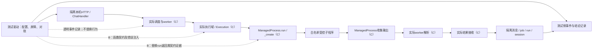
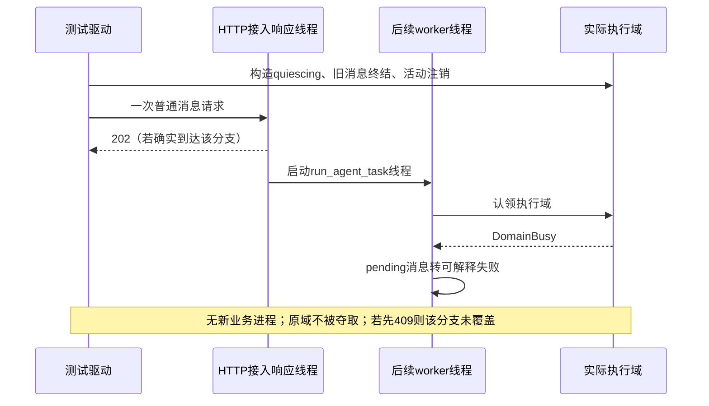
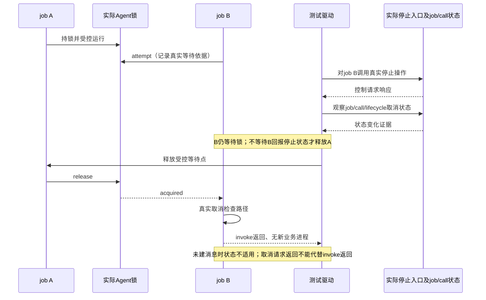

# 并发正确性验证设计

| 字段 | 值 |
|---|---|
| 版本 | 1.1 |
| 文档状态 | 正式设计基线；工程完整性修订已综合，综合版未另行独立复核 |
| 方案状态 | 隔离夹具及单请求监督已编码；未执行验证、未正式代码检视 |
| 需求依据 | [REQ-001 1.1](../requirements/CONCURRENCY_LOAD_TEST_REQUIREMENTS.md)§2—§5 |
| 形成记录 | [../drafts/CONCURRENCY_VERIFICATION_DESIGN.md](../drafts/CONCURRENCY_VERIFICATION_DESIGN.md)§14—§25；冻结候选、旧版及分批实施记录 |
| 更新 | Codex；2026-11-17 12:57:19 +08:00（Python本机带时区时钟） |

当前实施补记：首次单请求诊断失败于隔离workspace缺少AGENTS.md，尚未创建受控进程；见形成记录§21。服务已退出，未创建执行域已释放；入口装配及失败观察已静态修正（形成记录§22）；受控入口协议已修并通过内存解析检查（形成记录§23），单请求已创建进程并确认退出，子进程在 ready 前失败（形成记录§24），退出观察返修已通过无服务检查（形成记录§25），3551-01 提前退出观察已实测并复查，stdin 字节计数返修后 3551-02 完成一次 I2 隔离握手，待独立复查（形成记录§26）。

## 1. 摘要、目标与非目标

本机Windows工作台已有同域互斥和多入口，但尚缺本版HTTP接入、执行认领、进程创建及终态归属的完整证据。本方案先复核现有能力A，按缺口使用契约替身B或隔离HTTP与真实受控进程C，仅必要问题采用真实CLI D。产物是可追溯的使用/修复决定，隔离夹具已开始分批编码，行为验证结果仍为空；见形成记录§17—§19。

目标是验证选定S1—S4的唯一持有者、消息与session归属、取消收敛及退出不明保域。非目标为容量建议、供应商配额、长期稳定、全平台穷举、改变单job串行、增加生产接口和重设计产品权限模型。本文修订完成与未来验证完成分别判断。

## 2. 背景、问题与范围

用户先要求“嗯这下好了很多，清晰了不少，然后你来组织一下，根据这个分析文档，开展设计吧@Codex”，随后决定“那就落入正式文档吧@Codex”。原1.0据后一句正式化；本1.1按用户后续工程完整性要求及形成记录§14—§16修订，承接既有设计与限制。正式化仅确定当前文档基线，实施与测试执行仍须相应授权。

需求基线REQ-001 1.1的SHA256为ec4be1b5f6e02747a2a77be6aa1c7aad1e15f0cb15064c1685edcace4e252667。范围为S1同域竞争及重复提交、S2多对话／身份／广播与session隔离、S3跨协作任务等待取消、S4故障及旧回写恢复，包含控制动作活性；S5容量、S6长期增长、供应商上限及未来单job并行均不纳入。

原需求形成过程见[../drafts/CONCURRENCY_LOAD_TEST_REQUIREMENTS.md](../drafts/CONCURRENCY_LOAD_TEST_REQUIREMENTS.md)§13—§17。旧测试重启基线只作为来源和后继关系，不恢复旧工具、参数或废案。本正式稿为当前设计正文，关联草稿冻结原设计并持续保留形成记录。

## 3. 现状、能力与约束

原1.0记录的代码HEAD为ce0664c198359e721774012a76aefdb541a27313，工作区文档不完全在HEAD内，本轮未重新核HEAD。以下复用原1.0定向阅读的静态事实和用例存在性，不是当前通过记录。

| 编号 | 已核对象及内容 | 可复用部分与待补证据 |
|---|---|---|
| E1 | [web_chat.py](../../web_chat.py)2538—2612，事务查pending／活动运行后409，写消息后202再开线程；1415—1433及2166—2168再认领执行域 | HTTP接纳与执行认领分层；数据层测试不能代替双层对账。未确认已有完整HTTP竞争用例，不声称全仓不存在 |
| E2 | [execution_tracking.py](../../execution_tracking.py)112—154，域键为Agent＋conversation，事务内fence CAS；417—455按退出证据释放或保留quiescing | 复用互斥、代次及保域契约；本次不判已证明并发安全 |
| E3 | [test_execution_tracking.py](../../test_execution_tracking.py)98—127、148—155，旧token拒绝、两线程屏障单持有者、独立域 | 先核并运行适用用例，不重复编写相同数据层断言；仍需上层接入与进程归属 |
| E4 | [test_execution_wiring.py](../../test_execution_wiring.py)21—37隔离库与注册表；53—110忙碌、启动前取消、真实受控进程取消及注入unknown；147—184模拟worker输出 | 可复用隔离和进程测试经验；注入ProcessResult.confirmed及模拟session不是受管进程退出或真实CLI证据 |
| E5 | [web_chat.py](../../web_chat.py)154—213协作invoke按Agent锁，获锁后重查旧call和停止状态；[collaboration_service.py](../../collaboration_service.py)221—261取ready[0]同步调用 | S3须跨job制造真实竞争；单job串行不作缺陷。旧call重试不能再次启动；取消后是否写调用结果按真实协议区分 |
| E6 | [test_execution_sessions.py](../../test_execution_sessions.py)259—290以resolver和ManagedProcess替身验证启用路径；web_chat.py122默认resolver=None | 默认legacy与启用路径分组。已有模拟new/resume不能代替真实后端补证 |
| E7 | [web_chat.py](../../web_chat.py)2618—2653 startup_server先取库锁、绑定本机端口、初始化并interrupt_running | 新测试实例必须独立库；启动不能指向当前工作台，否则会改运行态。进程内补丁不得与其他测试同时使用全局状态 |

现有测试文件须按具体用例核副作用和隔离，不能直接全仓运行。未确认的覆盖先查具体用例和本版结果，若足够则缩减新增项。源码推导“保留域但消息非pending且活动已注销时可能202后DomainBusy”仅是待验证条件，不先定性为缺陷。

## 4. 备选方案与取舍

| 方式 | 适合回答的问题 | 代价及边界 | 取舍 |
|---|---|---|---|
| A 只核源码及已有证据 | 契约、已有覆盖、单job串行、应排除的能力 | 不证明实际竞争及进程归属 | 作为前置，充分部分不重测 |
| B 测试替身的链路集成 | 固定交错、错误注入、协议接收、计数及状态 | 注入退出证据不能证明真实退出 | 用于稀有分支及契约测试，明确标注替身 |
| C 隔离HTTP与真实受控进程 | 真实消息接入、启动、退出、取消及归属 | 需隔离实例与进程管理，不能代表供应商行为 | 作为端到端补缺口的主体 |
| D 必要真实CLI补证 | 实际选中后端的new/resume及会话适配 | 认证、环境、调用成本且难固定交错 | 仅对无法由B/C回答的问题条件采用 |

建议组合A→按缺口选择B/C→必要时D，不要求每个场景四层全跑。使用现有unittest风格、屏障／事件和标准HTTP客户端即可，不引入k6、通用压测平台或新生产状态机。新的测试夹具为本需求重新设计，不恢复旧探针。D未具备配置或预算时记明确未验证项，不能由C替代后宣布真实路径通过。

## 5. 方案总览与关键时序

图中C表示必须保留实际行为的链路，B可直接调用真实函数并注入边界；后者不能获得实际创建/退出或自然交错证据。

C1b使用构造的quiescing条件，不能将其称为自然故障复现：

图为设计示意，未进行Mermaid渲染或运行验证。逐单元细节及合法取消路径以§7为准。

## 6. 详细设计

### 6.1 两类执行单元

契约单元：按现有隔离测试方式，用独立临时库和可控替身运行真实业务函数；补丁只在该子进程内生效。适用于精确边界和unknown注入，结果标记为契约证据。

端到端单元C：独立子进程装配真实ChatHandler／调度／执行跟踪／ManagedProcess，临时根目录内建立库、会话存储及只读工作负载。仅将后端命令解析替换为新编写的受控子程序，维持真实worker输出格式、消息和协议接收路径。保留ChatHandler→run_agent_task／invoke_collaboration→实际worker→run_managed_process→Execution.launch→ManagedProcess.run／_create及worker_reply／stage_collaboration_reply／接收事务的实际行为；透明包装可记录事件，但不能替换创建、退出判断、业务处理或接收逻辑。patch ManagedProcess.run并返回confirmed属于B替身证据，不能标为C。若现有装配不能安全注入，先完成测试侧装配设计／实现，不启动当前工作台。服务使用127.0.0.1动态端口，持有绑定套接字后公布端口，不能先探测再假定空闲。

受控子程序发送唯一运行标记，报告实际进入与结束，通过测试控制通道等待释放、失败或退出；每次创建由父侧实际进程创建记录核对，不能仅数子程序输出。启动前取消还须证明无创建事件。控制通道断开应有有界退出，监督者拥有本单元进程清单；不扫描或终止同名的其他进程。

测试前写隔离清单：web_chat.DB_PATH与agent_bridge.DB_PATH及AGENT_BRIDGE_DB环境、ServiceInstanceLock和锁文件、SERVICE_INSTANCE_ID、COLLAB_SERVICE（独立实例内重建）、ACTIVE_RUNS、COLLAB_AGENT_LOCKS、COLLAB_MESSAGES、SESSION_CONFIGURATION_RESOLVER、端口、workspace、session根、临时输出与自有进程表。startup_server的初始化及interrupt_running只能作用于隔离库，不能以只补web.DB_PATH的进程内夹具代替。控制环境中的后端命令入口，以显式受控命令白名单避免真实模型调用；不读取凭据。临时目录须归属测试根或明确登记为自有资源。装配失败即停止，不在共享工作台注入故障。实际配置验证与初始化能力在实施前核，不假定夹具已可运行。

### 6.2 事件与对账

事件记录放测试侧：case_id、attempt_id、入口、Agent、conversation、user/assistant_message_id、job/call/task（适用时）、run_id、instance_id、fence、session配置类别、进程实例标识、事件名、来源及单调区间。不可用字段写不适用，不编造id。HTTP202响应提供消息映射；跟踪表提供run及来源call；受控协议标记核消息归属。session标识去敏，原始输出限夹具内容。

分别记录submitted、HTTP202／409／503／其他、claim成功／DomainBusy、process_created／running／exit、cancel_requested、结果接收、域释放。202且DomainBusy可能没有新run，按消息终态对账；不能强制每个接纳请求恰有run。广播一请求多收件人，按收件人子单元核对，HTTP分母与执行分母分开。协作call已reserved可能已消耗调度预算，取消不预设退费；比较取消前后预算及call状态，只禁止无依据的额外启动或重复计数。

判据依赖事件顺序和持有者，时延只用于有界等待诊断。驱动使用自身单调时钟，跨进程用握手建立先后关系，不直接相减。没有锁内事件就不声称精确锁等待；页面3秒轮询不作为执行时间。可用测试包装在调用真实函数前后记事件，严禁持全局注册表锁等待屏障或进程退出。

优先用已有响应、表和回调观测。若不能定位某个必要边界，先用测试侧代理／包装实际对象；若仍不足，写明拟加的只读观察点、位置、是否影响时序及替代方案，另形成代码审核单元，不能以设计建议默认授权改生产接口。

### 数据与接口

不修改生产数据库schema。配置记录包含场景/入口、选中身份及session类别、隔离资源归属、控制动作、有限截止及来源、所需事件；事件字段沿用§6.2；结论记录包含版本指纹、已到边界、证据等级、适用分母、判定和限制。配置和事件写入测试产物，不写入用户运行库。不要求建设独立存储平台，机器可读格式可沿用现有测试习惯。

驱动对普通消息使用现有HTTP入口（包括POST /api/messages），停止和协作调用通过所选配置的实际入口；确切路由、请求/响应字段及错误体在I1依据当版handler核定，不在此虚构新端点。HTTP响应用于消息映射，不承诺202提供run_id。B可直接调用真实业务函数，但须标明绕过的接入层。

测试控制通道的最小语义是ready（子程序已到指定点）、release（允许继续）、fail/exit（受控失败/退出），每个控制动作携带case与attempt标识。它是测试侧拟建协议，传输仅限隔离测试实例的本地IPC（管道、本机套接字或测试根内文件），具体方式由I2选择并记录，不属于产品API。握手必须能区分旧attempt；重复或错误归属的控制消息不得释放其他运行。断连/截止到达触发自有资源收尾，不能自动注入confirmed。创建成功以父侧真实创建事件为据，退出以ManagedProcess实际证据为据，子程序自报exit仅作辅助。

### 流程、并发与错误

先核I1配置与版本→建立独立资源并校验隔离→启动监督与受控程序→驱动到达指定边界→施加竞争或取消→收集状态和实际创建/退出→逐关联对账→保留必要证据后清理。并发保护、锁顺序与各单元断言沿用§6—§8；不得在真实全局锁内等待屏障。一个case的补丁和注册表仅属自有进程，不能并行污染其他case。

| 观察 | 分类与处理 |
|---|---|
| 预期409或202后DomainBusy且消息终结可解释 | 合同预期结果；分别记拒绝层，不计为意外产品错误 |
| 重复创建、错误归属、非法释放或迟到业务覆盖 | 有证据的契约违反；停止相关单元并留差异，需定位后决定产品缺陷或夹具问题 |
| 缺必要事件、关联丢失、交错未达、等待超时 | 证据不足；保留到达点，不自动判产品失败或通过 |
| 装配触及共享资源、受控命令白名单不成立 | 隔离失败；停止实例启动或后续动作，查明后再执行 |
| 实际非零退出、受控超时、unknown | 按对应场景契约核终态及保域；不混作正常完成，清理沿用§8 |

### 性能、安全与可观测性

性能仅关注有界完成和诊断：记录驱动发送至响应、实际claim、创建、取消至invoke返回、清理的本地单调区间；跨进程只用握手排序。截止由I2空载校准及所选路径给出，不定义吞吐或用户SLA。事件包装自身可能扰动时序，报告其位置；若包装改变锁顺序或掩盖竞争，证据作废。

安全范围是夹具防误调用和防污染：127.0.0.1隔离端口、独立库/session/workspace、白名单受控命令、非敏感固定内容、仅自有进程清理。它不证明产品认证、远程访问或供应商安全。真实CLI D仅在另有可用配置与调用预算时执行，报告去敏且不读取凭据正文。

每条结论核对其必要事件集合：未创建消息/run的合法路径标不适用并解释；缺字段或缺来源不能靠补造ID补齐。区分产品持久记录、父侧进程记录和受控程序辅助记录，冲突时保留两者及影响，不用汇总绿灯覆盖原始差异。

## 7. 场景设计与验收

每个单元输出输入配置、到达的边界、事件记录、期末状态差异、判定与可行动结论。边界未到达、关联缺失、超时未收敛均为证据不足，不能算通过。

| 单元／需求 | 已有证据与缺口 | 入口和可控交错 | 判据、失败处理及产物 |
|---|---|---|---|
| C1a／S1同域重复提交 | E3覆盖数据层，E1完整HTTP对账待核 | 两个独立HTTP客户端同对话同身份提交；确认首请求仍pending或活动占用后保持受控执行，第二请求到达；另做共同提交屏障竞争 | 保持占用的子场景预期第二请求409，拒绝不留下该请求的用户／助手孤儿行、不产生第二创建且不覆盖持有者；共同竞争记录实际先后与拒绝层，不预设获胜请求。首请求已终结后的顺序接纳不属于同时占用，不能概括所有时序均不可能双202。释放后新请求可接入；对账失败留消息／run差异 |
| C1b／S1与S4保留域再提交 | E2保域已有单测，HTTP分层待补 | 在隔离契约夹具建立真实quiescing域、旧消息终结且活动注销，再发一次HTTP；条件构造单列，不称自然复现 | 构造条件下核单次202→DomainBusy，助手pending最终成为可解释失败，不得悬空；无新业务进程、不夺域、原持有者保留。若准入即拒绝则记录实际差异，不能声称覆盖202后拒绝。不得改idle来通过；报告两层结论及构造来源 |
| C2a／S2普通消息隔离 | E3独立域但缺真实链路归属 | 同Agent不同conversation两个HTTP请求，两个受控进程分别到达各自等待点；反向释放；同对话不同Agent使用两条分别定向单身份的普通消息（两个HTTP、两套用户消息），广播另列C2b | 无串写，域及session归属正确；受控路径能够重叠，不要求真实CLI必然并行。若到不了重叠点先判夹具或隐藏序列化原因，不能直接宣称数据污染 |
| C2b／S2广播隔离 | E1多收件人启动，完整子单元对账待核 | 一个广播包含两个实际支持的身份，反序输出；再使其中一个子单元非零退出 | 响应映射、启动数与各收件人终态一致；一个失败不覆盖另一个。不能用HTTP请求数当进程数。以实际支持身份选择，不穷举适配器 |
| C2c／S2会话续用 | E6启用模拟路径及E4默认模拟已有 | 默认legacy与启用resolver分别选实际要支持的配置；每个配置同一对话顺序new→resume、另一对话独立new；合同层固定session标记；必要真实路径另列D | 续用绑定本域、无跨域借用；模拟配置结论与真实D分开，未启用可选配置明确排除。真实D缺失时不能报告真实隔离全通过 |
| C3a／S3跨job等待与取消 | E5锁和获锁后重查，真实竞争未证 | 两个独立job同Agent，A持受控执行，B真实call被派发；记录B锁attempt及A持有证据后调用真实停止操作，核job取消状态，再释放A并记录B acquired与invoke返回；另按缺口控制获锁后取消 | 取消操作返回不等于等待已收敛；须核B调用确实返回、无新业务进程／执行run，适用call及已有消息终态可解释，尚未创建消息则记录不适用。允许插消息前phase检查、插消息后检查或AgentRunCancelled等实际保护路径，不绑定181行。核取消前后reserved预算无重复增量，正常取消结果接收不算重复业务结果，A不受影响；仍阻塞不得通过 |
| C3b／S3重复call及单job依赖 | E4具名invoke重放测试及E5同步调度 | 复用test_real_invoke_roles_and_replan_keep_actual_call_identity，核完整断言再运行；单job带前后依赖的受控协议任务 | 相同call不重放进程；后继不越过前置完成；预期串行不是失败。不新增所有角色组合矩阵，具体遗漏再补 |
| C4a／S4退出和取消边界 | E4启动前取消、Windows取消用例；[受管进程测试](../../test_managed_process.py)已有边界用例 | 复核现有创建前、创建后运行前、运行中取消用例；缺少的HTTP停止链在受控进程已到边界后调用停止接口，另有独立域探针 | 启动前取消无创建；已创建须有退出证据且终态一致；独立域控制动作有解释。非零退出、超时分组，不能混合成正常完成。失败保留证据并只清理自有进程 |
| C4b／S4unknown及旧回写 | E2/E3/E4已有token拒绝和unknown注入；上层保护须分别核 | 复用旧token finish_run及unknown契约；实际worker_reply／update_workbench_message／stage_collaboration_reply／fail_entry_message／finish_execution边界控制取消前后顺序，核同消息终态和其他消息不变；session保存按C2c实际配置核 | 旧token不能改新持有者，unknown保域。取消后状态、正文和允许的诊断追加分别对账，不能以状态仍cancelled推出正文不变。直接调用实际函数只属契约证据；受控链路须证明边界可达。未找到跨代次自然回写入口时标相应端到端覆盖未证，不制造异步finish回调或宣布所有旧回调通过 |

C3a锁尝试事件优先测试侧代理真实锁，记录attempt/acquired并委托真实acquire/release，不改变生产锁顺序；无法证明B确实等待时，该次取消不是等待取消证据。不能因FIFO顺序未成立而失败，现有普通锁不承诺公平。

C4b边界依据：web_chat.py1319—1394按message_id及pending更新，协作stage还核job/call；2239—2252的fail_entry_message仅写pending/completed并检查取消意图；1440—1477的finish_execution异常分支保留cancelled状态但仍追加诊断正文。因此允许的故障说明须可追溯，业务成功正文不能迟到替换取消结论，其他消息和新持有者不能受影响。Execution.finish198—214同对象done防重复，run_agent_task的worker回写在finally收尾前；已读路径未找到新代次后旧Execution.finish自然重入入口，此为有限静态观察。若新增异步接收路径或运行证据显示该交错可达，再补对应端到端单元。

默认session边界：save_codex_thread_id1218—1233按conversation_id UPSERT；save_agent_session_id1246—1262按conversation_id＋agent/session key UPSERT，两者在resolver启用时拒绝legacy写。调用位于Codex1874—1880、DSH1999—2006、Grok2100—2112；Grok另持state_lock复查取消。上述键支持按选中路径设计跨对话隔离断言，但无fence写入本身不证明可达串写。Codex兼容身份共享同conversation键的组合若被选中，I1须核其身份映射契约，不能把数据层域独立等同legacy session独立；有需求冲突返回负责人。启用路径的session代次保护与legacy分别验证，不能相互替代。

## 8. 执行截止、重复与失败收尾

每个所选交错必须至少取得一份完整对账证据；重跑按夹具可达性和发现的问题确定，增加重复不等于覆盖全部时序。先设计屏障而非随机sleep；不同竞争获胜者通过交换控制角色覆盖，必要的随机运行只补充发现，不成为容量样本。

实施者在执行配置中记录屏障等待、HTTP响应、进程运行与清理的有限截止及依据。依据应来自受控握手路径、现有适用用例和隔离环境的空载校准，不承接旧压测数值，也不冒充用户等待SLA。截止尚未给定不阻断本设计讨论，但阻断对应测试实际启动；不得无限等待或因超时自动判产品失败。

出现错误归属、重复启动、释放不明、夹具接触非隔离对象、输出越界或观察记录缺失，停止相关单元；独立单元在隔离和证据仍成立时可继续。保存故障时快照并结束自有进程。unknown按业务契约保留域，不直接写idle；验证业务拒绝之后，实验室可关闭／隔离整个临时实例，只有确认自有进程退出才删除临时根。清理失败保留路径与归属供执行者处置，结论标未收敛，不删除唯一证据。confirmed只覆盖受管Job内对象，不外推所有供应商委托进程。

## 9. 影响面、引入与回滚

| 对象 | 预期影响与边界 |
|---|---|
| 产品模块及HTTP/数据库契约 | 只调用现有行为；默认无生产变更、schema或接口迁移 |
| 测试代码和执行方式 | 后续增加隔离装配、受控程序和所需用例；沿用unittest，具体文件在I1/I2确定 |
| 机器资源 | 临时库、端口、自有进程和输出占用；实例间不得共享全局补丁 |
| 用户与后端配置 | 本轮文档无运行影响；D可能产生真实调用，须单独配置预算与归属 |
| 维护与回归 | 事件依赖真实调用边界；源码变化时重新核证据映射，不把行号当稳定接口 |

引入顺序采用§10 I1— I5，先验证隔离装配能失败收尾，再进入依赖它的单元；这是执行依赖，不新增设计批准门槛。产品数据迁移不适用，因为方案没有生产schema或数据变换，不编造迁移脚本。若后续确需生产观察点或修复，另作设计增量和代码审核，不借夹具引入默认放行。

执行异常时先停止驱动新增请求，释放或关闭测试控制通道，按自有进程清单取得退出证据并关闭隔离服务；保存对账与故障快照后处理临时资源。unknown仍按产品契约保域，不能手工idle伪造恢复。退出不明或清理失败时隔离整个实例并保留资源归属，不能删唯一证据。撤回测试改动时按其独立审核单元恢复文件/配置，不回退无关工作区变更；撤回文档时保留形成历史和替代决定。上述为未来操作设计，当前未执行回滚。

## 10. 实施计划与依赖

| 任务 | 依赖与交付 | 完成判据 |
|---|---|---|
| I1 证据与隔离清单 | 对照需求与E1—E7逐用例核适用版本、副作用、已有结果；选择配置，列复用／删减／补建及依据 | 足够证据不重复建设；隔离对象和观测字段可定位，未知标明影响；这是实施准备产物，不另设定稿前固定闸门 |
| I2 测试侧装配及记录 | 依赖I1；独立实例、受控协议程序、事件与对账夹具 | 不触生产路径，不启动真实后端；能区分创建及模拟退出，失败可收尾 |
| I3 S1—S4单元实现 | 依赖I2及已有用例复核；按C1—C4覆盖剩余缺口，必要观察点单列代码变更 | 代码作者自查及非作者检视绑定实际版本，未授权不执行集成 |
| I4 隔离验证及报告 | 依赖所选单元代码门槛、执行授权和截止配置；可分单元推进 | 每单元通过／缺陷／证据不足／排除，退出和对账完整，报告版本范围准确 |
| I5 必要真实路径D | 依赖I1选定问题与稳定的隔离路径；实际配置、认证可用性及调用预算须有来源 | 只测必要new/resume与归属，不扩大吞吐；无条件则保留真实路径缺口 |

I5不强制等待全部I4完成，但不能依赖未证明的清理或归属。产品代码默认不需改；若I2/I3确认测试侧无法观察必要事件，列具体新增点和替代方案，先修订设计再形成代码审核单元。发现产品缺陷时保留失败证据并另行修复，不为了通过放宽契约。本次均为计划，未实现。

## 11. 验证、验收与完成定义

实施产物建议为测试用例、场景配置／复用清单、机器可读事件和对账摘要、面向使用者的结果报告。正式保留路径由实施任务按现有仓库结构确定；敏感会话或配置不进入报告。结论不可依赖不随交付提供的孤立本机日志。

报告首页先介绍本机工作台与后端CLI，再列版本及实际文件指纹、环境／session配置、所测操作、结果、限制和行动。逐场景附请求→消息→run→进程及适用job/call关联；明确替身、受控进程、真实CLI三类证据，预期409与非预期503分列，202后执行拒绝单列，取消前reserved预算与重复启动分别解释。

验收对齐REQ-001§5：无重复合法持有者、无跨域／session串写、无迟到覆盖、unknown不误释放，终态及预期拒绝可追溯。缺少实际选中配置或关键关联时对应项不得通过。用例全绿、重复次数或模板存在均不是证据充分的独立条件。输出“忙碌保护可在所测范围内依赖／先修重复启动”“某组合归属正确／避免该组合”“取消等待可用／需要修复”的有依据决定，不给建议并发容量或长期稳定承诺。

文档修订完成：适用章节有实质内容、排除有理由、两方意见与处理可追溯、正式稿和入口一致、未验证项准确。1.1-C1已完成两方独立讨论，本综合1.1已按意见更新正式稿与入口；综合版本尚未另行独立复核。

验证任务完成：I1确定的S1—S4范围逐项有“通过/契约违反/证据不足/排除”结果，复用证据注明版本和配置；未达边界不得排除冒充通过。报告允许如实交付失败或不足，但不能宣称对应正确性验收通过。真实D缺失时结果限定受控路径，不写真实隔离全通过。

| 指标 | 计算与判断（仅适用单元；未实测，有限样本） |
|---|---|
| 重复合法持有者/额外进程创建 | 按域、重叠持有区间与attempt核对；预期0次违反；广播按收件人、顺序新任务不当重复 |
| 错误消息/session归属 | 对选中配置的消息、run、进程和session映射逐条核；预期0次已证串写 |
| 迟到业务覆盖 | 取消后业务正文替换取消结论或影响其他消息/新持有者的次数；预期0；可追溯诊断追加单列，不能视作违规或忽略 |
| 退出未明却释放 | unknown后域错误转idle或新claim成功次数；预期0 |
| 接纳后悬空 | 已接纳消息在所配置有限截止后仍无可解释终态的数量；预期0，但超时首先标证据不足并定位，不能仅凭超时定产品缺陷 |
| 取消等待收敛 | 已证明等待的B取消单元中，实际invoke返回且无新业务进程的单元数/到达等待边界的所选单元数；每个所选单元须完整取证，分母0不得称通过 |
| 关联与范围完整度 | 已具所需关联的单元/已到达边界的所选单元，并列未到达、排除和未验证配置；缺必要关联项不得通过，不以总体比例掩盖某单元缺证 |
| HTTP结果与活性 | submitted分别对202/409/503/其他，202后拒绝单列；控制操作有界响应及后续实际收敛分别记录，不定义达标毫秒值 |

以上0次是REQ正确性契约的计数表达，不是新性能阈值或已测结果；有限样本0次不证明所有交错。每个指标同时注明B/C/D证据等级和不可观察项。

## 12. 风险与未决问题

设计综合已定位C4b实际回写与legacy保存边界，并明确B/C替身区别和隔离清单；尚未证明HTTP装配能安全替换全部实际选中后端入口、每个受控交错可达及模块初始化无遗漏。I1/I2据具体配置核验，不假定夹具可运行。自然跨代次回写端到端覆盖未证；直接函数契约证据不能填补此缺口。真实后端及配置清单、调用预算未给，阻断I5执行及真实路径结论，不阻断受控设计。实际截止需校准并有据配置，不设容量目标。已有覆盖检索未穷尽，查到有效证据就缩减新增。

| 未决项/风险 | 责任角色、处理与阻断范围 |
|---|---|
| 隔离装配与控制通道实现未证 | I2实施者验证双DB_PATH、初始化、真实创建与失败收尾；阻断依赖该夹具的运行 |
| legacy身份键/session配置映射 | I1实施者按选中组合核契约；冲突交负责人，阻断该组合隔离结论 |
| 自然跨代次旧回写可达性 | I1/I3实施者定向核调用路径；未证保留端到端缺口，直接调用只报契约 |
| 预算、真实配置、有限截止与重复策略 | I1/I2/I5实施者记录来源；预算/使用目标取用户来源，阻断相应真实调用或未配置单元启动 |
| 观察扰动、遗漏已有有效覆盖 | I1/I2核已有证据与包装位置；删减重复建设，不能用扩大重复次数补缺失边界 |

实施顺序、交付和依赖沿用§10，不增加固定工时、日期或审批角色。责任为后续任务角色，不表示本轮已分派实现。

## 13. 讨论、证据与交付边界

方案取舍及意见逐项处理见[形成记录](../drafts/CONCURRENCY_VERIFICATION_DESIGN.md)§11—§13。DeepSeek、Grok独立检视0.1，DeepSeek参与聚焦回应；Grok于2026-11-17 12:20:17 +08:00对0.2修订复核无阻断，所审SHA256为55981800dc83e683ecce11112f26c50ef18847b327415bb360fd277acf8d5101。0.3文档收尾仅作者核对，其原SHA256为58c91fa8177afb8bf8cf082b7efa9f87976c789da7d510137c70cefe38798bb7。上述复核不扩大为正式1.0已独立审阅或运行通过。

复核的非阻断限定继续适用：DSH先保存session再检查returncode；fail_entry_message在未取消时可将completed改failed。状态、正文和允许的诊断追加分别取证，不据调用顺序直接认定缺陷。自然跨代次回写端到端、夹具安全装配和选中session映射仍待核实；真实CLI配置预算、有限截止及重复策略在执行前确定。旧留稿未单独采秒的历史缺口保留在草稿§11，不倒填。

本次1.1-C1由DeepSeek与Grok分别独立讨论，所审草稿0.5 SHA256为171b5f177ad3b3b4eebee2e4086f5a41432ab1b0e59d05189b5685bdeaeccf47；DS-C3/DS-C6及G-C2—C5/G-C7的处理见形成记录§16。综合1.1修正线程、停止状态观察者、输出接收链与指标限定，并重排章节；两方未另行复核此综合版本，不把候选无阻断扩为运行通过。

本阶段适用需求1.1.0、设计1.3.3、文档1.5.0、执行1.1.1和讨论1.3.1规范，见[../../specs/README.md](../../specs/README.md)。正文必要条款已读或有效复用；代码编写/检视因无代码活动不适用。本轮仅文档修订及静态检查，未运行或导入业务模块、测试、服务、真实CLI，未访问运行数据库凭据或废案，未提交推送。

规范归因：设计规范§4已有背景、目标、范围约束、取舍、验收、结果、风险与历史义务，原设计深度不足属执行整理遗漏；摘要、图示、工程详细项、影响回滚和实施依赖的适用性检查提示不足可后续改进，允许合并/引用和按风险裁剪。本轮未改规范。

## 变更历史

| 时间 | 版本／议题 | 原状态或决定→新状态或决定 | 原因与证据 | 提出／决定者及来源 | 影响范围 |
|---|---|---|---|---|---|
| 2026-11-18 02:29:31+08:00 | entry-3551／stdin 字节统计 | 编码失败→单请求 I2 握手完成 | 形成记录§26，fixture-smoke-3551-02；Python本机时钟 | Codex | 测试夹具及状态同步，待独立复查 |
| 2026-11-18 02:17:55+08:00 | entry-3551／退出观察 | 待返修→无服务检查通过 | 形成记录§25及DS-R1/R2、G-R1/R2；Python本机时钟 | Codex | 测试夹具返修，待新根单请求及独立复查 |
| 2026-11-18 02:04:55+08:00 | entry-3543／单请求诊断 | 待运行→已创建并确认退出，未到达 ready | 形成记录§24及隔离运行证据 | Codex | 单请求失败，待正式检视 |
| 2026-11-18 02:02:17+08:00 | entry-3543／受控入口协议 | 协议待修→已修，待单请求验证 | 形成记录§23、入口解析器内存检查 | Codex | 测试夹具与活动状态，待正式检视 |
| 2026-11-17 14:36:12+08:00 | entry-3527／最小返修 | 装配失败待修→静态修正、协议阻断待处理 | 形成记录§22；Python本机时钟 | Codex | 仅测试侧入口和失败观察，未重跑、未正式检视 |
| 2026-11-17 14:29:52+08:00 | entry-3527／首次运行 | 静态待验证→装配失败待修 | 形成记录§21；Python本机时钟 | Codex | 未创建受控进程，代码未改 |
| 2026-11-17 14:26:23+08:00 | entry-3527／运行前修正 | 导入及清理待查→定向核查与测试侧修正完成 | 形成记录§20；Python本机时钟 | Codex | 未运行、未正式检视；首次闭环待执行 |
| 2026-11-17 14:21:47+08:00 | entry-3527／单请求监督 | 部分接线→监督驱动已编码 | 形成记录§19；Python本机时钟 | Codex | 仅静态检查，运行前导入副作用待查、未正式检视 |
| 2026-11-17 14:13:18+08:00 | entry-3527／夹具接线 | 未编码表述→部分实现 | 用户实施授权；关联形成记录§18；Python本机时钟 | Codex | 范围验收不变；未运行、未正式检视 |
| 2026-11-17 12:57:19 +08:00 | entry-3499／1.1综合 | 1.0设计→工程说明补齐并重排 | 用户要求；形成记录§14—§16及两方意见 | Codex综合；Python本机时钟 | 仅文档；候选已讨论，综合版未另复核，未实施验证 |
| 2026-11-17 12:42:38 +08:00 | entry-3499／1.1候选C1 | 正式1.0→工程完整性候选 | 用户章节补充要求；形成记录§14 | 用户提出；Codex起草，Python本机时钟 | 候选待两方讨论；未实施验证 |
| 2026-11-17 12:29:43 +08:00 | entry-3495／1.0正式化 | 草稿0.3→正式设计基线 | 用户正式化指示；关联草稿§13前置记录；Python本机时钟 | 用户决定；Codex整理 | 文档及入口；方案范围与验收不变，未实施验证，落盘版未独立复核 |
