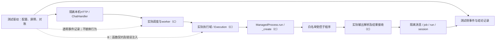
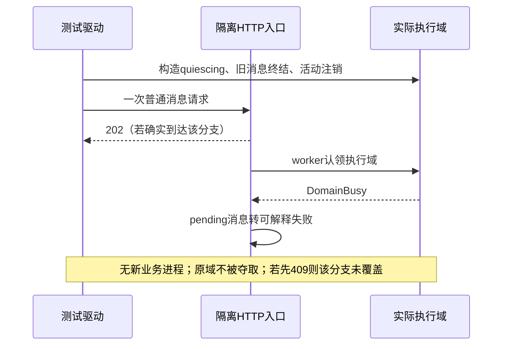
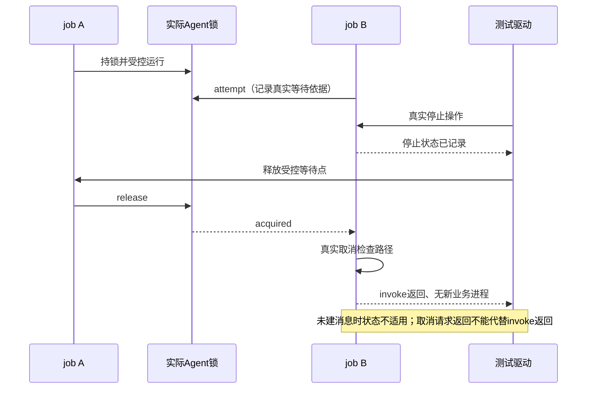

# 并发正确性验证设计

> 当前后继：[../design/CONCURRENCY_VERIFICATION_DESIGN.md](../design/CONCURRENCY_VERIFICATION_DESIGN.md)1.1。本文0.3正文冻结为形成基线；仅追加正式化及后续形成记录，不作为并行维护的当前设计。

| 字段 | 值 |
|---|---|
| 版本 | 0.3 |
| 文档状态 | 草案；0.2经Grok限定无阻断复核，0.3文档收尾已作者核对、未另行独立复核 |
| 方案状态 | 提案；未编码、未执行验证 |
| 需求依据 | [REQ-001 1.1](../requirements/CONCURRENCY_LOAD_TEST_REQUIREMENTS.md)§2—§5 |
| 起草 | Codex；2026-11-17 11:56:23 +08:00（Python本机带时区时钟） |

## 1. 背景、授权及范围

用户完整原文：“嗯这下好了很多，清晰了不少，然后你来组织一下，根据这个分析文档，开展设计吧@Codex”。本次承接设计授权，目标是把需求分析中的可行动结论转为可实现、可核对的验证方案。原始分析来源及形成过程见[需求形成记录](CONCURRENCY_LOAD_TEST_REQUIREMENTS.md)§13—§17。

已核REQ-001 1.1指纹ec4be1b5f6e02747a2a77be6aa1c7aad1e15f0cb15064c1685edcace4e252667。范围是S1同域竞争、S2多对话／身份／广播隔离、S3跨协作任务等待取消、S4故障及旧回调恢复，包含占用下控制动作的活性；不引入S5容量、S6长期增长、供应商上限或未来单job并行。设计符合当前需求范围，实际正确性仍未验证。

[设计入口](../design/README.md)没有本需求的当前正式设计。采用本独立主题草稿，避免把需求形成记录改成设计正文。[测试重启基线](TEST_RESTART_BASELINE.md)0.7只核来源、状态和后继，不采纳其旧参数和工具；废案不读取、不恢复。起草及综合仅修改本文；0.3交接维护同步最近草稿索引，不正式化，不改需求、产品或测试代码。

## 2. 已有能力与证据

代码HEAD为ce0664c198359e721774012a76aefdb541a27313，工作区文档不完全在HEAD内。以下是本次定向阅读的静态事实和用例存在性，不是当前通过记录。

| 编号 | 已核对象及内容 | 可复用部分与待补证据 |
|---|---|---|
| E1 | [web_chat.py](../../web_chat.py)2538—2612，事务查pending／活动运行后409，写消息后202再开线程；1415—1433及2166—2168再认领执行域 | HTTP接纳与执行认领分层；数据层测试不能代替双层对账。未确认已有完整HTTP竞争用例，不声称全仓不存在 |
| E2 | [execution_tracking.py](../../execution_tracking.py)112—154，域键为Agent＋conversation，事务内fence CAS；417—455按退出证据释放或保留quiescing | 复用互斥、代次及保域契约；本次不判已证明并发安全 |
| E3 | [test_execution_tracking.py](../../test_execution_tracking.py)98—127、148—155，旧token拒绝、两线程屏障单持有者、独立域 | 先核并运行适用用例，不重复编写相同数据层断言；仍需上层接入与进程归属 |
| E4 | [test_execution_wiring.py](../../test_execution_wiring.py)21—37隔离库与注册表；53—110忙碌、启动前取消、真实受控进程取消及注入unknown；147—184模拟worker输出 | 可复用隔离和进程测试经验；注入ProcessResult.confirmed及模拟session不是受管进程退出或真实CLI证据 |
| E5 | [web_chat.py](../../web_chat.py)154—213协作invoke按Agent锁，获锁后重查旧call和停止状态；[collaboration_service.py](../../collaboration_service.py)221—261取ready[0]同步调用 | S3须跨job制造真实竞争；单job串行不作缺陷。旧call重试不能再次启动；取消后是否写调用结果按真实协议区分 |
| E6 | [test_execution_sessions.py](../../test_execution_sessions.py)259—290以resolver和ManagedProcess替身验证启用路径；web_chat.py122默认resolver=None | 默认legacy与启用路径分组。已有模拟new/resume不能代替真实后端补证 |
| E7 | [web_chat.py](../../web_chat.py)2618—2653 startup_server先取库锁、绑定本机端口、初始化并interrupt_running | 新测试实例必须独立库；启动不能指向当前工作台，否则会改运行态。进程内补丁不得与其他测试同时使用全局状态 |

现有测试文件须按具体用例核副作用和隔离，不能直接全仓运行。未确认的覆盖先查具体用例和本版结果，若足够则缩减新增项。源码推导“保留域但消息非pending且活动已注销时可能202后DomainBusy”仅是待验证条件，不先定性为缺陷。

## 3. 方案比较与选定建议

| 方式 | 适合回答的问题 | 代价及边界 | 取舍 |
|---|---|---|---|
| A 只核源码及已有证据 | 契约、已有覆盖、单job串行、应排除的能力 | 不证明实际竞争及进程归属 | 作为前置，充分部分不重测 |
| B 测试替身的链路集成 | 固定交错、错误注入、协议接收、计数及状态 | 注入退出证据不能证明真实退出 | 用于稀有分支及契约测试，明确标注替身 |
| C 隔离HTTP与真实受控进程 | 真实消息接入、启动、退出、取消及归属 | 需隔离实例与进程管理，不能代表供应商行为 | 作为端到端补缺口的主体 |
| D 必要真实CLI补证 | 实际选中后端的new/resume及会话适配 | 认证、环境、调用成本且难固定交错 | 仅对无法由B/C回答的问题条件采用 |

建议组合A→按缺口选择B/C→必要时D，不要求每个场景四层全跑。使用现有unittest风格、屏障／事件和标准HTTP客户端即可，不引入k6、通用压测平台或新生产状态机。新的测试夹具为本需求重新设计，不恢复旧探针。D未具备配置或预算时记明确未验证项，不能由C替代后宣布真实路径通过。

## 4. 测试布局、观测与隔离

### 4.1 两类执行单元

契约单元：按现有隔离测试方式，用独立临时库和可控替身运行真实业务函数；补丁只在该子进程内生效。适用于精确边界和unknown注入，结果标记为契约证据。

端到端单元C：独立子进程装配真实ChatHandler／调度／执行跟踪／ManagedProcess，临时根目录内建立库、会话存储及只读工作负载。仅将后端命令解析替换为新编写的受控子程序，维持真实worker输出格式、消息和协议接收路径。保留ChatHandler→run_agent_task／invoke_collaboration→实际worker→run_managed_process→Execution.launch→ManagedProcess.run／_create及worker_reply／stage_collaboration_reply／接收事务的实际行为；透明包装可记录事件，但不能替换创建、退出判断、业务处理或接收逻辑。patch ManagedProcess.run并返回confirmed属于B替身证据，不能标为C。若现有装配不能安全注入，先完成测试侧装配设计／实现，不启动当前工作台。服务使用127.0.0.1动态端口，持有绑定套接字后公布端口，不能先探测再假定空闲。

受控子程序发送唯一运行标记，报告实际进入与结束，通过测试控制通道等待释放、失败或退出；每次创建由父侧实际进程创建记录核对，不能仅数子程序输出。启动前取消还须证明无创建事件。控制通道断开应有有界退出，监督者拥有本单元进程清单；不扫描或终止同名的其他进程。

测试前写隔离清单：web_chat.DB_PATH与agent_bridge.DB_PATH及AGENT_BRIDGE_DB环境、ServiceInstanceLock和锁文件、SERVICE_INSTANCE_ID、COLLAB_SERVICE（独立实例内重建）、ACTIVE_RUNS、COLLAB_AGENT_LOCKS、COLLAB_MESSAGES、SESSION_CONFIGURATION_RESOLVER、端口、workspace、session根、临时输出与自有进程表。startup_server的初始化及interrupt_running只能作用于隔离库，不能以只补web.DB_PATH的进程内夹具代替。控制环境中的后端命令入口，以显式受控命令白名单避免真实模型调用；不读取凭据。临时目录须归属测试根或明确登记为自有资源。装配失败即停止，不在共享工作台注入故障。实际配置验证与初始化能力在实施前核，不假定夹具已可运行。

### 4.2 事件与对账

事件记录放测试侧：case_id、attempt_id、入口、Agent、conversation、user/assistant_message_id、job/call/task（适用时）、run_id、instance_id、fence、session配置类别、进程实例标识、事件名、来源及单调区间。不可用字段写不适用，不编造id。HTTP202响应提供消息映射；跟踪表提供run及来源call；受控协议标记核消息归属。session标识去敏，原始输出限夹具内容。

分别记录submitted、HTTP202／409／503／其他、claim成功／DomainBusy、process_created／running／exit、cancel_requested、结果接收、域释放。202且DomainBusy可能没有新run，按消息终态对账；不能强制每个接纳请求恰有run。广播一请求多收件人，按收件人子单元核对，HTTP分母与执行分母分开。协作call已reserved可能已消耗调度预算，取消不预设退费；比较取消前后预算及call状态，只禁止无依据的额外启动或重复计数。

判据依赖事件顺序和持有者，时延只用于有界等待诊断。驱动使用自身单调时钟，跨进程用握手建立先后关系，不直接相减。没有锁内事件就不声称精确锁等待；页面3秒轮询不作为执行时间。可用测试包装在调用真实函数前后记事件，严禁持全局注册表锁等待屏障或进程退出。

优先用已有响应、表和回调观测。若不能定位某个必要边界，先用测试侧代理／包装实际对象；若仍不足，写明拟加的只读观察点、位置、是否影响时序及替代方案，另形成代码审核单元，不能以设计建议默认授权改生产接口。

## 5. 场景设计与验收

每个单元输出输入配置、到达的边界、事件记录、期末状态差异、判定与可行动结论。边界未到达、关联缺失、超时未收敛均为证据不足，不能算通过。

| 单元／需求 | 已有证据与缺口 | 入口和可控交错 | 判据、失败处理及产物 |
|---|---|---|---|
| C1a／S1同域重复提交 | E3覆盖数据层，E1完整HTTP对账待核 | 两个独立HTTP客户端同对话同身份提交；确认首请求仍pending或活动占用后保持受控执行，第二请求到达；另做共同提交屏障竞争 | 保持占用的子场景预期第二请求409，拒绝不留下该请求的用户／助手孤儿行、不产生第二创建且不覆盖持有者；共同竞争记录实际先后与拒绝层，不预设获胜请求。首请求已终结后的顺序接纳不属于同时占用，不能概括所有时序均不可能双202。释放后新请求可接入；对账失败留消息／run差异 |
| C1b／S1与S4保留域再提交 | E2保域已有单测，HTTP分层待补 | 在隔离契约夹具建立真实quiescing域、旧消息终结且活动注销，再发一次HTTP；条件构造单列，不称自然复现 | 构造条件下核单次202→DomainBusy，助手pending最终成为可解释失败，不得悬空；无新业务进程、不夺域、原持有者保留。若准入即拒绝则记录实际差异，不能声称覆盖202后拒绝。不得改idle来通过；报告两层结论及构造来源 |
| C2a／S2普通消息隔离 | E3独立域但缺真实链路归属 | 同Agent不同conversation两个HTTP请求，两个受控进程分别到达各自等待点；反向释放；同对话不同Agent使用两条分别定向单身份的普通消息（两个HTTP、两套用户消息），广播另列C2b | 无串写，域及session归属正确；受控路径能够重叠，不要求真实CLI必然并行。若到不了重叠点先判夹具或隐藏序列化原因，不能直接宣称数据污染 |
| C2b／S2广播隔离 | E1多收件人启动，完整子单元对账待核 | 一个广播包含两个实际支持的身份，反序输出；再使其中一个子单元非零退出 | 响应映射、启动数与各收件人终态一致；一个失败不覆盖另一个。不能用HTTP请求数当进程数。以实际支持身份选择，不穷举适配器 |
| C2c／S2会话续用 | E6启用模拟路径及E4默认模拟已有 | 默认legacy与启用resolver分别选实际要支持的配置；每个配置同一对话顺序new→resume、另一对话独立new；合同层固定session标记；必要真实路径另列D | 续用绑定本域、无跨域借用；模拟配置结论与真实D分开，未启用可选配置明确排除。真实D缺失时不能报告真实隔离全通过 |
| C3a／S3跨job等待与取消 | E5锁和获锁后重查，真实竞争未证 | 两个独立job同Agent，A持受控执行，B真实call被派发；记录B锁attempt及A持有证据后调用真实停止操作，核job取消状态，再释放A并记录B acquired与invoke返回；另按缺口控制获锁后取消 | 取消操作返回不等于等待已收敛；须核B调用确实返回、无新业务进程／执行run，适用call及已有消息终态可解释，尚未创建消息则记录不适用。允许插消息前phase检查、插消息后检查或AgentRunCancelled等实际保护路径，不绑定181行。核取消前后reserved预算无重复增量，正常取消结果接收不算重复业务结果，A不受影响；仍阻塞不得通过 |
| C3b／S3重复call及单job依赖 | E4具名invoke重放测试及E5同步调度 | 复用test_real_invoke_roles_and_replan_keep_actual_call_identity，核完整断言再运行；单job带前后依赖的受控协议任务 | 相同call不重放进程；后继不越过前置完成；预期串行不是失败。不新增所有角色组合矩阵，具体遗漏再补 |
| C4a／S4退出和取消边界 | E4启动前取消、Windows取消用例；[受管进程测试](../../test_managed_process.py)已有边界用例 | 复核现有创建前、创建后运行前、运行中取消用例；缺少的HTTP停止链在受控进程已到边界后调用停止接口，另有独立域探针 | 启动前取消无创建；已创建须有退出证据且终态一致；独立域控制动作有解释。非零退出、超时分组，不能混合成正常完成。失败保留证据并只清理自有进程 |
| C4b／S4unknown及旧回写 | E2/E3/E4已有token拒绝和unknown注入；上层保护须分别核 | 复用旧token finish_run及unknown契约；实际worker_reply／update_workbench_message／stage_collaboration_reply／fail_entry_message／finish_execution边界控制取消前后顺序，核同消息终态和其他消息不变；session保存按C2c实际配置核 | 旧token不能改新持有者，unknown保域。取消后状态、正文和允许的诊断追加分别对账，不能以状态仍cancelled推出正文不变。直接调用实际函数只属契约证据；受控链路须证明边界可达。未找到跨代次自然回写入口时标相应端到端覆盖未证，不制造异步finish回调或宣布所有旧回调通过 |

C3a锁尝试事件优先测试侧代理真实锁，记录attempt/acquired并委托真实acquire/release，不改变生产锁顺序；无法证明B确实等待时，该次取消不是等待取消证据。不能因FIFO顺序未成立而失败，现有普通锁不承诺公平。

C4b边界依据：web_chat.py1319—1394按message_id及pending更新，协作stage还核job/call；2239—2252的fail_entry_message仅写pending/completed并检查取消意图；1440—1477的finish_execution异常分支保留cancelled状态但仍追加诊断正文。因此允许的故障说明须可追溯，业务成功正文不能迟到替换取消结论，其他消息和新持有者不能受影响。Execution.finish198—214同对象done防重复，run_agent_task的worker回写在finally收尾前；已读路径未找到新代次后旧Execution.finish自然重入入口，此为有限静态观察。若新增异步接收路径或运行证据显示该交错可达，再补对应端到端单元。

默认session边界：save_codex_thread_id1218—1233按conversation_id UPSERT；save_agent_session_id1246—1262按conversation_id＋agent/session key UPSERT，两者在resolver启用时拒绝legacy写。调用位于Codex1874—1880、DSH1999—2006、Grok2100—2112；Grok另持state_lock复查取消。上述键支持按选中路径设计跨对话隔离断言，但无fence写入本身不证明可达串写。Codex兼容身份共享同conversation键的组合若被选中，I1须核其身份映射契约，不能把数据层域独立等同legacy session独立；有需求冲突返回负责人。启用路径的session代次保护与legacy分别验证，不能相互替代。

## 6. 截止、重复、失败及清理

每个所选交错必须至少取得一份完整对账证据；重跑按夹具可达性和发现的问题确定，增加重复不等于覆盖全部时序。先设计屏障而非随机sleep；不同竞争获胜者通过交换控制角色覆盖，必要的随机运行只补充发现，不成为容量样本。

实施者在执行配置中记录屏障等待、HTTP响应、进程运行与清理的有限截止及依据。依据应来自受控握手路径、现有适用用例和隔离环境的空载校准，不承接旧压测数值，也不冒充用户等待SLA。截止尚未给定不阻断本设计讨论，但阻断对应测试实际启动；不得无限等待或因超时自动判产品失败。

出现错误归属、重复启动、释放不明、夹具接触非隔离对象、输出越界或观察记录缺失，停止相关单元；独立单元在隔离和证据仍成立时可继续。保存故障时快照并结束自有进程。unknown按业务契约保留域，不直接写idle；验证业务拒绝之后，实验室可关闭／隔离整个临时实例，只有确认自有进程退出才删除临时根。清理失败保留路径与归属供执行者处置，结论标未收敛，不删除唯一证据。confirmed只覆盖受管Job内对象，不外推所有供应商委托进程。

## 7. 实施任务与依赖

| 任务 | 依赖与交付 | 完成判据 |
|---|---|---|
| I1 证据与隔离清单 | 对照需求与E1—E7逐用例核适用版本、副作用、已有结果；选择配置，列复用／删减／补建及依据 | 足够证据不重复建设；隔离对象和观测字段可定位，未知标明影响；这是实施准备产物，不另设定稿前固定闸门 |
| I2 测试侧装配及记录 | 依赖I1；独立实例、受控协议程序、事件与对账夹具 | 不触生产路径，不启动真实后端；能区分创建及模拟退出，失败可收尾 |
| I3 S1—S4单元实现 | 依赖I2及已有用例复核；按C1—C4覆盖剩余缺口，必要观察点单列代码变更 | 代码作者自查及非作者检视绑定实际版本，未授权不执行集成 |
| I4 隔离验证及报告 | 依赖所选单元代码门槛、执行授权和截止配置；可分单元推进 | 每单元通过／缺陷／证据不足／排除，退出和对账完整，报告版本范围准确 |
| I5 必要真实路径D | 依赖I1选定问题与稳定的隔离路径；实际配置、认证可用性及调用预算须有来源 | 只测必要new/resume与归属，不扩大吞吐；无条件则保留真实路径缺口 |

I5不强制等待全部I4完成，但不能依赖未证明的清理或归属。产品代码默认不需改；若I2/I3确认测试侧无法观察必要事件，列具体新增点和替代方案，先修订设计再形成代码审核单元。发现产品缺陷时保留失败证据并另行修复，不为了通过放宽契约。本次均为计划，未实现。

## 8. 产物、验收与价值呈现

实施产物建议为测试用例、场景配置／复用清单、机器可读事件和对账摘要、面向使用者的结果报告。正式保留路径由实施任务按现有仓库结构确定；敏感会话或配置不进入报告。结论不可依赖不随交付提供的孤立本机日志。

报告首页先介绍本机工作台与后端CLI，再列版本及实际文件指纹、环境／session配置、所测操作、结果、限制和行动。逐场景附请求→消息→run→进程及适用job/call关联；明确替身、受控进程、真实CLI三类证据，预期409与非预期503分列，202后执行拒绝单列，取消前reserved预算与重复启动分别解释。

验收对齐REQ-001§5：无重复合法持有者、无跨域／session串写、无迟到覆盖、unknown不误释放，终态及预期拒绝可追溯。缺少实际选中配置或关键关联时对应项不得通过。用例全绿、重复次数或模板存在均不是证据充分的独立条件。输出“忙碌保护可在所测范围内依赖／先修重复启动”“某组合归属正确／避免该组合”“取消等待可用／需要修复”的有依据决定，不给建议并发容量或长期稳定承诺。

## 9. 未决项、限制与检视问题

下列D1—D4、G1—G4为0.1历史检视题；两方意见及处理见§11，0.2修订复核和交接结果见§12，不作为尚未开展的邀请。

设计综合已定位C4b实际回写与legacy保存边界，并明确B/C替身区别和隔离清单；尚未证明HTTP装配能安全替换全部实际选中后端入口、每个受控交错可达及模块初始化无遗漏。I1/I2据具体配置核验，不假定夹具可运行。自然跨代次回写端到端覆盖未证；直接函数契约证据不能填补此缺口。真实后端及配置清单、调用预算未给，阻断I5执行及真实路径结论，不阻断受控设计。实际截止需校准并有据配置，不设容量目标。已有覆盖检索未穷尽，查到有效证据就缩减新增。

供DeepSeek独立检视：D1 C1a普通双POST与C1b保留域202后DomainBusy是否正确分开，是否遗漏合法拒绝但消息悬空的结果？D2 C2按普通／广播／协作及默认／启用session分组是否覆盖REQ-001且没有扩大承诺？D3 C3a对取消后的call结果接收、reserved预算与业务启动的区分是否符合实际协议，是否需补锁后再取消边界？D4 C4b是否错误把StaleRun等同消息及session保护，应核哪个实际边界？

供Grok独立检视：G1 测试侧受控后端如何确保真实worker、ManagedProcess与接收链保留，是否存在夹具造成的假通过？G2 隔离库／模块全局／启动interrupt_running／进程清理的前提是否充分？G3 事件、分母、屏障、时钟和截止能否区分产品失败与证据不足？G4 在不新增生产观测接口条件下，C3等待和C4旧回调是否可验证，最小替代是什么？请指出阻断项及可区分证据，不要求认可全部提案。

## 10. 本次结果及规范核对

0.1独立起草时讨论规范不适用；0.2综合协作意见，新增适用agent-discussion-spec1.3.1 [正文](../../specs/AGENT_DISCUSSION_SPEC.md)§3、§6—§9。其余must_follow：design-decision-record-spec1.3.3 [正文](../../specs/DESIGN_DECISION_RECORD_SPEC.md)§1—§8；requirements-analysis-spec1.1.0 [正文](../../specs/REQUIREMENTS_ANALYSIS_SPEC.md)的下游核对及变化返回；task-execution-spec1.1.1 [正文](../../specs/TASK_EXECUTION_SPEC.md)§2—§5；document-management-spec1.5.0 [正文](../../specs/DOCUMENT_MANAGEMENT_SPEC.md)§1—§4。本次重核入口、索引、版本与需求指纹，设计、需求、执行、文档、讨论正文必要条款实际读取，既有同版本证据按范围复用。首个PowerShell读取中文解码错误，已改UTF8补读；批量输出截断及一次截取脚本失败已定向补读必要条款与源码。两方完整意见及聚焦回应取自调度完整材料，非截断摘要。编写1.0.1与检视2.0.0无代码活动不适用；uncertain无。

官方方法沿用REQ-001§6已核来源，不新增技术库或依赖，未重复检索网络。源码／测试读取未运行或导入业务模块，未读运行库、凭据或废案。设计与需求目标对齐符合；方案仍提案，覆盖、隔离可运行性和实际结果未验证。未启动Agent、模型CLI、服务或测试，未提交推送。

0.2综合阶段只修订此草稿；0.3已完成最近草稿索引维护和文档交付审核，具体依据见§12。0.1两方检视及交叉回应与Grok对0.2的修订复核分别记录，不混为两方均已审0.2。设计文档交付完成，方案仍为提案，实施及运行验证未开展。

## 11. 综合修订拟改记录

本记录先于正文修订落盘。目标为本文§2、§4—§10；来源为DeepSeek DS-D1—DS-D6、Grok G-D1—G-D11及DeepSeek聚焦回应。拟接受消息终态、入口区分、真实创建链与双库引用隔离；取消验收改为可观察收敛；C4b拆分数据层契约与实际回写边界。拒绝把具体源码行、固定定稿闸门或未找到自然重入入口变成额外门槛或绝对结论。保留原方案比较及S1—S4范围，修订后仍为草案提案，索引另行交接。留稿发生于本次正文补丁之前，未单独采集秒级时间，不倒填；本次综合记录时间为2026-11-17 12:15:33 +08:00，来源Python本机带时区时钟。

### 意见处理与保留范围

| 意见 | 处理及理由 | 正文落点 |
|---|---|---|
| DS-D1；G-D6、G-D9 | 接受拒绝无孤儿及202后消息不悬空；撤回“双202主要在C1b”。409结论限定首请求仍占用的交错，不排除前请求已完成后的顺序双接纳 | C1a／C1b |
| DS-D2；G-D10 | 接受两条定向消息与一条广播的分母、消息所有权区分 | C2a／C2b |
| DS-D3；G-D4、G-D7 | 接受实际取消、等待调用返回及无新进程；DeepSeek聚焦回应撤回绑定181行。尚未插消息时不强求消息状态变化 | C3a及锁代理说明 |
| DS-D4；G-D5 | 接受实际回写边界；原0.1“使旧finish在新代次后到达”改为契约与可达链路分别取证。源码所读路径未找到自然重入，保留端到端缺口；cancelled状态保留不等于正文不变 | C4b及其后两段 |
| DS-D5；G-D8、G-D11 | 接受减项产物，DeepSeek撤回定稿前固定闸门；已有用例存在仍不等于本版通过或覆盖全部选中配置 | I1、方案比较 |
| DS-D6；G-D3 | 保留可行动决定、独立分母、时钟与证据不足分类；有限截止数值属执行前配置 | §4.2、§6、§8 |
| G-D1 | 接受真实创建与接收链；收窄“不可替换”为不替换关键行为，允许透明观测包装。创建成功记录足够，不强制另建OS追踪平台 | §4.1 |
| G-D2 | 接受双DB_PATH、环境、单例、锁及interrupt隔离范围；夹具跑通仍未验证 | §4.1 |

意见来源：DeepSeek首次检视调用cb6fe5bfe0e04dc49489c9bd6a39c139；Grok调用599aae2b462f4a0d8d3d1c59dddb2155；DeepSeek聚焦回应b08431337c484448bf67ac23d30cb751。前两次提出时间未取得完整秒级事件，Grok自报2026-11-17 12:07:58 +08:00；其余不推定时刻，统一以本节记录时间标明综合。无用户新增决定；两方对列明修正的回应不代表已审0.2。负责人收窄了DeepSeek“永不覆盖cancelled”“不存在正常双202”和双方“无自然重入”的绝对措辞，理由为正文／状态分离及有限静态范围；修订版仍待核对。

本次新增静态证据：web_chat.py1218—1262、1319—1414、1440—1477、1857—1887、1999—2006、2100—2131、2133—2252；execution_runtime.py191—214。HEAD仍为ce0664c198359e721774012a76aefdb541a27313；工作区源码实际读取，未以HEAD代替文件内容。未运行或导入业务模块。方案与REQ-001范围符合，实际正确性未验证。

## 12. 文档交接维护拟改记录

2026-11-17 12:24:08 +08:00，来源Python本机带时区时钟。本记录先于索引维护落盘。目标为本文状态、§9—§10及最近入口[README.md](README.md)：拟在讨论中分组按文件名于architecture-review之后、SKILL之前新增本文链接，摘要为“S1—S4并发正确性验证设计；0.2经Grok限定无阻断复核，收尾版未另行独立复核；草案／提案，未实施验证”。理由是使已交付草稿可发现，索引收录不代表进入正式计划。总索引已有草稿分区导航，正式设计清单不适用，本次不重复登记、不移动或正式化。拟记录复核对象精确版本与来源、标明旧检视题为历史，保留执行前限制；不改变§3—§8方案、判据或范围。负责人已接受限定无阻断结论，授权本次交接维护。

### 交接结果与复核范围

2026-11-17 12:24:21 +08:00（Python本机带时区时钟）记录本次收尾。Grok于2026-11-17 12:20:17 +08:00复核0.2，SHA256为55981800dc83e683ecce11112f26c50ef18847b327415bb360fd277acf8d5101，调用22b7076a89e54551b5abfe2d75e78bc2；G-R1—G-R8结论为限定范围内无阻断项。负责人接受该结论。DeepSeek仅独立检视0.1并参与交叉回应，没有宣称其已审0.2。0.3仅记录检视状态、历史提问及索引交接，方案关键行为、验收和范围不变；本收尾版作者核对，未另行独立复核，不构成用户实施批准。

Grok非阻断限定保留：DSH在web_chat.py1999—2012先保存session再检查returncode；fail_entry_message未取消时可把completed改failed，不只是追加诊断。这些是复核已核源码的调用顺序及状态边界，C2c/C4b按所选配置取证，不据此认定产品缺陷。旧留稿未单独采秒的缺口仍见§11，不补造。当前无未处理的阻断设计异议；HTTP夹具安全装配、交错可达性、自然跨代次回写端到端、实际session映射、真实CLI配置预算以及截止和重复配置仍待实施前核验。

最近入口README.md已收录本文，按讨论中分组文件名排序；总索引及正式设计清单维持原导航，不重复登记。REQ-001 1.1指纹保持不变。本次维护仅本文和README.md，保留原有工作区改动；未启动Agent、业务模块、测试、服务或真实CLI，未访问运行库、凭据或废案，未提交推送。

负责人五项审核：

- 目标：符合。原始开展设计指示已转为REQ-001 S1—S4逐场景入口、证据和判据，未扩成容量结论。
- 范围复杂度：符合。按已有证据减项、B/C分层及必要D补证；本次仅交接文档与最近索引，不新增平台或产品接口。
- 文档交付完成度：符合。草案、意见处理、0.2修订复核及最近索引齐备；本次设计文档交付完成，实施未授权、未开展。
- 结论证据：符合。复核绑定0.2精确指纹及调用来源，0.3仅作者静态核对；运行效果未验证，不以静态阅读代替通过。
- 缺口披露：符合。§9及本节保留夹具、实际配置、预算、可达性与端到端未证限制，§11保留时间缺口；无未处理阻断异议。

## 13. 正式化拟改记录（形成记录0.4）

2026-11-17 12:28:56 +08:00，来源Python本机带时区时钟。用户完整原文：“那就落入正式文档吧@Codex”。接受正式化：拟新增[../design/CONCURRENCY_VERIFICATION_DESIGN.md](../design/CONCURRENCY_VERIFICATION_DESIGN.md)1.0，承接0.3的§2—§9有效设计和范围，背景更新为本次正式化决定，形成及检视细节继续引用本文。目标不存在冲突；正式稿状态为正式设计、方案已选定为文档基线，未编码、未执行验证，实施仍须相应授权。拟在docs/design/README.md新增“S1—S4验证设计1.0，用户授权正式化，未实施验证”条目；草稿索引移入已形成正式记录组并指向正式后继。总索引现有分区导航已足够，无须重复登记。

本文标题至§12及既有历史为冻结0.3基线，原文件SHA256为58c91fa8177afb8bf8cf082b7efa9f87976c789da7d510137c70cefe38798bb7；本次仅追加本节、当前后继提示及历史，不覆盖原正文。后续仅维护形成记录，当前设计正文以正式稿为准。Grok复核仅绑定0.2，0.3及正式稿未另行独立复核；不将正式化等同实现或验证。此记录先落盘，再创建正式稿和修改入口。

## 14. 完整性修订需求与拟改记录（形成记录0.5）

2026-11-17 12:42:18 +08:00，来源Python本机带时区时钟，先于候选正文和索引更新落盘。

用户原文：“正常来说，设计文档需要包含以下部分：摘要、背景与问题、目标与非目标、现状与约束、方案总览（架构图 / 时序图）、详细设计（数据 / 接口 / 流程 / 并发 / 错误 / 性能 / 安全 / 可观测性）、备选方案与取舍、影响面、迁移与回滚、验证与验收（怎么算完成，关键指标）、风险与未决问题、实施计划、变更历史，这些我看很多部分，我们都没有，这个应该是我们设计规范的不足，你们先在我们这个并发正确性设计的方案上，按照我前面说的部分，有需要的将其补上，不需要的就忽略，再和其他两个agent仔细讨论补充一下@Codex”。

理解基线：为陌生读者和后续实施者补齐本设计的工程说明；按适用性补充，不要求固定标题或虚构生产变更。本次成功判据为逐项适用性判断、可读总览图、夹具的数据/接口/错误与证据契约、影响和退出恢复说明、可计算验收指标及带依赖的实施计划，并提交两方独立讨论。产品需求仍为REQ-001 1.1的S1—S4；不新增容量、长期稳定或产品安全认证目标，不执行实现和验证。

正式1.0为未变现行基线，SHA256=1e6ad91de399538e1ab37034e6aff3d6f139e52fc2b84aeb2533fab203678e0c；原形成记录0.4 SHA256=40bf857186dbfe8c15fec9919bf552c7e3d82920ed4e6706dca001abecf40d70。拟在本文§15保存完整1.1候选（原1.0有效正文加补充章节），讨论后再整理正式章节，当前正式稿保持不变。旧0.3冻结正文及历次形成记录不覆盖。草稿索引本行拟追加“形成记录0.5；§14—§15完整性候选待两方讨论，现行正式稿仍1.0”。理由是当前形成记录含新候选，入口须准确可发现；保持原组和名称排序。

must_follow：requirements-analysis-spec1.1.0、design-decision-record-spec1.3.3、document-management-spec1.5.0、task-execution-spec1.1.1、agent-discussion-spec1.3.1，路径均见[规范索引](../../specs/README.md)，本次读取必要正文及既有同版本条款有效复用。code-writing-spec1.0.1/code-review-spec2.0.0无代码活动不适用；uncertain无。

### 章节适用性与缺口映射

| 用户所列部分 | 判断与1.0依据 | 候选处理 |
|---|---|---|
| 摘要 | 需补；§1范围存在但缺一页决策入口 | 新增摘要、目标与非目标 |
| 背景与问题 | 已有充分内容；§1及REQ§1 | 保留并引用需求问题 |
| 目标与非目标 | 需显式化；§1范围、§8验收分散 | 区分验证目标、文档目标和排除项 |
| 现状与约束 | 已有；§2 E1—E7、§4隔离 | 保留版本与证据边界，不冒充本次重查源码 |
| 方案总览和图 | 需补；§3仅文字比较 | 增架构图与C1b/C3a时序 |
| 数据详细设计 | 需补；§4.2字段已有 | 增测试侧配置、事件、结论三类记录及约束，不改库表 |
| 接口详细设计 | 需补；入口分散§4—§5 | 增测试控制协议语义和现有入口边界，不新增产品接口 |
| 流程详细设计 | 已有§5，但缺整体生命周期 | 增装配→交错→取证→清理顺序 |
| 并发详细设计 | 已有充分内容；§5九单元和锁代理限制 | 保留全部判据，图示不能替代细节 |
| 错误详细设计 | 需集中；§5—§6已有 | 增错误分类、结论和停止动作 |
| 性能详细设计 | 有界等待诊断适用；容量SLA不适用 | 明确时钟、校准和时序扰动；容量指标忽略 |
| 安全详细设计 | 夹具隔离适用；产品安全架构重设不适用 | 增受控命令、临时库、输出与自有资源边界 |
| 可观测性详细设计 | 已有§4.2但关联完整度缺定义 | 增必要事件检查和证据等级 |
| 备选方案与取舍 | 已有充分内容；§3 A—D | 保留，不虚构备选 |
| 影响面 | 需补；实现与业务影响未集中 | 新增模块/资源/用户/执行顺序影响 |
| 迁移与回滚 | 夹具引入与异常退出适用；产品数据迁移不适用 | 新增测试引入、隔离关闭、证据保留及版本撤回 |
| 验证与验收 | 已有§5/§8；完成定义和分母需补 | 增范围闭合、失败/不足分类、指标表 |
| 风险与未决问题 | 已有§9但缺责任及触发条件 | 增责任与阻断对应执行的条件 |
| 实施计划 | 已有充分内容；§7 I1—I5 | 保留依赖和交付，不虚构日期工时 |
| 变更历史 | 已有规范六列 | 保留历史；新增候选形成事实 |

### 对规范不足的独立判断及待讨论问题

设计规范§4已要求背景/目标、范围约束、方案与取舍、验收、结果、风险和历史，§8反对无关章节。因此这些内容缺乏深度主要是本次设计整理遗漏，不能全归因于规范缺失。规范没有明确提示摘要、图示、数据/接口/错误/性能/安全/观测、影响面、迁移回滚和实施依赖的适用性核对；建议后续增加按风险裁剪的工程完整性提示，允许合并/引用并说明不适用，不能强制所有文档套满目录。本轮不改规范。

D-C1请DeepSeek先独立判断：上述适用性是否过度扩写，指标是否改变REQ，尤其“无迟到覆盖”与允许诊断、配置范围闭合如何准确表达；再逐点回应候选。G-C1请Grok先独立判断：总览图、C1b/C3a时序与B/C边界是否准确；控制协议、清理及指标是否足以防假通过而不新建平台。两方均须指出新增约束依据、最小修订与非阻断建议；不把以往检视自动扩为本候选通过。建议本job20次预算内，当前已用2次后，预留两方独立2次、聚焦交叉最多2次、综合与必要复核/收尾至少4次；连续无新证据则按讨论规范停止或交负责人裁决，不以沉默当同意。

## 15. 完整修订候选1.1-C1

记录时间2026-11-17 12:42:38 +08:00（Python本机带时区时钟）。以下为供讨论的完整候选，含1.0有效正文和§11—§15补充；最终综合时按阅读顺序重排，当前正式稿不变。候选内旧检视和正式化叙述保留当时时态，不代表新补充已获审阅。

展开完整候选1.1-C1

### 并发正确性验证设计

| 字段 | 值 |
|---|---|
| 版本 | 1.1候选C1 |
| 文档状态 | 完整性修订候选，待DeepSeek与Grok独立讨论；现行正式稿仍1.0 |
| 方案状态 | 已选定为设计文档基线；未编码、未执行验证 |
| 需求依据 | [REQ-001 1.1](../requirements/CONCURRENCY_LOAD_TEST_REQUIREMENTS.md)§2—§5 |
| 形成记录 | [../drafts/CONCURRENCY_VERIFICATION_DESIGN.md](../drafts/CONCURRENCY_VERIFICATION_DESIGN.md)；冻结0.3及历轮检视、取舍记录 |
| 更新 | Codex；2026-11-17 12:29:43 +08:00（Python本机带时区时钟） |

### 1. 背景、决定及范围

用户先要求“嗯这下好了很多，清晰了不少，然后你来组织一下，根据这个分析文档，开展设计吧@Codex”，随后决定“那就落入正式文档吧@Codex”。本稿据后一句正式化，承接草稿0.3的设计与限制。正式化仅确定当前文档基线，实施与测试执行仍须相应授权。

需求基线REQ-001 1.1的SHA256为ec4be1b5f6e02747a2a77be6aa1c7aad1e15f0cb15064c1685edcace4e252667。范围为S1同域竞争及重复提交、S2多对话／身份／广播与session隔离、S3跨协作任务等待取消、S4故障及旧回写恢复，包含控制动作活性；S5容量、S6长期增长、供应商上限及未来单job并行均不纳入。

原需求形成过程见[../drafts/CONCURRENCY_LOAD_TEST_REQUIREMENTS.md](../drafts/CONCURRENCY_LOAD_TEST_REQUIREMENTS.md)§13—§17。旧测试重启基线只作为来源和后继关系，不恢复旧工具、参数或废案。本正式稿为当前设计正文，关联草稿冻结原设计并持续保留形成记录。

### 2. 已有能力与证据

代码HEAD为ce0664c198359e721774012a76aefdb541a27313，工作区文档不完全在HEAD内。以下复用原1.0定向阅读的静态事实和用例存在性，不是当前通过记录。

| 编号 | 已核对象及内容 | 可复用部分与待补证据 |
|---|---|---|
| E1 | [web_chat.py](../../web_chat.py)2538—2612，事务查pending／活动运行后409，写消息后202再开线程；1415—1433及2166—2168再认领执行域 | HTTP接纳与执行认领分层；数据层测试不能代替双层对账。未确认已有完整HTTP竞争用例，不声称全仓不存在 |
| E2 | [execution_tracking.py](../../execution_tracking.py)112—154，域键为Agent＋conversation，事务内fence CAS；417—455按退出证据释放或保留quiescing | 复用互斥、代次及保域契约；本次不判已证明并发安全 |
| E3 | [test_execution_tracking.py](../../test_execution_tracking.py)98—127、148—155，旧token拒绝、两线程屏障单持有者、独立域 | 先核并运行适用用例，不重复编写相同数据层断言；仍需上层接入与进程归属 |
| E4 | [test_execution_wiring.py](../../test_execution_wiring.py)21—37隔离库与注册表；53—110忙碌、启动前取消、真实受控进程取消及注入unknown；147—184模拟worker输出 | 可复用隔离和进程测试经验；注入ProcessResult.confirmed及模拟session不是受管进程退出或真实CLI证据 |
| E5 | [web_chat.py](../../web_chat.py)154—213协作invoke按Agent锁，获锁后重查旧call和停止状态；[collaboration_service.py](../../collaboration_service.py)221—261取ready[0]同步调用 | S3须跨job制造真实竞争；单job串行不作缺陷。旧call重试不能再次启动；取消后是否写调用结果按真实协议区分 |
| E6 | [test_execution_sessions.py](../../test_execution_sessions.py)259—290以resolver和ManagedProcess替身验证启用路径；web_chat.py122默认resolver=None | 默认legacy与启用路径分组。已有模拟new/resume不能代替真实后端补证 |
| E7 | [web_chat.py](../../web_chat.py)2618—2653 startup_server先取库锁、绑定本机端口、初始化并interrupt_running | 新测试实例必须独立库；启动不能指向当前工作台，否则会改运行态。进程内补丁不得与其他测试同时使用全局状态 |

现有测试文件须按具体用例核副作用和隔离，不能直接全仓运行。未确认的覆盖先查具体用例和本版结果，若足够则缩减新增项。源码推导“保留域但消息非pending且活动已注销时可能202后DomainBusy”仅是待验证条件，不先定性为缺陷。

### 3. 方案比较与选定建议

| 方式 | 适合回答的问题 | 代价及边界 | 取舍 |
|---|---|---|---|
| A 只核源码及已有证据 | 契约、已有覆盖、单job串行、应排除的能力 | 不证明实际竞争及进程归属 | 作为前置，充分部分不重测 |
| B 测试替身的链路集成 | 固定交错、错误注入、协议接收、计数及状态 | 注入退出证据不能证明真实退出 | 用于稀有分支及契约测试，明确标注替身 |
| C 隔离HTTP与真实受控进程 | 真实消息接入、启动、退出、取消及归属 | 需隔离实例与进程管理，不能代表供应商行为 | 作为端到端补缺口的主体 |
| D 必要真实CLI补证 | 实际选中后端的new/resume及会话适配 | 认证、环境、调用成本且难固定交错 | 仅对无法由B/C回答的问题条件采用 |

建议组合A→按缺口选择B/C→必要时D，不要求每个场景四层全跑。使用现有unittest风格、屏障／事件和标准HTTP客户端即可，不引入k6、通用压测平台或新生产状态机。新的测试夹具为本需求重新设计，不恢复旧探针。D未具备配置或预算时记明确未验证项，不能由C替代后宣布真实路径通过。

### 4. 测试布局、观测与隔离

#### 4.1 两类执行单元

契约单元：按现有隔离测试方式，用独立临时库和可控替身运行真实业务函数；补丁只在该子进程内生效。适用于精确边界和unknown注入，结果标记为契约证据。

端到端单元C：独立子进程装配真实ChatHandler／调度／执行跟踪／ManagedProcess，临时根目录内建立库、会话存储及只读工作负载。仅将后端命令解析替换为新编写的受控子程序，维持真实worker输出格式、消息和协议接收路径。保留ChatHandler→run_agent_task／invoke_collaboration→实际worker→run_managed_process→Execution.launch→ManagedProcess.run／_create及worker_reply／stage_collaboration_reply／接收事务的实际行为；透明包装可记录事件，但不能替换创建、退出判断、业务处理或接收逻辑。patch ManagedProcess.run并返回confirmed属于B替身证据，不能标为C。若现有装配不能安全注入，先完成测试侧装配设计／实现，不启动当前工作台。服务使用127.0.0.1动态端口，持有绑定套接字后公布端口，不能先探测再假定空闲。

受控子程序发送唯一运行标记，报告实际进入与结束，通过测试控制通道等待释放、失败或退出；每次创建由父侧实际进程创建记录核对，不能仅数子程序输出。启动前取消还须证明无创建事件。控制通道断开应有有界退出，监督者拥有本单元进程清单；不扫描或终止同名的其他进程。

测试前写隔离清单：web_chat.DB_PATH与agent_bridge.DB_PATH及AGENT_BRIDGE_DB环境、ServiceInstanceLock和锁文件、SERVICE_INSTANCE_ID、COLLAB_SERVICE（独立实例内重建）、ACTIVE_RUNS、COLLAB_AGENT_LOCKS、COLLAB_MESSAGES、SESSION_CONFIGURATION_RESOLVER、端口、workspace、session根、临时输出与自有进程表。startup_server的初始化及interrupt_running只能作用于隔离库，不能以只补web.DB_PATH的进程内夹具代替。控制环境中的后端命令入口，以显式受控命令白名单避免真实模型调用；不读取凭据。临时目录须归属测试根或明确登记为自有资源。装配失败即停止，不在共享工作台注入故障。实际配置验证与初始化能力在实施前核，不假定夹具已可运行。

#### 4.2 事件与对账

事件记录放测试侧：case_id、attempt_id、入口、Agent、conversation、user/assistant_message_id、job/call/task（适用时）、run_id、instance_id、fence、session配置类别、进程实例标识、事件名、来源及单调区间。不可用字段写不适用，不编造id。HTTP202响应提供消息映射；跟踪表提供run及来源call；受控协议标记核消息归属。session标识去敏，原始输出限夹具内容。

分别记录submitted、HTTP202／409／503／其他、claim成功／DomainBusy、process_created／running／exit、cancel_requested、结果接收、域释放。202且DomainBusy可能没有新run，按消息终态对账；不能强制每个接纳请求恰有run。广播一请求多收件人，按收件人子单元核对，HTTP分母与执行分母分开。协作call已reserved可能已消耗调度预算，取消不预设退费；比较取消前后预算及call状态，只禁止无依据的额外启动或重复计数。

判据依赖事件顺序和持有者，时延只用于有界等待诊断。驱动使用自身单调时钟，跨进程用握手建立先后关系，不直接相减。没有锁内事件就不声称精确锁等待；页面3秒轮询不作为执行时间。可用测试包装在调用真实函数前后记事件，严禁持全局注册表锁等待屏障或进程退出。

优先用已有响应、表和回调观测。若不能定位某个必要边界，先用测试侧代理／包装实际对象；若仍不足，写明拟加的只读观察点、位置、是否影响时序及替代方案，另形成代码审核单元，不能以设计建议默认授权改生产接口。

### 5. 场景设计与验收

每个单元输出输入配置、到达的边界、事件记录、期末状态差异、判定与可行动结论。边界未到达、关联缺失、超时未收敛均为证据不足，不能算通过。

| 单元／需求 | 已有证据与缺口 | 入口和可控交错 | 判据、失败处理及产物 |
|---|---|---|---|
| C1a／S1同域重复提交 | E3覆盖数据层，E1完整HTTP对账待核 | 两个独立HTTP客户端同对话同身份提交；确认首请求仍pending或活动占用后保持受控执行，第二请求到达；另做共同提交屏障竞争 | 保持占用的子场景预期第二请求409，拒绝不留下该请求的用户／助手孤儿行、不产生第二创建且不覆盖持有者；共同竞争记录实际先后与拒绝层，不预设获胜请求。首请求已终结后的顺序接纳不属于同时占用，不能概括所有时序均不可能双202。释放后新请求可接入；对账失败留消息／run差异 |
| C1b／S1与S4保留域再提交 | E2保域已有单测，HTTP分层待补 | 在隔离契约夹具建立真实quiescing域、旧消息终结且活动注销，再发一次HTTP；条件构造单列，不称自然复现 | 构造条件下核单次202→DomainBusy，助手pending最终成为可解释失败，不得悬空；无新业务进程、不夺域、原持有者保留。若准入即拒绝则记录实际差异，不能声称覆盖202后拒绝。不得改idle来通过；报告两层结论及构造来源 |
| C2a／S2普通消息隔离 | E3独立域但缺真实链路归属 | 同Agent不同conversation两个HTTP请求，两个受控进程分别到达各自等待点；反向释放；同对话不同Agent使用两条分别定向单身份的普通消息（两个HTTP、两套用户消息），广播另列C2b | 无串写，域及session归属正确；受控路径能够重叠，不要求真实CLI必然并行。若到不了重叠点先判夹具或隐藏序列化原因，不能直接宣称数据污染 |
| C2b／S2广播隔离 | E1多收件人启动，完整子单元对账待核 | 一个广播包含两个实际支持的身份，反序输出；再使其中一个子单元非零退出 | 响应映射、启动数与各收件人终态一致；一个失败不覆盖另一个。不能用HTTP请求数当进程数。以实际支持身份选择，不穷举适配器 |
| C2c／S2会话续用 | E6启用模拟路径及E4默认模拟已有 | 默认legacy与启用resolver分别选实际要支持的配置；每个配置同一对话顺序new→resume、另一对话独立new；合同层固定session标记；必要真实路径另列D | 续用绑定本域、无跨域借用；模拟配置结论与真实D分开，未启用可选配置明确排除。真实D缺失时不能报告真实隔离全通过 |
| C3a／S3跨job等待与取消 | E5锁和获锁后重查，真实竞争未证 | 两个独立job同Agent，A持受控执行，B真实call被派发；记录B锁attempt及A持有证据后调用真实停止操作，核job取消状态，再释放A并记录B acquired与invoke返回；另按缺口控制获锁后取消 | 取消操作返回不等于等待已收敛；须核B调用确实返回、无新业务进程／执行run，适用call及已有消息终态可解释，尚未创建消息则记录不适用。允许插消息前phase检查、插消息后检查或AgentRunCancelled等实际保护路径，不绑定181行。核取消前后reserved预算无重复增量，正常取消结果接收不算重复业务结果，A不受影响；仍阻塞不得通过 |
| C3b／S3重复call及单job依赖 | E4具名invoke重放测试及E5同步调度 | 复用test_real_invoke_roles_and_replan_keep_actual_call_identity，核完整断言再运行；单job带前后依赖的受控协议任务 | 相同call不重放进程；后继不越过前置完成；预期串行不是失败。不新增所有角色组合矩阵，具体遗漏再补 |
| C4a／S4退出和取消边界 | E4启动前取消、Windows取消用例；[受管进程测试](../../test_managed_process.py)已有边界用例 | 复核现有创建前、创建后运行前、运行中取消用例；缺少的HTTP停止链在受控进程已到边界后调用停止接口，另有独立域探针 | 启动前取消无创建；已创建须有退出证据且终态一致；独立域控制动作有解释。非零退出、超时分组，不能混合成正常完成。失败保留证据并只清理自有进程 |
| C4b／S4unknown及旧回写 | E2/E3/E4已有token拒绝和unknown注入；上层保护须分别核 | 复用旧token finish_run及unknown契约；实际worker_reply／update_workbench_message／stage_collaboration_reply／fail_entry_message／finish_execution边界控制取消前后顺序，核同消息终态和其他消息不变；session保存按C2c实际配置核 | 旧token不能改新持有者，unknown保域。取消后状态、正文和允许的诊断追加分别对账，不能以状态仍cancelled推出正文不变。直接调用实际函数只属契约证据；受控链路须证明边界可达。未找到跨代次自然回写入口时标相应端到端覆盖未证，不制造异步finish回调或宣布所有旧回调通过 |

C3a锁尝试事件优先测试侧代理真实锁，记录attempt/acquired并委托真实acquire/release，不改变生产锁顺序；无法证明B确实等待时，该次取消不是等待取消证据。不能因FIFO顺序未成立而失败，现有普通锁不承诺公平。

C4b边界依据：web_chat.py1319—1394按message_id及pending更新，协作stage还核job/call；2239—2252的fail_entry_message仅写pending/completed并检查取消意图；1440—1477的finish_execution异常分支保留cancelled状态但仍追加诊断正文。因此允许的故障说明须可追溯，业务成功正文不能迟到替换取消结论，其他消息和新持有者不能受影响。Execution.finish198—214同对象done防重复，run_agent_task的worker回写在finally收尾前；已读路径未找到新代次后旧Execution.finish自然重入入口，此为有限静态观察。若新增异步接收路径或运行证据显示该交错可达，再补对应端到端单元。

默认session边界：save_codex_thread_id1218—1233按conversation_id UPSERT；save_agent_session_id1246—1262按conversation_id＋agent/session key UPSERT，两者在resolver启用时拒绝legacy写。调用位于Codex1874—1880、DSH1999—2006、Grok2100—2112；Grok另持state_lock复查取消。上述键支持按选中路径设计跨对话隔离断言，但无fence写入本身不证明可达串写。Codex兼容身份共享同conversation键的组合若被选中，I1须核其身份映射契约，不能把数据层域独立等同legacy session独立；有需求冲突返回负责人。启用路径的session代次保护与legacy分别验证，不能相互替代。

### 6. 截止、重复、失败及清理

每个所选交错必须至少取得一份完整对账证据；重跑按夹具可达性和发现的问题确定，增加重复不等于覆盖全部时序。先设计屏障而非随机sleep；不同竞争获胜者通过交换控制角色覆盖，必要的随机运行只补充发现，不成为容量样本。

实施者在执行配置中记录屏障等待、HTTP响应、进程运行与清理的有限截止及依据。依据应来自受控握手路径、现有适用用例和隔离环境的空载校准，不承接旧压测数值，也不冒充用户等待SLA。截止尚未给定不阻断本设计讨论，但阻断对应测试实际启动；不得无限等待或因超时自动判产品失败。

出现错误归属、重复启动、释放不明、夹具接触非隔离对象、输出越界或观察记录缺失，停止相关单元；独立单元在隔离和证据仍成立时可继续。保存故障时快照并结束自有进程。unknown按业务契约保留域，不直接写idle；验证业务拒绝之后，实验室可关闭／隔离整个临时实例，只有确认自有进程退出才删除临时根。清理失败保留路径与归属供执行者处置，结论标未收敛，不删除唯一证据。confirmed只覆盖受管Job内对象，不外推所有供应商委托进程。

### 7. 实施任务与依赖

| 任务 | 依赖与交付 | 完成判据 |
|---|---|---|
| I1 证据与隔离清单 | 对照需求与E1—E7逐用例核适用版本、副作用、已有结果；选择配置，列复用／删减／补建及依据 | 足够证据不重复建设；隔离对象和观测字段可定位，未知标明影响；这是实施准备产物，不另设定稿前固定闸门 |
| I2 测试侧装配及记录 | 依赖I1；独立实例、受控协议程序、事件与对账夹具 | 不触生产路径，不启动真实后端；能区分创建及模拟退出，失败可收尾 |
| I3 S1—S4单元实现 | 依赖I2及已有用例复核；按C1—C4覆盖剩余缺口，必要观察点单列代码变更 | 代码作者自查及非作者检视绑定实际版本，未授权不执行集成 |
| I4 隔离验证及报告 | 依赖所选单元代码门槛、执行授权和截止配置；可分单元推进 | 每单元通过／缺陷／证据不足／排除，退出和对账完整，报告版本范围准确 |
| I5 必要真实路径D | 依赖I1选定问题与稳定的隔离路径；实际配置、认证可用性及调用预算须有来源 | 只测必要new/resume与归属，不扩大吞吐；无条件则保留真实路径缺口 |

I5不强制等待全部I4完成，但不能依赖未证明的清理或归属。产品代码默认不需改；若I2/I3确认测试侧无法观察必要事件，列具体新增点和替代方案，先修订设计再形成代码审核单元。发现产品缺陷时保留失败证据并另行修复，不为了通过放宽契约。本次均为计划，未实现。

### 8. 产物、验收与价值呈现

实施产物建议为测试用例、场景配置／复用清单、机器可读事件和对账摘要、面向使用者的结果报告。正式保留路径由实施任务按现有仓库结构确定；敏感会话或配置不进入报告。结论不可依赖不随交付提供的孤立本机日志。

报告首页先介绍本机工作台与后端CLI，再列版本及实际文件指纹、环境／session配置、所测操作、结果、限制和行动。逐场景附请求→消息→run→进程及适用job/call关联；明确替身、受控进程、真实CLI三类证据，预期409与非预期503分列，202后执行拒绝单列，取消前reserved预算与重复启动分别解释。

验收对齐REQ-001§5：无重复合法持有者、无跨域／session串写、无迟到覆盖、unknown不误释放，终态及预期拒绝可追溯。缺少实际选中配置或关键关联时对应项不得通过。用例全绿、重复次数或模板存在均不是证据充分的独立条件。输出“忙碌保护可在所测范围内依赖／先修重复启动”“某组合归属正确／避免该组合”“取消等待可用／需要修复”的有依据决定，不给建议并发容量或长期稳定承诺。

### 9. 未决项与限制

设计综合已定位C4b实际回写与legacy保存边界，并明确B/C替身区别和隔离清单；尚未证明HTTP装配能安全替换全部实际选中后端入口、每个受控交错可达及模块初始化无遗漏。I1/I2据具体配置核验，不假定夹具可运行。自然跨代次回写端到端覆盖未证；直接函数契约证据不能填补此缺口。真实后端及配置清单、调用预算未给，阻断I5执行及真实路径结论，不阻断受控设计。实际截止需校准并有据配置，不设容量目标。已有覆盖检索未穷尽，查到有效证据就缩减新增。

### 10. 检视、正式化与交付边界

方案取舍及意见逐项处理见[形成记录](../drafts/CONCURRENCY_VERIFICATION_DESIGN.md)§11—§13。DeepSeek、Grok独立检视0.1，DeepSeek参与聚焦回应；Grok于2026-11-17 12:20:17 +08:00对0.2修订复核无阻断，所审SHA256为55981800dc83e683ecce11112f26c50ef18847b327415bb360fd277acf8d5101。0.3文档收尾仅作者核对，其原SHA256为58c91fa8177afb8bf8cf082b7efa9f87976c789da7d510137c70cefe38798bb7。上述复核不扩大为正式1.0已独立审阅或运行通过。

复核的非阻断限定继续适用：DSH先保存session再检查returncode；fail_entry_message在未取消时可将completed改failed。状态、正文和允许的诊断追加分别取证，不据调用顺序直接认定缺陷。自然跨代次回写端到端、夹具安全装配和选中session映射仍待核实；真实CLI配置预算、有限截止及重复策略在执行前确定。旧留稿未单独采秒的历史缺口保留在草稿§11，不倒填。

正式化遵循document-management-spec1.5.0、design-decision-record-spec1.3.3、task-execution-spec1.1.1及协作交接范围的agent-discussion-spec1.3.1；消费requirements-analysis-spec1.1.0未变基线，不重复建立需求。入口及规范版本已核，必要正文沿用已读同版本条款；代码编写及代码检视规范因无代码活动不适用。规范路径见[../../specs/README.md](../../specs/README.md)。原1.0阶段仅文档正式化及入口同步；当前候选新增工程说明，待独立讨论，不运行或导入业务模块、测试、服务、真实CLI，不访问运行数据库凭据或废案，不提交推送。

### 11. 摘要、目标与非目标（本次补充）

本机Windows工作台已有同域互斥和多入口，但尚缺本版HTTP接入、执行认领、进程创建及终态归属的完整证据。本方案先复核现有能力A，按缺口使用契约替身B或隔离HTTP与真实受控进程C，仅必要问题采用真实CLI D。产物是可追溯的使用/修复决定，实施与验证结果仍为空。

目标是验证选定S1—S4的唯一持有者、消息与session归属、取消收敛及退出不明保域。非目标为容量建议、供应商配额、长期稳定、全平台穷举、改变单job串行、增加生产接口和重设计产品权限模型。本文修订完成与未来验证完成分别判断。

### 12. 方案总览与关键时序（本次补充）

图中C表示必须保留实际行为的链路，B可直接调用真实函数并注入边界；后者不能获得实际创建/退出或自然交错证据。

C1b使用构造的quiescing条件，不能将其称为自然故障复现：

图为设计示意，未进行Mermaid渲染或运行验证。逐单元细节及合法取消路径以§5为准。

### 13. 夹具详细契约与生命周期（本次补充）

#### 数据与接口

不修改生产数据库schema。配置记录包含场景/入口、选中身份及session类别、隔离资源归属、控制动作、有限截止及来源、所需事件；事件字段沿用§4.2；结论记录包含版本指纹、已到边界、证据等级、适用分母、判定和限制。配置和事件写入测试产物，不写入用户运行库。不要求建设独立存储平台，机器可读格式可沿用现有测试习惯。

驱动对普通消息使用现有HTTP入口（包括POST /api/messages），停止和协作调用通过所选配置的实际入口；确切路由、请求/响应字段及错误体在I1依据当版handler核定，不在此虚构新端点。HTTP响应用于消息映射，不承诺202提供run_id。B可直接调用真实业务函数，但须标明绕过的接入层。

测试控制通道的最小语义是ready（子程序已到指定点）、release（允许继续）、fail/exit（受控失败/退出），每个控制动作携带case与attempt标识。它是测试侧拟建协议，具体传输方式由I2选择并记录，不属于产品API。握手必须能区分旧attempt；重复或错误归属的控制消息不得释放其他运行。断连/截止到达触发自有资源收尾，不能自动注入confirmed。创建成功以父侧真实创建事件为据，退出以ManagedProcess实际证据为据，子程序自报exit仅作辅助。

#### 流程、并发与错误

先核I1配置与版本→建立独立资源并校验隔离→启动监督与受控程序→驱动到达指定边界→施加竞争或取消→收集状态和实际创建/退出→逐关联对账→保留必要证据后清理。并发保护、锁顺序与各单元断言沿用§4—§6；不得在真实全局锁内等待屏障。一个case的补丁和注册表仅属自有进程，不能并行污染其他case。

| 观察 | 分类与处理 |
|---|---|
| 预期409或202后DomainBusy且消息终结可解释 | 合同预期结果；分别记拒绝层，不计为意外产品错误 |
| 重复创建、错误归属、非法释放或迟到业务覆盖 | 有证据的契约违反；停止相关单元并留差异，需定位后决定产品缺陷或夹具问题 |
| 缺必要事件、关联丢失、交错未达、等待超时 | 证据不足；保留到达点，不自动判产品失败或通过 |
| 装配触及共享资源、受控命令白名单不成立 | 隔离失败；停止实例启动或后续动作，查明后再执行 |
| 实际非零退出、受控超时、unknown | 按对应场景契约核终态及保域；不混作正常完成，清理沿用§6 |

#### 性能、安全与可观测性

性能仅关注有界完成和诊断：记录驱动发送至响应、实际claim、创建、取消至invoke返回、清理的本地单调区间；跨进程只用握手排序。截止由I2空载校准及所选路径给出，不定义吞吐或用户SLA。事件包装自身可能扰动时序，报告其位置；若包装改变锁顺序或掩盖竞争，证据作废。

安全范围是夹具防误调用和防污染：127.0.0.1隔离端口、独立库/session/workspace、白名单受控命令、非敏感固定内容、仅自有进程清理。它不证明产品认证、远程访问或供应商安全。真实CLI D仅在另有可用配置与调用预算时执行，报告去敏且不读取凭据正文。

每条结论核对其必要事件集合：未创建消息/run的合法路径标不适用并解释；缺字段或缺来源不能靠补造ID补齐。区分产品持久记录、父侧进程记录和受控程序辅助记录，冲突时保留两者及影响，不用汇总绿灯覆盖原始差异。

### 14. 影响面、引入与回滚（本次补充）

| 对象 | 预期影响与边界 |
|---|---|
| 产品模块及HTTP/数据库契约 | 只调用现有行为；默认无生产变更、schema或接口迁移 |
| 测试代码和执行方式 | 后续增加隔离装配、受控程序和所需用例；沿用unittest，具体文件在I1/I2确定 |
| 机器资源 | 临时库、端口、自有进程和输出占用；实例间不得共享全局补丁 |
| 用户与后端配置 | 本轮文档无运行影响；D可能产生真实调用，须单独配置预算与归属 |
| 维护与回归 | 事件依赖真实调用边界；源码变化时重新核证据映射，不把行号当稳定接口 |

引入顺序采用§7 I1— I5，先验证隔离装配能失败收尾，再进入依赖它的单元；这是执行依赖，不新增设计批准门槛。产品数据迁移不适用，因为方案没有生产schema或数据变换，不编造迁移脚本。若后续确需生产观察点或修复，另作设计增量和代码审核，不借夹具引入默认放行。

执行异常时先停止驱动新增请求，释放或关闭测试控制通道，按自有进程清单取得退出证据并关闭隔离服务；保存对账与故障快照后处理临时资源。unknown仍按产品契约保域，不能手工idle伪造恢复。退出不明或清理失败时隔离整个实例并保留资源归属，不能删唯一证据。撤回测试改动时按其独立审核单元恢复文件/配置，不回退无关工作区变更；撤回文档时保留形成历史和替代决定。上述为未来操作设计，当前未执行回滚。

### 15. 完成定义、指标与未决责任（本次补充）

文档修订完成：适用章节有实质内容、排除有理由、两方意见与处理可追溯、正式稿和入口一致、未验证项准确。本候选尚未完成两方讨论或正式更新。

验证任务完成：I1确定的S1—S4范围逐项有“通过/契约违反/证据不足/排除”结果，复用证据注明版本和配置；未达边界不得排除冒充通过。报告允许如实交付失败或不足，但不能宣称对应正确性验收通过。真实D缺失时结果限定受控路径，不写真实隔离全通过。

| 指标 | 计算与判断（仅适用单元） |
|---|---|
| 重复合法持有者/额外进程创建 | 按域、重叠持有区间与attempt核对；预期0次违反；广播按收件人、顺序新任务不当重复 |
| 错误消息/session归属 | 对选中配置的消息、run、进程和session映射逐条核；预期0次已证串写 |
| 迟到业务覆盖 | 取消后业务正文替换取消结论或影响其他消息/新持有者的次数；预期0；可追溯诊断追加单列，不能视作违规或忽略 |
| 退出未明却释放 | unknown后域错误转idle或新claim成功次数；预期0 |
| 接纳后悬空 | 已接纳消息在所配置有限截止后仍无可解释终态的数量；预期0，但超时首先标证据不足并定位，不能仅凭超时定产品缺陷 |
| 取消等待收敛 | 已证明等待的B取消单元中，实际invoke返回且无新业务进程的单元数/到达等待边界的所选单元数；每个所选单元须完整取证，分母0不得称通过 |
| 关联与范围完整度 | 已具所需关联的单元/已到达边界的所选单元，并列未到达、排除和未验证配置；缺必要关联项不得通过，不以总体比例掩盖某单元缺证 |
| HTTP结果与活性 | submitted分别对202/409/503/其他，202后拒绝单列；控制操作有界响应及后续实际收敛分别记录，不定义达标毫秒值 |

以上0次是REQ正确性契约的计数表达，不是新性能阈值或已测结果；有限样本0次不证明所有交错。每个指标同时注明B/C/D证据等级和不可观察项。

| 未决项/风险 | 责任角色、处理与阻断范围 |
|---|---|
| 隔离装配与控制通道实现未证 | I2实施者验证双DB_PATH、初始化、真实创建与失败收尾；阻断依赖该夹具的运行 |
| legacy身份键/session配置映射 | I1实施者按选中组合核契约；冲突交负责人，阻断该组合隔离结论 |
| 自然跨代次旧回写可达性 | I1/I3实施者定向核调用路径；未证保留端到端缺口，直接调用只报契约 |
| 预算、真实配置、有限截止与重复策略 | I1/I2/I5实施者记录来源；预算/使用目标取用户来源，阻断相应真实调用或未配置单元启动 |
| 观察扰动、遗漏已有有效覆盖 | I1/I2核已有证据与包装位置；删减重复建设，不能用扩大重复次数补缺失边界 |

实施顺序、交付和依赖沿用§7，不增加固定工时、日期或审批角色。责任为后续任务角色，不表示本轮已分派实现。

### 变更历史

| 时间 | 版本／议题 | 原状态或决定→新状态或决定 | 原因与证据 | 提出／决定者及来源 | 影响范围 |
|---|---|---|---|---|---|
| 2026-11-17 12:42:38 +08:00 | entry-3499／1.1候选C1 | 正式1.0→工程完整性候选 | 用户章节补充要求；形成记录§14 | 用户提出；Codex起草，Python本机时钟 | 候选待两方讨论；未实施验证 |
| 2026-11-17 12:29:43 +08:00 | entry-3495／1.0正式化 | 草稿0.3→正式设计基线 | 用户正式化指示；关联草稿§13前置记录；Python本机时钟 | 用户决定；Codex整理 | 文档及入口；方案范围与验收不变，未实施验证，落盘版未独立复核 |

## 16. 两方讨论处理与正式1.1拟改（形成记录0.6）

前置记录时间：2026-11-17 12:56:27+08:00，Python本机带时区时钟。来源为用户§14原文、负责人综合任务及DeepSeek调用d8f7824b80804734a4393a8780c13e47、Grok调用b90919b890504643b389325bf8fe809a完整意见；两方所审均为§15的1.1-C1，草稿0.5 SHA256=171b5f177ad3b3b4eebee2e4086f5a41432ab1b0e59d05189b5685bdeaeccf47。DeepSeek意见未提供秒级事件时间，不倒填；Grok报告时间2026-11-17 12:51:19 +08:00。

独立综合判断：新增内容应服务测试实施和证据判断，维持REQ-001 1.1；图必须表达实际线程和观察者，否则虽正文正确仍可能误导实施。接受以下具体纠正，不将两方“无阻断”替代纠正。没有待用户裁决的范围或价值冲突；当前可据独立意见与明确接受条件进入文档综合，非运行验证通过，也不称两方已审综合1.1。

| 意见 | 处理、理由及目标 |
|---|---|
| DS-C1 | 接受；适用章节服务夹具，保留§14映射，不引入产品架构重写 |
| DS-C2 | 接受；指标仅表达已有正确性契约，分母0、未达边界、允许诊断各自保留 |
| DS-C3 | 接受；正式指标表头及零值行就近注明未实测、有限样本，防摘录误读 |
| DS-C4 | 接受；影响、测试引入及回滚保留为实施者实际需要 |
| DS-C5 | 接受；规范已有职责的不足属执行遗漏，工程完整性提示可后续改善，本轮不改规范 |
| DS-C6 | 接受；C1b明确HTTP响应线程与worker认领线程；其正文称三处建议但仅两项具体编号，不补造第三项 |
| G-C1 | 接受；按风险裁剪，不强制标题，规范归因同DS-C5 |
| G-C2 | 接受；B虚线同时指向MP.run，子程序输出经MP/worker解析与实际接收，避免简化图误导 |
| G-C3 | 接受；与DS-C6同一修订，单次202后DomainBusy，无新双202场景 |
| G-C4 | 接受；真实停止经控制入口，驱动观察job/call/lifecycle状态后释放A；禁止等阻塞B回报才释放A |
| G-C5 | 接受；控制通道限定隔离测试实例的本地IPC，管道/本机套接字/文件由I2选择，不建共享服务 |
| G-C6 | 接受；错误分类、隔离、unknown保域及自有资源退出继续保留，装配可运行性仍未知 |
| G-C7 | 接受；与DS-C3同一修订，指标不是实测SLA |
| G-C8 | 接受；保留S1—S4、S5/S6排除、A—D、九单元及I1减项，旧检视不外推 |

拟改正文：取§15完整候选为内容来源，修正上述图与指标，删除候选待讨论时态，将正式1.0更新1.1；候选与原正式1.0在本文冻结为历史依据，当前设计只维护正式路径。正式索引拟标1.1工程说明补齐、候选已两方讨论、综合版未另复核、未实施验证；草稿索引拟标0.6形成记录及冻结候选。两索引维持原位置、分类和文件名排序。

| 候选来源 | 正式1.1目标章节 |
|---|---|
| §11摘要与目标 | §1摘要、目标与非目标 |
| §1背景及范围 | §2背景、问题与范围 |
| §2 E1—E7 | §3现状、能力与约束 |
| §3比较 | §4备选方案与取舍 |
| §12图示 | §5方案总览与关键时序 |
| §4装配隔离/事件＋§13契约 | §6详细设计（装配、数据、接口、流程、并发、错误、性能、安全、观测） |
| §5九单元 | §7场景设计与验收 |
| §6截止清理 | §8执行截止、重复与失败收尾 |
| §14影响回滚 | §9影响面、引入与回滚 |
| §7 I1—I5 | §10实施计划与依赖 |
| §8产物＋§15完成/指标 | §11验证、验收与完成定义 |
| §9限制＋§15风险责任 | §12风险与未决问题 |
| §10检视及合规 | §13讨论、证据与交付边界 |
| 候选历史及原1.0历史 | 文末六列变更历史，区分候选与综合 |

must_follow：requirements-analysis-spec1.1.0、design-decision-record-spec1.3.3、document-management-spec1.5.0、task-execution-spec1.1.1、agent-discussion-spec1.3.1，路径为specs对应SPEC文件；本阶段实质文档维护均适用。代码编写1.0.1/代码检视2.0.0因无代码活动不适用，uncertain无。核有效需求及§14目标符合；复用原E1—E7静态证据和两方报告，不冒充本轮源码重查。

### 正式1.0冻结依据

以下仅为历史快照，不是第二份活动设计；文本按UTF8、CRLF恢复可核原SHA256=1e6ad91de399538e1ab37034e6aff3d6f139e52fc2b84aeb2533fab203678e0c。

展开正式1.0历史快照

~~~~text
# 并发正确性验证设计

| 字段 | 值 |
|---|---|
| 版本 | 1.0 |
| 文档状态 | 正式设计；用户授权正式化，落盘版作者静态核对，未另行独立复核 |
| 方案状态 | 已选定为设计文档基线；未编码、未执行验证 |
| 需求依据 | [REQ-001 1.1](../requirements/CONCURRENCY_LOAD_TEST_REQUIREMENTS.md)§2—§5 |
| 形成记录 | [../drafts/CONCURRENCY_VERIFICATION_DESIGN.md](../drafts/CONCURRENCY_VERIFICATION_DESIGN.md)；冻结0.3及历轮检视、取舍记录 |
| 更新 | Codex；2026-11-17 12:29:43 +08:00（Python本机带时区时钟） |

## 1. 背景、决定及范围

用户先要求“嗯这下好了很多，清晰了不少，然后你来组织一下，根据这个分析文档，开展设计吧@Codex”，随后决定“那就落入正式文档吧@Codex”。本稿据后一句正式化，承接草稿0.3的设计与限制。正式化仅确定当前文档基线，实施与测试执行仍须相应授权。

需求基线REQ-001 1.1的SHA256为ec4be1b5f6e02747a2a77be6aa1c7aad1e15f0cb15064c1685edcace4e252667。范围为S1同域竞争及重复提交、S2多对话／身份／广播与session隔离、S3跨协作任务等待取消、S4故障及旧回写恢复，包含控制动作活性；S5容量、S6长期增长、供应商上限及未来单job并行均不纳入。

原需求形成过程见[../drafts/CONCURRENCY_LOAD_TEST_REQUIREMENTS.md](../drafts/CONCURRENCY_LOAD_TEST_REQUIREMENTS.md)§13—§17。旧测试重启基线只作为来源和后继关系，不恢复旧工具、参数或废案。本正式稿为当前设计正文，关联草稿冻结原设计并持续保留形成记录。

## 2. 已有能力与证据

代码HEAD为ce0664c198359e721774012a76aefdb541a27313，工作区文档不完全在HEAD内。以下是本次定向阅读的静态事实和用例存在性，不是当前通过记录。

| 编号 | 已核对象及内容 | 可复用部分与待补证据 |
|---|---|---|
| E1 | [web_chat.py](../../web_chat.py)2538—2612，事务查pending／活动运行后409，写消息后202再开线程；1415—1433及2166—2168再认领执行域 | HTTP接纳与执行认领分层；数据层测试不能代替双层对账。未确认已有完整HTTP竞争用例，不声称全仓不存在 |
| E2 | [execution_tracking.py](../../execution_tracking.py)112—154，域键为Agent＋conversation，事务内fence CAS；417—455按退出证据释放或保留quiescing | 复用互斥、代次及保域契约；本次不判已证明并发安全 |
| E3 | [test_execution_tracking.py](../../test_execution_tracking.py)98—127、148—155，旧token拒绝、两线程屏障单持有者、独立域 | 先核并运行适用用例，不重复编写相同数据层断言；仍需上层接入与进程归属 |
| E4 | [test_execution_wiring.py](../../test_execution_wiring.py)21—37隔离库与注册表；53—110忙碌、启动前取消、真实受控进程取消及注入unknown；147—184模拟worker输出 | 可复用隔离和进程测试经验；注入ProcessResult.confirmed及模拟session不是受管进程退出或真实CLI证据 |
| E5 | [web_chat.py](../../web_chat.py)154—213协作invoke按Agent锁，获锁后重查旧call和停止状态；[collaboration_service.py](../../collaboration_service.py)221—261取ready[0]同步调用 | S3须跨job制造真实竞争；单job串行不作缺陷。旧call重试不能再次启动；取消后是否写调用结果按真实协议区分 |
| E6 | [test_execution_sessions.py](../../test_execution_sessions.py)259—290以resolver和ManagedProcess替身验证启用路径；web_chat.py122默认resolver=None | 默认legacy与启用路径分组。已有模拟new/resume不能代替真实后端补证 |
| E7 | [web_chat.py](../../web_chat.py)2618—2653 startup_server先取库锁、绑定本机端口、初始化并interrupt_running | 新测试实例必须独立库；启动不能指向当前工作台，否则会改运行态。进程内补丁不得与其他测试同时使用全局状态 |

现有测试文件须按具体用例核副作用和隔离，不能直接全仓运行。未确认的覆盖先查具体用例和本版结果，若足够则缩减新增项。源码推导“保留域但消息非pending且活动已注销时可能202后DomainBusy”仅是待验证条件，不先定性为缺陷。

## 3. 方案比较与选定建议

| 方式 | 适合回答的问题 | 代价及边界 | 取舍 |
|---|---|---|---|
| A 只核源码及已有证据 | 契约、已有覆盖、单job串行、应排除的能力 | 不证明实际竞争及进程归属 | 作为前置，充分部分不重测 |
| B 测试替身的链路集成 | 固定交错、错误注入、协议接收、计数及状态 | 注入退出证据不能证明真实退出 | 用于稀有分支及契约测试，明确标注替身 |
| C 隔离HTTP与真实受控进程 | 真实消息接入、启动、退出、取消及归属 | 需隔离实例与进程管理，不能代表供应商行为 | 作为端到端补缺口的主体 |
| D 必要真实CLI补证 | 实际选中后端的new/resume及会话适配 | 认证、环境、调用成本且难固定交错 | 仅对无法由B/C回答的问题条件采用 |

建议组合A→按缺口选择B/C→必要时D，不要求每个场景四层全跑。使用现有unittest风格、屏障／事件和标准HTTP客户端即可，不引入k6、通用压测平台或新生产状态机。新的测试夹具为本需求重新设计，不恢复旧探针。D未具备配置或预算时记明确未验证项，不能由C替代后宣布真实路径通过。

## 4. 测试布局、观测与隔离

### 4.1 两类执行单元

契约单元：按现有隔离测试方式，用独立临时库和可控替身运行真实业务函数；补丁只在该子进程内生效。适用于精确边界和unknown注入，结果标记为契约证据。

端到端单元C：独立子进程装配真实ChatHandler／调度／执行跟踪／ManagedProcess，临时根目录内建立库、会话存储及只读工作负载。仅将后端命令解析替换为新编写的受控子程序，维持真实worker输出格式、消息和协议接收路径。保留ChatHandler→run_agent_task／invoke_collaboration→实际worker→run_managed_process→Execution.launch→ManagedProcess.run／_create及worker_reply／stage_collaboration_reply／接收事务的实际行为；透明包装可记录事件，但不能替换创建、退出判断、业务处理或接收逻辑。patch ManagedProcess.run并返回confirmed属于B替身证据，不能标为C。若现有装配不能安全注入，先完成测试侧装配设计／实现，不启动当前工作台。服务使用127.0.0.1动态端口，持有绑定套接字后公布端口，不能先探测再假定空闲。

受控子程序发送唯一运行标记，报告实际进入与结束，通过测试控制通道等待释放、失败或退出；每次创建由父侧实际进程创建记录核对，不能仅数子程序输出。启动前取消还须证明无创建事件。控制通道断开应有有界退出，监督者拥有本单元进程清单；不扫描或终止同名的其他进程。

测试前写隔离清单：web_chat.DB_PATH与agent_bridge.DB_PATH及AGENT_BRIDGE_DB环境、ServiceInstanceLock和锁文件、SERVICE_INSTANCE_ID、COLLAB_SERVICE（独立实例内重建）、ACTIVE_RUNS、COLLAB_AGENT_LOCKS、COLLAB_MESSAGES、SESSION_CONFIGURATION_RESOLVER、端口、workspace、session根、临时输出与自有进程表。startup_server的初始化及interrupt_running只能作用于隔离库，不能以只补web.DB_PATH的进程内夹具代替。控制环境中的后端命令入口，以显式受控命令白名单避免真实模型调用；不读取凭据。临时目录须归属测试根或明确登记为自有资源。装配失败即停止，不在共享工作台注入故障。实际配置验证与初始化能力在实施前核，不假定夹具已可运行。

### 4.2 事件与对账

事件记录放测试侧：case_id、attempt_id、入口、Agent、conversation、user/assistant_message_id、job/call/task（适用时）、run_id、instance_id、fence、session配置类别、进程实例标识、事件名、来源及单调区间。不可用字段写不适用，不编造id。HTTP202响应提供消息映射；跟踪表提供run及来源call；受控协议标记核消息归属。session标识去敏，原始输出限夹具内容。

分别记录submitted、HTTP202／409／503／其他、claim成功／DomainBusy、process_created／running／exit、cancel_requested、结果接收、域释放。202且DomainBusy可能没有新run，按消息终态对账；不能强制每个接纳请求恰有run。广播一请求多收件人，按收件人子单元核对，HTTP分母与执行分母分开。协作call已reserved可能已消耗调度预算，取消不预设退费；比较取消前后预算及call状态，只禁止无依据的额外启动或重复计数。

判据依赖事件顺序和持有者，时延只用于有界等待诊断。驱动使用自身单调时钟，跨进程用握手建立先后关系，不直接相减。没有锁内事件就不声称精确锁等待；页面3秒轮询不作为执行时间。可用测试包装在调用真实函数前后记事件，严禁持全局注册表锁等待屏障或进程退出。

优先用已有响应、表和回调观测。若不能定位某个必要边界，先用测试侧代理／包装实际对象；若仍不足，写明拟加的只读观察点、位置、是否影响时序及替代方案，另形成代码审核单元，不能以设计建议默认授权改生产接口。

## 5. 场景设计与验收

每个单元输出输入配置、到达的边界、事件记录、期末状态差异、判定与可行动结论。边界未到达、关联缺失、超时未收敛均为证据不足，不能算通过。

| 单元／需求 | 已有证据与缺口 | 入口和可控交错 | 判据、失败处理及产物 |
|---|---|---|---|
| C1a／S1同域重复提交 | E3覆盖数据层，E1完整HTTP对账待核 | 两个独立HTTP客户端同对话同身份提交；确认首请求仍pending或活动占用后保持受控执行，第二请求到达；另做共同提交屏障竞争 | 保持占用的子场景预期第二请求409，拒绝不留下该请求的用户／助手孤儿行、不产生第二创建且不覆盖持有者；共同竞争记录实际先后与拒绝层，不预设获胜请求。首请求已终结后的顺序接纳不属于同时占用，不能概括所有时序均不可能双202。释放后新请求可接入；对账失败留消息／run差异 |
| C1b／S1与S4保留域再提交 | E2保域已有单测，HTTP分层待补 | 在隔离契约夹具建立真实quiescing域、旧消息终结且活动注销，再发一次HTTP；条件构造单列，不称自然复现 | 构造条件下核单次202→DomainBusy，助手pending最终成为可解释失败，不得悬空；无新业务进程、不夺域、原持有者保留。若准入即拒绝则记录实际差异，不能声称覆盖202后拒绝。不得改idle来通过；报告两层结论及构造来源 |
| C2a／S2普通消息隔离 | E3独立域但缺真实链路归属 | 同Agent不同conversation两个HTTP请求，两个受控进程分别到达各自等待点；反向释放；同对话不同Agent使用两条分别定向单身份的普通消息（两个HTTP、两套用户消息），广播另列C2b | 无串写，域及session归属正确；受控路径能够重叠，不要求真实CLI必然并行。若到不了重叠点先判夹具或隐藏序列化原因，不能直接宣称数据污染 |
| C2b／S2广播隔离 | E1多收件人启动，完整子单元对账待核 | 一个广播包含两个实际支持的身份，反序输出；再使其中一个子单元非零退出 | 响应映射、启动数与各收件人终态一致；一个失败不覆盖另一个。不能用HTTP请求数当进程数。以实际支持身份选择，不穷举适配器 |
| C2c／S2会话续用 | E6启用模拟路径及E4默认模拟已有 | 默认legacy与启用resolver分别选实际要支持的配置；每个配置同一对话顺序new→resume、另一对话独立new；合同层固定session标记；必要真实路径另列D | 续用绑定本域、无跨域借用；模拟配置结论与真实D分开，未启用可选配置明确排除。真实D缺失时不能报告真实隔离全通过 |
| C3a／S3跨job等待与取消 | E5锁和获锁后重查，真实竞争未证 | 两个独立job同Agent，A持受控执行，B真实call被派发；记录B锁attempt及A持有证据后调用真实停止操作，核job取消状态，再释放A并记录B acquired与invoke返回；另按缺口控制获锁后取消 | 取消操作返回不等于等待已收敛；须核B调用确实返回、无新业务进程／执行run，适用call及已有消息终态可解释，尚未创建消息则记录不适用。允许插消息前phase检查、插消息后检查或AgentRunCancelled等实际保护路径，不绑定181行。核取消前后reserved预算无重复增量，正常取消结果接收不算重复业务结果，A不受影响；仍阻塞不得通过 |
| C3b／S3重复call及单job依赖 | E4具名invoke重放测试及E5同步调度 | 复用test_real_invoke_roles_and_replan_keep_actual_call_identity，核完整断言再运行；单job带前后依赖的受控协议任务 | 相同call不重放进程；后继不越过前置完成；预期串行不是失败。不新增所有角色组合矩阵，具体遗漏再补 |
| C4a／S4退出和取消边界 | E4启动前取消、Windows取消用例；[受管进程测试](../../test_managed_process.py)已有边界用例 | 复核现有创建前、创建后运行前、运行中取消用例；缺少的HTTP停止链在受控进程已到边界后调用停止接口，另有独立域探针 | 启动前取消无创建；已创建须有退出证据且终态一致；独立域控制动作有解释。非零退出、超时分组，不能混合成正常完成。失败保留证据并只清理自有进程 |
| C4b／S4unknown及旧回写 | E2/E3/E4已有token拒绝和unknown注入；上层保护须分别核 | 复用旧token finish_run及unknown契约；实际worker_reply／update_workbench_message／stage_collaboration_reply／fail_entry_message／finish_execution边界控制取消前后顺序，核同消息终态和其他消息不变；session保存按C2c实际配置核 | 旧token不能改新持有者，unknown保域。取消后状态、正文和允许的诊断追加分别对账，不能以状态仍cancelled推出正文不变。直接调用实际函数只属契约证据；受控链路须证明边界可达。未找到跨代次自然回写入口时标相应端到端覆盖未证，不制造异步finish回调或宣布所有旧回调通过 |

C3a锁尝试事件优先测试侧代理真实锁，记录attempt/acquired并委托真实acquire/release，不改变生产锁顺序；无法证明B确实等待时，该次取消不是等待取消证据。不能因FIFO顺序未成立而失败，现有普通锁不承诺公平。

C4b边界依据：web_chat.py1319—1394按message_id及pending更新，协作stage还核job/call；2239—2252的fail_entry_message仅写pending/completed并检查取消意图；1440—1477的finish_execution异常分支保留cancelled状态但仍追加诊断正文。因此允许的故障说明须可追溯，业务成功正文不能迟到替换取消结论，其他消息和新持有者不能受影响。Execution.finish198—214同对象done防重复，run_agent_task的worker回写在finally收尾前；已读路径未找到新代次后旧Execution.finish自然重入入口，此为有限静态观察。若新增异步接收路径或运行证据显示该交错可达，再补对应端到端单元。

默认session边界：save_codex_thread_id1218—1233按conversation_id UPSERT；save_agent_session_id1246—1262按conversation_id＋agent/session key UPSERT，两者在resolver启用时拒绝legacy写。调用位于Codex1874—1880、DSH1999—2006、Grok2100—2112；Grok另持state_lock复查取消。上述键支持按选中路径设计跨对话隔离断言，但无fence写入本身不证明可达串写。Codex兼容身份共享同conversation键的组合若被选中，I1须核其身份映射契约，不能把数据层域独立等同legacy session独立；有需求冲突返回负责人。启用路径的session代次保护与legacy分别验证，不能相互替代。

## 6. 截止、重复、失败及清理

每个所选交错必须至少取得一份完整对账证据；重跑按夹具可达性和发现的问题确定，增加重复不等于覆盖全部时序。先设计屏障而非随机sleep；不同竞争获胜者通过交换控制角色覆盖，必要的随机运行只补充发现，不成为容量样本。

实施者在执行配置中记录屏障等待、HTTP响应、进程运行与清理的有限截止及依据。依据应来自受控握手路径、现有适用用例和隔离环境的空载校准，不承接旧压测数值，也不冒充用户等待SLA。截止尚未给定不阻断本设计讨论，但阻断对应测试实际启动；不得无限等待或因超时自动判产品失败。

出现错误归属、重复启动、释放不明、夹具接触非隔离对象、输出越界或观察记录缺失，停止相关单元；独立单元在隔离和证据仍成立时可继续。保存故障时快照并结束自有进程。unknown按业务契约保留域，不直接写idle；验证业务拒绝之后，实验室可关闭／隔离整个临时实例，只有确认自有进程退出才删除临时根。清理失败保留路径与归属供执行者处置，结论标未收敛，不删除唯一证据。confirmed只覆盖受管Job内对象，不外推所有供应商委托进程。

## 7. 实施任务与依赖

| 任务 | 依赖与交付 | 完成判据 |
|---|---|---|
| I1 证据与隔离清单 | 对照需求与E1—E7逐用例核适用版本、副作用、已有结果；选择配置，列复用／删减／补建及依据 | 足够证据不重复建设；隔离对象和观测字段可定位，未知标明影响；这是实施准备产物，不另设定稿前固定闸门 |
| I2 测试侧装配及记录 | 依赖I1；独立实例、受控协议程序、事件与对账夹具 | 不触生产路径，不启动真实后端；能区分创建及模拟退出，失败可收尾 |
| I3 S1—S4单元实现 | 依赖I2及已有用例复核；按C1—C4覆盖剩余缺口，必要观察点单列代码变更 | 代码作者自查及非作者检视绑定实际版本，未授权不执行集成 |
| I4 隔离验证及报告 | 依赖所选单元代码门槛、执行授权和截止配置；可分单元推进 | 每单元通过／缺陷／证据不足／排除，退出和对账完整，报告版本范围准确 |
| I5 必要真实路径D | 依赖I1选定问题与稳定的隔离路径；实际配置、认证可用性及调用预算须有来源 | 只测必要new/resume与归属，不扩大吞吐；无条件则保留真实路径缺口 |

I5不强制等待全部I4完成，但不能依赖未证明的清理或归属。产品代码默认不需改；若I2/I3确认测试侧无法观察必要事件，列具体新增点和替代方案，先修订设计再形成代码审核单元。发现产品缺陷时保留失败证据并另行修复，不为了通过放宽契约。本次均为计划，未实现。

## 8. 产物、验收与价值呈现

实施产物建议为测试用例、场景配置／复用清单、机器可读事件和对账摘要、面向使用者的结果报告。正式保留路径由实施任务按现有仓库结构确定；敏感会话或配置不进入报告。结论不可依赖不随交付提供的孤立本机日志。

报告首页先介绍本机工作台与后端CLI，再列版本及实际文件指纹、环境／session配置、所测操作、结果、限制和行动。逐场景附请求→消息→run→进程及适用job/call关联；明确替身、受控进程、真实CLI三类证据，预期409与非预期503分列，202后执行拒绝单列，取消前reserved预算与重复启动分别解释。

验收对齐REQ-001§5：无重复合法持有者、无跨域／session串写、无迟到覆盖、unknown不误释放，终态及预期拒绝可追溯。缺少实际选中配置或关键关联时对应项不得通过。用例全绿、重复次数或模板存在均不是证据充分的独立条件。输出“忙碌保护可在所测范围内依赖／先修重复启动”“某组合归属正确／避免该组合”“取消等待可用／需要修复”的有依据决定，不给建议并发容量或长期稳定承诺。

## 9. 未决项与限制

设计综合已定位C4b实际回写与legacy保存边界，并明确B/C替身区别和隔离清单；尚未证明HTTP装配能安全替换全部实际选中后端入口、每个受控交错可达及模块初始化无遗漏。I1/I2据具体配置核验，不假定夹具可运行。自然跨代次回写端到端覆盖未证；直接函数契约证据不能填补此缺口。真实后端及配置清单、调用预算未给，阻断I5执行及真实路径结论，不阻断受控设计。实际截止需校准并有据配置，不设容量目标。已有覆盖检索未穷尽，查到有效证据就缩减新增。

## 10. 检视、正式化与交付边界

方案取舍及意见逐项处理见[形成记录](../drafts/CONCURRENCY_VERIFICATION_DESIGN.md)§11—§13。DeepSeek、Grok独立检视0.1，DeepSeek参与聚焦回应；Grok于2026-11-17 12:20:17 +08:00对0.2修订复核无阻断，所审SHA256为55981800dc83e683ecce11112f26c50ef18847b327415bb360fd277acf8d5101。0.3文档收尾仅作者核对，其原SHA256为58c91fa8177afb8bf8cf082b7efa9f87976c789da7d510137c70cefe38798bb7。上述复核不扩大为正式1.0已独立审阅或运行通过。

复核的非阻断限定继续适用：DSH先保存session再检查returncode；fail_entry_message在未取消时可将completed改failed。状态、正文和允许的诊断追加分别取证，不据调用顺序直接认定缺陷。自然跨代次回写端到端、夹具安全装配和选中session映射仍待核实；真实CLI配置预算、有限截止及重复策略在执行前确定。旧留稿未单独采秒的历史缺口保留在草稿§11，不倒填。

正式化遵循document-management-spec1.5.0、design-decision-record-spec1.3.3、task-execution-spec1.1.1及协作交接范围的agent-discussion-spec1.3.1；消费requirements-analysis-spec1.1.0未变基线，不重复建立需求。入口及规范版本已核，必要正文沿用已读同版本条款；代码编写及代码检视规范因无代码活动不适用。规范路径见[../../specs/README.md](../../specs/README.md)。本轮仅文档正式化及入口同步，不新增技术取舍，不运行或导入业务模块、测试、服务、真实CLI，不访问运行数据库凭据或废案，不提交推送。

## 变更历史

| 时间 | 版本／议题 | 原状态或决定→新状态或决定 | 原因与证据 | 提出／决定者及来源 | 影响范围 |
|---|---|---|---|---|---|
| 2026-11-17 12:29:43 +08:00 | entry-3495／1.0正式化 | 草稿0.3→正式设计基线 | 用户正式化指示；关联草稿§13前置记录；Python本机时钟 | 用户决定；Codex整理 | 文档及入口；方案范围与验收不变，未实施验证，落盘版未独立复核 |
~~~~

### 综合落盘结果

2026-11-17 12:57:19 +08:00，Python本机时钟：正式1.1已按上表重排，§15的1.1-C1冻结为所审候选，不继续维护。正文三图已修正，具体IPC方式仍未选；尚未渲染Mermaid或运行验证。当前入口改指1.1；文首后继版本由1.0更新1.1，其余旧0.5正文保留。恢复原文首版本并移除§16及本次历史行，可核原0.5指纹。正式1.0历史快照按CRLF可还原原指纹。

目标核对：符合；仅完善用户指定设计，REQ不变。
范围复杂度：符合；不新增产品接口、schema迁移、容量目标或固定批准闸门。
完成度：文档综合及入口同步已完成；综合版独立复核和实施验证未完成。
证据：原E1—E7及两方限定报告有效复用；本轮未新核源码，不冒充新证据。
缺口：Mermaid未渲染、夹具可运行性/session映射/自然跨代次端到端及真实CLI未验证，正式§12/§13继续披露。

静态复查拟纠正（2026-11-17 12:58:02 +08:00，Python本机时钟）：正式§11的外部REQ-001引用被章节重排误改为§7，恢复为原需求§5；只映射本文编号，不改变外部需求编号。草稿0.5还原时移除§16/本次历史行、恢复文首1.0并消除插入边界新增的一空行，SHA256已精确匹配原值；旧1.0快照同样匹配。

## 17. entry-3527 首批隔离装配实施记录

用户授权依据设计开始并发测试，由Codex编码、两方检视，并要求短阶段与避免过度防御性编程。REQ-001 1.1及正式设计1.1未变。本批先交付隔离装配核心，未运行，不代表I2闭环完成。

拟新增根目录 `concurrency_fixture_server.py`：仅作为独立子进程入口，要求调用者提供新建空实例根；导入业务模块前设置隔离库及HOME/USERPROFILE/TEMP/TMP，startup_server(0)绑定后写ready文件。全新进程使用全新注册表及COLLAB_SERVICE；校验双DB路径。首批在全部后端解析入口安装明确拒绝函数，防止尚未完成命令注入时调用真实模型；后续只开放一条受控Codex命令，保持实际worker及ManagedProcess。控制采用实例根内文件，避免新增网络控制接口；监督者写stop文件，实例有有限存活期并在finally停止自有活动执行。与管道相比文件更便于下一批驱动检查，不增加产品协议。根目录是新建空目录这一边界只检查一次；不读取凭据。

本批尚缺受控CLI程序、命令白名单注入、父侧创建事件、退出证据和驱动；不得用当前装配运行场景或报告C级证据。下一批补齐这些部分后再运行。正式设计图仍是目标链路，无需改图；本记录披露部分实现，未改正式需求或验收。

## 18. entry-3527 受控 Codex 接线取舍（实施前）

承接§17和用户短批授权，只补测试侧受控程序与创建观察，不改正式范围、验收或生产代码。实际worker仍准备legacy session、cwd、stdin及output-last-message；测试解析器返回专用标记，包装ManagedProcess._create仅接受该标记的Codex exec参数并转换为绝对Python解释器加受控脚本。run_managed_process仅添加委托式on_created观察，真实创建、运行、退出判定均保留。不采用替换run返回成功的方案。

每次创建生成UUID attempt目录，目录内ready/release与该attempt绑定，控制程序只接受内容等于本attempt的release；旧目录的释放不影响新进程。父侧创建事件含message_id、attempt、PID和创建时间，写入独立事件文件，不等待驱动。受控程序输出thread.started及答案文件；超时非零退出，不自报confirmed。60秒为防止诊断夹具无限等待的暂定上限，未校准且非SLA；原ManagedProcess的默认5秒settle/5秒cleanup仍委托原实现，完整监督截止待下一批设计。

在导入前隔离AGENT_BRIDGE_DB、HOME/USERPROFILE、CODEX_HOME、APPDATA/LOCALAPPDATA、TEMP/TMP；清除Python子进程路径注入变量。PATH不用于受控可执行文件解析（绝对路径）；其他后端明确拒绝。只承接legacy session路径，resolver分支尚未支持；这不代表完整环境或九场景验证。已新增受控程序并接线；message_id作为本批case关联键，attempt为创建UUID。下一步独立驱动负责HTTP创建、ready/release、退出及资源对账。本批仅静态检查，尚未正式检视。

## 19. 单请求监督拟改及运行前静态核查

承接用户实施授权和短批要求，新增concurrency_fixture_supervisor.py，仅装配一次Codex HTTP消息。先创建唯一产物根及空实例根，父进程在启动解释器前配置库、HOME/CODEX_HOME、应用数据和临时目录并清除Python注入变量；服务仍自行校验双库。ProbeManager.__init__只建锁和缓存，手动probe入口本驱动不调用。startup_server使用隔离库实例锁、127.0.0.1动态端口，initialize/interrupt均落隔离库。新进程全新注册表与COLLAB_SERVICE；其他后端拒绝，驱动不调用代理发现或能力探测入口。FastMCP等依赖导入的完整传递副作用尚未动态验证，不能据静态核查称完整隔离已通过。

驱动通过settings设置独立cwd（对话由conversation_id标识，无额外创建接口），messages发送@Codex及recipients，读取assistant_message_ids和消息终态。创建事件补充逻辑命令标记与实际解释器/脚本，仅记录必要字段。真实ManagedProcess结果由透明run包装finally读取execution.result形成退出记录，不改变异常或结果；驱动只据该记录的confirmed及实际消息completed核闭环，不据子程序ready推断退出。

暂定全局业务截止40秒，HTTP单次最多2秒，服务存活60秒；收尾正常stop文件后最多15秒，覆盖ManagedProcess默认5秒settle和5秒cleanup并留调度余量，均未校准、非SLA。服务finally等待自有execution.done最多12秒；不能证明released时写unknown并保留服务进程与实例锁，等待后续人工处理，不自动idle。驱动不强杀未知业务子进程，不删除产物；正常停止超时记录unknown并返回失败，保留自有进程归属信息。本批不运行，故未生成任何结果。

发现§17被前批误插入冻结候选：本批移到活动§18之前，保留原文本和事件时间；冻结快照中的该次实施历史行移入活动历史。已同步正式设计当前实施说明及分区索引，范围验收和目标图不变。单请求驱动及父侧退出观察已编码，未运行、未正式审核。未知清理分支会隔离保留服务进程和锁，不属于重试；外层15秒后返回unknown，须后续按自有PID处置。FastMCP传递导入副作用未完全查清，首次运行前仍为待查阻断，不能凭AST宣布安全。

## 20. 定向前提核查及清理修正（实施前）

FastMCP已安装源码的Settings默认读取当前目录.env，构造器建立协议管理对象并配置stderr日志，不启动transport；本夹具导入前已chdir至新建空workspace，因此不会读取项目.env。父侧及服务侧清除FASTMCP_环境覆盖（只按键筛选、不输出值），防止继承认证/配置改变构造条件。mcp包导入导出客户端类，不调用stdio_client或server.run；本次请求也不触发probe和其他后端。已证数据库及锁初始化落隔离根，日志落父侧重定向；这是当前单请求路径的定向判断，不是任意依赖无副作用的证明。

上一版仅finally快照ACTIVE_RUNS会漏掉已移出注册表的执行，也不能证明未claim线程已结束。已在测试侧委托包装register_active_run保留本次run对象及worker完成事件，包装实际run_agent_task的finally仅标记返回；收尾停止新请求、真实取消后，在共同12秒截止内等待所有已接纳worker，随后核每个execution.done/released。未claim且worker已返回属于无执行，不要求虚构进程。任何unknown均写清理证据、以非零退出服务并保留隔离库、域状态和产物，移除永久Event.wait；独立实例不复用，不手工idle。服务退出释放OS锁不等于业务域已释放，unknown不能通过验收。

退出观察写盘失败如发生在业务异常传播期间，保留原异常并附注观察错误；正常路径观察失败继续抛出，使测试失败。入口关闭与register_owned使用同一测试侧短锁，先关闭接纳再取消/遍历，避免超时HTTP处理线程稍后登记新worker；锁内不等待worker。只修测试代码及活动记录，不改生产语义。首次单次运行可在上述修正静态检查完成后独立安排，仍须动态核实际输出和清理。冻结快照仅检查误插§17及实施历史已移出，未重核历史字节指纹。

## 21. 首次单请求诊断结果

本轮仅运行一次固定代码版本的监督驱动，Python 3.13.7，业务截止40秒及清理15秒均为暂定诊断参数。实际耗时40.510秒，监督退出码1；HTTP settings=200、messages=202，assistant_message_id=2。真实worker在进程创建前读取隔离workspace/AGENTS.md失败，消息failed；父侧created、子ready、release、exit事件均无，因此未验证受控创建、答案或退出。分类为测试夹具装配失败，不能据总截止诊断业务并发缺陷。

服务返回cleanup confirmed并退出；只读核本次隔离库：execution_runs一条failed、exit_confirmed=0，execution_domains为idle且owner_run_id为空；这是未创建执行的释放证据，不能称业务进程退出confirmed。外层核自有监督及服务PID均已不存在，无需强制清理，实例与原始证据保留，不复用。消息正文直接给出缺失AGENTS.md依据。未修代码、未重跑、未调用真实模型。

下一最小批补齐隔离workspace所需的入口契约，并让监督者在等待created时及时识别消息失败；随后另派一次运行。当前仅完成首次失败诊断，I2闭环、九场景及真实CLI均未通过。原始证据由运行命令在指定的新产物根生成，包括versions、launch、result、cleanup、stdout/stderr、隔离库及reconciliation；缺失的创建/退出事件按未发生记录。正式设计目标图不变，尚未正式检视。

## 22. 入口装配与失败观察最小修正（entry-3527）

依据§21首次失败，本批先记录后实现：在新隔离workspace生成明确标识为测试夹具的AGENTS.md和specs/README.md最小文本，满足真实worker直接读取契约，不复制仓库、凭据或共享运行态。等待created阶段复用真实HTTP消息查询，failed/cancelled时保存消息ID、状态及原始正文并立即失败；不新增重试或fallback，事件成功路径和有限截止保持。

静态核对发现后续确定性阻断：请求内容含@Codex，collaboration_entry.py的route_message返回协作entry；web_chat.py实际调用parse_entry_response。现有受控程序写出的controlled:attempt普通答案缺少唯一agent-collaboration块及初始plan，不能被实际接收。建议下一最小批修改测试侧输出及监督答案断言，生成合法completed入口协议和空tasks计划，同时保留可核对受控标识；本批不扩大修改或绕过接收端。

本批仅静态验证，生产处理、执行域释放和ManagedProcess判断不变；目标图无需改动，当前仍未形成I2闭环，尚未正式检视。40秒业务、2秒HTTP、15秒清理仍为未校准诊断参数，非SLA。首次运行根保留且不复用；累计文档任务起点和历史冻结字节还原仍缺证。

## 23. 受控回复与协作入口契约（entry-3543）

沿用§22和REQ-001 1.1。将受控回复改为带本次 attempt 标识的 completed 结果，附唯一协议块及空任务初始计划。监督驱动在同一消息达到 completed 后使用既有解析器核对已保存的回复、标识及空任务计划。原有进程及资源证据仍须满足。

正式设计当前说明与两个索引拟同步为“受控入口协议已修，待新根单请求验证”。依据为恢复核查定位的解析与持久化路径。本批限测试夹具、文档及定向契约检查。

本批已实现，真实解析器在内存中接受新回复并拒绝旧普通答案。服务接收、进程退出及 I2 待新根运行。

## 24. 修订版单请求诊断（entry-3543）

拟同步正式设计和两个索引的当前状态：已创建受控进程并确认退出，子进程在 ready 前失败，入口协议运行验证仍未到达。

本次仅运行一次，Python 3.13.7，耗时40.783秒，监督退出码1。隔离证据根为 test-artifacts/fixture-smoke-3543-01。消息2获接纳并创建 attempt 6a70c4fb361249b9b9261480c1759b8a，实际子进程 PID 49308，退出已确认，返回码1。该 attempt 只有 created 和 exit 记录。子进程未发布 ready，监督未释放，未有持久化的入口结果。

本次隔离库只读对账显示消息和执行均 failed，exit_confirmed=1，执行域 idle 且无所有者。服务报告 cleanup confirmed，按夹具实现涵盖 worker 返回和域释放。监督、服务及受控子进程的已登记 PID 均已不存在。监督在等待 ready 时耗尽全局诊断截止。保留记录只有通用进程失败原因，子进程退出码1的具体起因仍未知。

首次运行根保留。本批无代码变更或再次运行，尚未验证 I2、并发场景或真实 CLI。后续应先检视本次记录失败细节和等待 ready 的路径。

## 25. 子进程退出观察返修（entry-3551）

沿用 REQ-001 1.1 和 §24 的单请求边界。DS-R1/G-R1 采用同一次 attempt 的原子退出记录，复用 ProcessResult 的输出。每个流只扫描尾部有限字节，并仅保留允许列表内的 Python 异常类型和有界 traceback 行号。消息、源码行、路径及其他任意文本均不写入证据。原有退出字段继续用于判断。

DS-R2/G-R2 复用同一次 attempt 的退出记录，在等待 ready 时检查消息与 PID，并在发布 release 前再查一次。两个记录同时可见时退出结果优先，unknown 保留为未确认退出。被确认退出和未确认退出均无法继续握手。沿用已有收尾逻辑和有限截止。文件观察仍受退出记录发布时序约束。未采用额外 HTTP 轮询或生产处理改动。

3543 的 40.783 秒是监督总耗时，创建到退出的间隔及退出码 1 的原因仍未知。返修验证限于无服务定向检查。后续新根单请求用于核对进程、消息、握手、入口结果和收尾。

无服务检查已通过：三份夹具语法检查、输出去敏和截断、缺席、正常 ready、提前退出、ready 与退出同时可见、退出未确认及归属不符。实际服务、I2 与独立返修复查待完成。

## 26. 受控夹具 stdin 字节统计（entry-3551）

3551-01 在 3.351 秒内报告子进程在 ready 前退出，退出码 1，诊断留存 UnicodeEncodeError（受控脚本第 38 行），清理已确认。Grok 独立复查确认已实测的退出观察问题关闭。实际 stdin 解码配置和失败字符未记录，3543 是否同因未知。用合成 UTF-8 输入在 ASCII/surrogateescape 下重现了文本再编码失败的机制。

发送端以 UTF-8 编码并写入二进制临时文件，夹具只需要输入字节数。选用二进制 stdin 直接计数，省去文本解码和再次编码。显式 UTF-8 文本读取仍会引入不需要的解码和换行转换。改动限受控脚本，验证覆盖合成输入和一次隔离单请求。

合成子进程检查通过：ASCII、多字节 UTF-8、CRLF 和任意字节均按原始长度计数，收到 release 后返回匹配的入口答复。

fixture-smoke-3551-02 单次隔离实测 2.912 秒，监督与受控进程均退出 0。消息 2 对应同一 attempt 的 ready、release、持久化入口结果及 confirmed 退出。执行域 idle 且无所有者，cleanup confirmed。该固定修订取得一次 I2 完整握手运行证据，待独立复查。并发场景和真实 CLI 未验证。运行使用的正式设计指纹见该目录 versions.json，本文和活动入口的结果同步在运行之后。

## 27. entry-3603 检视问题闭环基线

用户要求处理前轮发现的问题，再由 DeepSeek Harness 与 Grok 依次检视，按证据返修复查直至一致。范围沿用 REQ-001 1.1 §2—§5 与正式设计 1.1 §7、§11。新增工作是补足本次检视指出的证据与报告缺口。受控性能对照用于诊断。生产容量验收、用户 SLA 和长期增长承诺仍需单独的需求依据。

来源为 entry-3596 两位检视交接与负责人汇总，以及[阶段报告 0.3](CONCURRENCY_LOAD_TEST_REPORT.md)。本次实核报告 SHA-256 为 95F6EA24EC90A1617808760059A4204BDA3AA88D09540D1EAB80D56688FC6DE2。两份意见引用同版；部分聊天正文截断，以下采用可见全文段落、编号交接与前轮汇总。DS-T10 仅在交接中合并列出，具体标题待核。

| 议题 | 发现及依据 | 处理与验收 | 状态 |
|---|---|---|---|
| DS-T1／G-T1 | smoke 并发 3 跨三个 agent/conversation 域，共用实例及工作区 | 接受。C1a 用两个客户端覆盖持有期重复、共同屏障及释放再接纳。核持有期 409、无孤儿消息或额外创建、归属不变。C1b 另验证已有 quiescing 状态下的实际 HTTP 拒绝层及终态 | 待测 |
| DS-T2／G-T2 | 每个子进程配置 0.75 秒延迟，报告漏列。Grok 样例恢复至结果观察 0.910 秒，三并发端到端约 1.85–2.17 秒 | 接受披露与固定拓扑 0/0.75 秒对照。保留 DeepSeek 主导吞吐的原判断及 Grok 的反对理由。现采用窄口径，样例中延迟占恢复至结果观察的大部分，整批吞吐归因待对照 | 待修订、待测 |
| DS-T3／G-T8 | 129.3 MiB 为同机驱动、服务及子进程合计，工具驱动与服务同进程 | 接受分项采样。现有工具区分宿主与夹具，纯服务资源需要真正分进程的对照。保留同机干扰限制和每项口径 | 待修订、待验证 |
| DS-T4／G-T5 | 每档 3 条，单次短批 | 接受固定条件重复、扩样和有界持续诊断。列样本、重复、错误、相同窗口定义及离散程度，尾部可信度受样本限制。30 条是建议值 | 待测 |
| DS-T5／G-T3/G-T4 | 已有单调时钟事件，报告缺阶段表 | 接受。按请求与运行归属关联，先验同一时钟及端点定义。客户端和服务区间分别列出。结果观察是上界，客户终态差值不全归因轮询。约 266 ms 单例保留为待查 | 待计算、待修订 |
| DS-T6／G-T7，S2 | 短批全是 direct/new/fault none，广播 503 属已有拒绝证据 | 接受。C2a 覆盖同身份不同对话、同对话不同身份。C2b 分别验证成功广播和一收件人非零退出，按收件人核进程和终态。C2c 分配置核 new→resume 及跨域独立新会话 | 待测 |
| DS-T6／G-T7，S3 | 单任务依赖及重放已有契约证据，跨任务真实等待取消待证 | 接受。C3a 观察 A 持锁、B 确已等待及取消后调用返回。无新增业务 run/进程或重复预算，A 正常收尾。C3b 按现有用例复用，协作 smoke 只证明它实际覆盖的范围 | 待测 |
| DS-T6／G-T7，S4 | 已有受管进程及旧 token/unknown 契约证据，HTTP 停止和上层回写缺证 | 接受。C4a 核停止、实际退出、终态、清理及独立域活性。C4b 核退出不明保域、真实回写边界和允许的诊断追加。跨代次自然回写若未能证明可达，保留端到端缺口，契约构造单列 | 待测 |
| G-T6／G-T7，真实路径 D | I2 与性能工具是不同夹具。已有 Grok 隔离探测在认证处退出 | 接受分列。可用隔离认证及调用预算确认后，验证必要真实 new/resume、回执持久化、会话归属、退出和清理。程序可解析仅证明可发现 | 待外部前提 |
| DS-T7／G-T8 | 62/23/70 有重叠，报告已有各批不合并说明 | 接受明确批次范围、通过及跳过；唯一覆盖若未计算则写未统计 | 待修订 |
| DS-T8／G-T6 | 报告开头范围与 0.3 后段不一致，工具 README 运行状态落后 | 接受同步报告范围、独立检视与运行状态。历史 I2 和后续运行各注明时间及证据等级 | 待修订 |
| DS-T9／DS-T10／G-T1/G-T8 | 六次短批结果、归属、退出与清理可保留，历史工具运行时指纹缺失 | 接受既有观察范围。新批次随运行固定代码、配置、事件与结果版本；历史限制如实保留。I2 旧版双指纹及未提交状态既有说明继续适用 | 既有证据保留，新批次待验 |

选用正式设计 C1—C4 的受控边界和现有 I2 握手，先核可复用用例及接口，再补观测缺口。相比直接加大短批或用固定睡眠触发争用，明确边界能证明实际交错及归属。性能工具复用在跨域和诊断路径。静态检查表明 runner 的 one/batch 接受 delay 参数，已有 smoke、collaboration-smoke、controlled 入口，controlled 当前明确跳过 unknown。它们的实际覆盖及运行版本由实施阶段逐项验证。真实 D 只确认本机可解析 Grok 命令及旧隔离失败，认证和实际调用预算尚无可用证据。

实施依赖次序为先取历史阶段表、核隔离及有限截止，再补 C1，随后 C2—C4 与固定拓扑测量。隔离越界或异常归属停止相关场景。缺事件、交错未到达、清理未确认或证据冲突时保留缺口，独立场景继续。依照文档规范，报告、邻近索引及工具 README 的正式修订先在关联草稿保留拟改稿，实施后记录实际结果。负责人交付前逐项复核各场景判据、版本和两方意见。工作台快照为已用 2／上限 20，后续按实扣减并预留复查与最终交付调用。

## 28. entry-3603 实施取舍与报告拟改

§27 验收基线沿用。协作 smoke 的旧夹具在同一身份承担 owner 和 final 时固定断言五次启动，但真实调度合并交付，实跑只启动四次且收到三个回执。为了保留现有五次启动审计及覆盖独立 final，候选改法是让测试协议明确指定另一已启用身份作为 final；产品调度及预算沿用现有契约。已保留原版全批，随后采用独立 final 身份的夹具方案。当前夹具仅调整测试入口协议，产品状态图与用户接口无需变更。四次启动结果保留为夹具预期与调度契约不匹配的证据。

阶段报告拟把版首改为 I2、契约与进程层、历史受控 smoke 和本次隔离补测。历史表披露三个独立域、0.75 秒注入、分阶段端点和观察间隔。批次计数分列。工具 README 拟将未执行描述替换为实际模式、结果边界及仍缺场景。两处均保留原历史，结果以实际对账为准。

实施结果见[阶段报告 0.4](CONCURRENCY_LOAD_TEST_REPORT.md)。C1 两种交错与保留域、C2 广播与默认会话、C3 等待取消、C4 停止及固定拓扑对照已有范围化证据。协作修订后 smoke 和五个 C4 请求聚焦复跑通过。跨代次自然回写、resolver 另行验收、纯服务测量及真实 CLI 成功路径仍待验证。

## 29. entry-3603 报告 0.5 返修

| 意见 | 处置及依据 |
|---|---|
| G-C1／DS-T8 | 接受。同步前表与隔离补测，逐项标注测试层级及缺口。 |
| G-C5／DS-C1 | 屏障争用和释放后再入是同一场景的阶段。顺序提交另有独立运行，广播和保留域诊断中的重复执行按同一场景计。 |
| G-C2／DS-C3 | 接受。产品生命周期、调度、预算与既有同身份和异身份测试支持合并交付契约。独立 final 的聚焦复跑对应另一条路径。 |
| G-C3／DS-C4 | 保留原全批退出 1。修订夹具只影响协作计划的 final 身份，现有协作 smoke 与五个协作请求聚焦复跑覆盖该路径。全批未用新版夹具重跑。 |
| G-C4／DS-C5 | 补零合成延迟组的端到端观察值。DeepSeek 提出的工作台开销主导仍缺阶段和分进程证据，保留归因未知。 |
| G-C6／DS-C2、DS-C6–C8 | 沿用等待取消、历史阶段计时、324 条对照及构造保留域的证据范围。 |

当前结果见[阶段报告](CONCURRENCY_LOAD_TEST_REPORT.md)。真实 CLI、自然跨代次迟到回写、可选 resolver、纯服务资源与长期稳定性仍待验证。返修待双方复查。

## 30. entry-3631 补测记录

新版夹具全量运行触发 2 GiB 启动保护。继续使用既有会话及追踪用例和历史事件做核验。会话及追踪 31 项通过，合成验收 16/17，第 16 项在注入收尾故障时出现预期与实际错误提示不符，根因待核。验证结果和运行边界见[阶段报告](CONCURRENCY_LOAD_TEST_REPORT.md#补测与历史事件复算entry-3631)。

## 31. entry-3631 复查返修

新版全量 controlled 退出码 0，记录 427 条，启动 441 次，清理确认 True，活动调用 0，归属未确认 0，正确性审计失败 0 项，同机合计峰值 RSS 309.5 MiB。 第 16 项按持久化消息复查收尾告警。启动门槛依据和验证边界见[报告 0.7](CONCURRENCY_LOAD_TEST_REPORT.md)。

## 变更历史

| 时间 | 版本／议题 | 原状态或决定→新状态或决定 | 原因与证据 | 提出／决定者及来源 | 影响范围 |
|---|---|---|---|---|---|
| 2026-11-18 13:38:52 +08:00 | 0.7／entry-3631 | 0.6→返修及复跑 | 同版检视反馈与本机实测 | Codex | 补测及证据口径 |
| 2026-11-18 13:20:22+08:00 | entry-3631 补测 | 待补测→部分取得证据 | entry-3631 实测，本机时钟 | Codex | 现有验收与历史计时，待独立检视 |
| 2026-11-18 12:16:04 +08:00 | entry-3603／0.5 返修 | 0.4 检视发现→逐项处置 | §29、双方检视与现有证据，本机时钟 | Codex | 文档同步，待复查 |
| 2026-11-18 11:59:22 +08:00 | entry-3603／实施验证 | 补测判据→记录结果与剩余限制 | §28 及阶段报告；本机时钟 | Codex | 测试夹具与证据范围，待独立检视 |
| 2026-11-18 11:50:18 +08:00 | entry-3603／闭环基线 | 报告0.3检视意见→逐项补证判据 | §27；用户指示及两方交接；本机时钟 | Codex 梳理 | 方案取舍留稿，待实施验证 |
| 2026-11-18 02:29:31+08:00 | entry-3551／stdin 字节统计 | 编码失败→单请求 I2 握手完成 | 形成记录§26，fixture-smoke-3551-02；Python本机时钟 | Codex | 测试夹具及状态同步，待独立复查 |
| 2026-11-18 02:17:55+08:00 | entry-3551／退出观察 | 待返修→无服务检查通过 | 形成记录§25及DS-R1/R2、G-R1/R2；Python本机时钟 | Codex | 测试夹具返修，待新根单请求及独立复查 |
| 2026-11-18 02:04:55+08:00 | entry-3543／单请求诊断 | 待运行→已创建并确认退出，未到达 ready | 形成记录§24及隔离运行证据 | Codex | 单请求失败，待正式检视 |
| 2026-11-18 02:02:17+08:00 | entry-3543／受控入口协议 | 协议待修→已修，待单请求验证 | 形成记录§23、入口解析器内存检查 | Codex | 测试夹具与活动状态，待正式检视 |
| 2026-11-17 14:36:12+08:00 | entry-3527／最小返修 | 装配失败待修→静态修正、协议阻断待处理 | 形成记录§22；Python本机时钟 | Codex | 仅测试侧入口和失败观察，未重跑、未正式检视 |
| 2026-11-17 14:29:52+08:00 | entry-3527／首次诊断 | 待运行→进程创建前装配失败 | §21；实际HTTP、消息、隔离库和进程状态；Python本机时钟 | Codex | 一次失败，代码未改、未重跑、未正式检视 |
| 2026-11-17 14:25:39+08:00 | entry-3527／前提与清理 | 快照及永久等待→保留接纳对象、有界收尾并退出 | §20；依赖源码定向阅读；Python本机时钟 | Codex | 测试侧修正，未运行、未正式检视 |
| 2026-11-17 14:18:35+08:00 | entry-3527／监督驱动 | 接线→补单请求监督及冻结区纠正 | §19前置记录；Python本机时钟 | Codex | 未运行、未正式检视 |
| 2026-11-17 14:14:46+08:00 | entry-3527／受控接线 | 部分装配→单后端接线与创建观察 | §18前置取舍；Python本机时钟 | Codex | 仅静态检查；未运行、未正式检视 |
| 2026-11-17 14:09:33 +0800 | entry-3527／装配核心 | 未编码→首批隔离启动核心 | 用户实施授权；§17；Python本机时钟 | Codex | 部分实现，未运行、待两方检视 |
| 2026-11-17 12:57:19 +08:00 | entry-3499／0.6形成记录 | 候选待讨论→冻结候选并综合正式1.1 | §16逐项处理与重排、旧1.0快照；Python本机时钟 | Codex；两方讨论意见 | 正式及两入口同步，综合版未另复核、未实施验证 |
| 2026-11-17 12:42:38 +08:00 | entry-3499／0.5形成记录 | 正式1.0→完整性修订候选待讨论 | §14需求及拟改记录、§15候选；Python本机时钟 | 用户要求；Codex准备 | 仅候选及索引；正式稿、REQ与代码未改 |
| 2026-11-17 12:29:43 +08:00 | entry-3495／0.4形成记录 | 0.3草案→冻结基线并关联正式1.0 | 用户正式化决定；§13前置记录；Python本机时钟 | 用户；Codex | 仅追加后继与形成记录；0.3正文保留，未实施验证 |
| 2026-11-17 12:24:21 +08:00 | entry-3479／0.3交接 | 0.2待核对及索引待办→复核记录与最近入口齐备 | §12前置留稿、G-R1—G-R8及交接审核；Python本机时钟 | Grok复核0.2；负责人接受；Codex维护 | 仅文档状态与导航，方案不变；收尾自查未独立复核，未实施验证 |
| 2026-11-17 12:15:33 +08:00 | entry-3479／0.2 | 初稿边界待核→综合修订提案 | 本文§11意见及拟改记录；实际源码回写与session键；Python本机时钟 | Codex综合；DeepSeek、Grok检视0.1及聚焦回应 | 仅本文；修订版待核对、未实施验证，索引待交接 |
| 2026-11-17 11:56:23 +08:00 | entry-3479／0.1 | 无→S1—S4验证设计提案 | 用户开展设计指示；REQ-001 1.1；Python本机时钟 | 用户授权；Codex起草 | 仅设计草稿，待独立检视，未实施或测试 |
