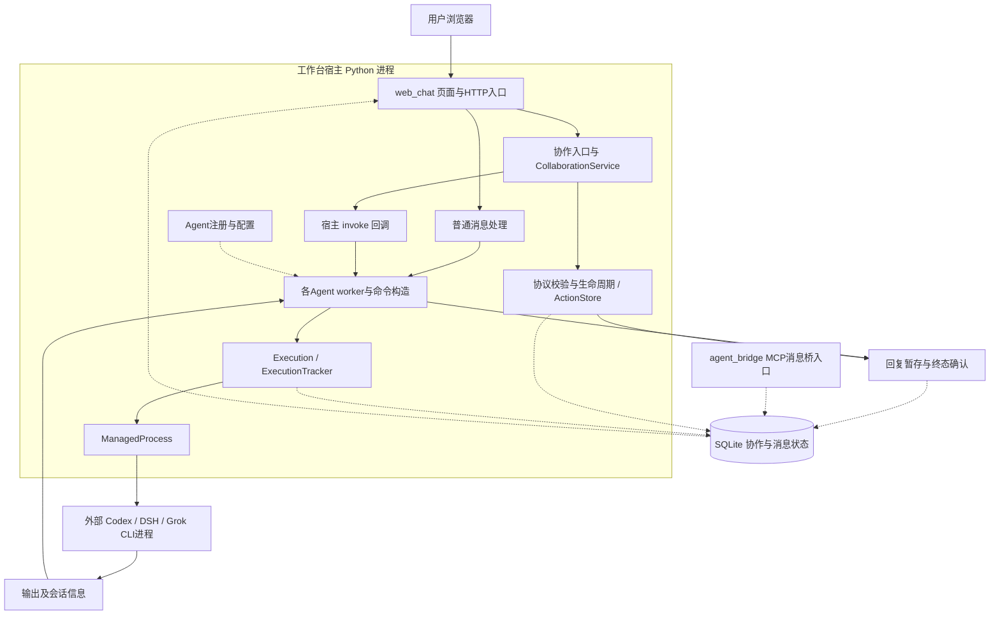
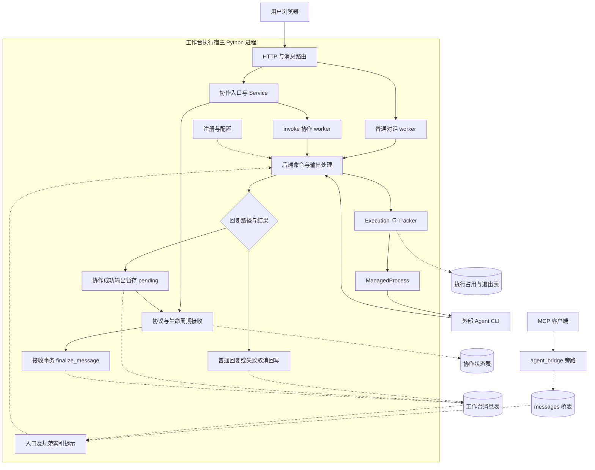

# Codex：当前架构与改进判断

作者：Codex；日期：2026-11-10 +08:00；文档状态：草案；所有改进均为提案，未实施、未形成三方共识。

用户期望与范围引用[本轮基线](README.md)。受检HEAD：`32b1de7b378aa46f4a43019459d649b6e6552bea`，分支沿用准备阶段的docs/coagent-plan。工作区已有docs/README.md、CAREER_ROADMAP_DESIGN.md及本轮目录；未发现本次status中的生产代码修改。三个verify_f2目录权限拒绝，内部未枚举。

规范：agent-discussion-spec 1.2.0（specs/AGENT_DISCUSSION_SPEC.md）及design-decision-record-spec 1.2.0（specs/DESIGN_DECISION_RECORD_SPEC.md）must_follow，全文已于准备阶段读取，本轮复核README补充；code-review-spec 1.2.0（specs/CODE_REVIEW_SPEC.md）not_applicable，依据§1：无代码变更的架构讨论不是正式代码合入审核。uncertain无。独立观点先成稿，未读取另两份署名分析来决定结论。

## 我的架构认知

我将其理解为“一个宿主进程组织多个外部CLI的本地工作台”。逻辑职责已拆出模块，但模块并不等于独立服务。尤其执行控制不是只负责启动命令：它还负责确认退出、保护会话归属和决定能否继续派发。SQLite也是多个控制面的共享持久化边界，不宜简单画成最后一层。

下面是现状图，实线表示调用/控制，虚线表示读写或查询；图表达主要关系，不宣称完整依赖图。

我的逻辑分层：交互与HTTP；消息/协作用例编排；执行与会话控制；平台进程设施。注册配置与持久化横跨这些职责。specs是提供给Agent的行为约束，不能据此推断宿主有对应强制拦截；不把它画成命令必经的运行时层。

证据：web_chat.py的ChatHandler（2255）、run_agent_task（2133）、run_codex（1801）、run_deepseek_harness（1940）、run_grok（2047）、run_managed_process（1624）；collaboration_service.py的register_entry（41）、kick（82）、_invoke（152）、_drive（221）；execution_runtime.py的Execution及claim_session/select_legacy_session；managed_process.py的ManagedProcess.run（232）；database_schema.py的require_current与原子迁移说明。agent_bridge作为消息桥的定位来自准备前的项目材料，本轮未逐条核对MCP工具路由，图中该旁路关系置信度中等。

## 主要请求流与边界

普通消息经HTTP进入宿主，分配Agent worker，构造CLI命令并经过Execution、ManagedProcess；外部CLI执行后，宿主处理输出与消息终态。协作路径增加入口规划、协议接收、任务依赖与生命周期驱动，最后仍借宿主invoke执行CLI。两条路径共用执行基础设施，但业务终态与进程退出是不同事实。

collaboration_service.InvocationResult带dispatch_allowed；_invoke发现不能派发会抛DispatchHalted。Execution记录run token并选择会话；模块说明明确锁顺序和事务不得回调运行时。web_chat.stage_collaboration_reply/finalize_message（1350/1362）说明回复可先暂存再确认。这些边界具有实际价值，不能为了“简化”把它们折成一个success布尔值。

## 我认为必须改进的缺点

### CX-D01：宿主入口承担过多变化原因

事实：同一个web_chat.py包含HTTP处理、提示构建、三种CLI启动、运行登记、取消和消息终态函数，见上述符号。推断：新增后端或调整消息策略容易影响HTTP及其他后端，单独验证适配逻辑成本偏高。建议先抽取后端调用接口和用例服务，保留web_chat作为装配与HTTP层；不是立即重写或拆成微服务。成本是迁移回调、测试夹具与配置依赖。优先级高（每次后端迭代都会触及）；置信度高。验证候选：抽取后相同输入的命令、终态及取消行为应与基线一致。

### CX-D02：协作恢复部分依赖进程内唤醒状态

事实：CollaborationService持有_locks、_rerun和_event_lock，kick通过daemon线程驱动，事件本身又存于数据库。推断：持久化记录与进程内唤醒不在一个恢复边界，诊断重启后的待办是否继续，需要额外理解启动恢复逻辑。本轮未完整审查启动扫描，不能断言任务一定丢失。建议明确并测试“重启后只恢复控制状态、不盲目重做有副作用任务”的恢复契约，按需补持久化调度信号。成本是幂等和不确定退出的处理。优先级高；风险判断置信度中等。验收候选：在预约、启动、结果接收之间注入中断，证明不会重复执行且能解释等待原因。

## 好思路与可优化做法

### CX-O01：已有统一执行边界，适配职责可以继续收齐

事实：Execution已统一会话与运行归属，但observe_session仍按codex/dsh/grok事件字段分支，Grok还调用grok_adapter.parse_output；web_chat保留各后端启动函数。价值：集中控制退出与归属，避免各CLI各自决定是否可继续派发。建议适配器负责命令和事件解码，Execution只接收统一会话/错误事件；不为三个后端建立动态插件市场。成本是统一事件语义及兼容测试。优先级中；置信度高。验证候选：用三类真实输出样本加异常/取消样本做契约测试。

### CX-O02：SQLite集中状态适合当前规模，但应明确状态所有权

事实：service既通过ActionStore也直接SQL更新calls/lifecycle；web_chat负责消息暂存与终态；ExecutionTracker另管执行归属。价值：单机部署简单，相关事务可保持原子。推断：难点更像“谁能改变哪个状态”，不是数据库选型落后。建议先写状态所有权和跨表事务契约，按用例收拢写入口；暂缓换数据库或引入消息队列。成本是梳理已有写路径。优先级中；置信度高。验收候选：取消、迟到结果与接收失败各有状态转换和事务测试。

## 遗漏或值得补充的能力

### CX-M01：面向用户的单次执行诊断摘要

事实：Execution已有类别化准入错误、run与message/job/call关联，宿主有list_active_runs；前一轮诊断仍需结合数据库与进程。推断：已有底层信息，但未在本轮读取范围发现一个统一回答“正在做什么、最后活动、等谁、能否安全重试”的视图，不能据此断言完全没有相关界面。建议整合既有检查能力为只读摘要，先不自动重试/杀进程。代价是活动记录脱敏、时效性及不可误判存活。优先级高（直接缓解卡住疑问）；置信度中。验收候选：正常、工具等待、已退出残留和占用拒绝四场景能明确区分。

### CX-M02：可重复的跨后端兼容样本与能力说明

事实：会话字段及Grok解析存在后端差异，权限与终态不能假设相同。推断：仅保持启动函数可运行不足以说明版本升级后语义一致；本轮未遍历全部测试，不声称缺少测试。建议整理CLI版本、权限语义、会话恢复和终态样本的兼容矩阵，复用既有测试而非另建大型评测平台。代价是维护脱敏样本和升级基线。优先级中；置信度中。验收候选：升级CLI前可离线复验关键输出契约，真实后端验收另记。

## 取舍、验证与保留意见

所有建议未选定。当前我倾向先做CX-M01和明确CX-D02恢复契约，再按实际改动压力抽取CX-D01；不认为“文件大”本身足以支持全面重构。非目标：微服务化、替换SQLite、恢复自动Git状态机、自动实施这些建议。

本轮实际只读代码片段、函数清单、数据库迁移定义、目录基线和协作设计文档开头；设计文档文本在终端出现乱码，未用它推出历史方案已验证。没有运行功能测试或真实CLI，没有完成所有模块审查。rg不可用，改用Select-String；部分工具输出截断，未将截断内容作为完整阅读证据。Mermaid仅做文本结构检查，未用渲染器验证。

异议CX-A01（Codex，2026-11-10 14:42:00 +08:00）：不宜把当前架构解释成严格单向分层，SQLite与注册配置是横切依赖，web_chat尚混合多层。理由见图和CX-D01；属于我的初始独立判断，不代表反对另一位Agent的最终结论。用户决定尚无。此时间为文档记录时间，不作为运行事件时间证据。

用户期望对齐：符合本独立分析范围（现状图、明确缺点、优化、遗漏均已提供）；整个三方任务仍待他方与汇总。五项自查：目标符合（引用README）；范围符合（仅此文件）；本子任务完成；结论有代码证据但覆盖有限；缺口已披露。准备后无实质决策变化；首次记录保留上述提案及理由。

---

## 第二轮：互读后的逐项复核与修正

记录者 Codex，2026-11-10 15:03:17 +08:00。以下追加区与上面的第一轮原稿分开保存。事实修正以本区为准，建议仍是提案，不代表三方已决定或已经实施。

用户基线来自本轮要求：互读其他 Agent 的总结，对自己的全部判断作详细复核，让读者能直接区分原表述不当、修正结果、维持项和未证实项。本次完整互读 [DSH 原稿](DEEPSEEK_HARNESS.md)、[Grok 原稿](GROK.md)、[第一轮汇总](SUMMARY.md)及自己的原稿。并非以他方赞同数量决定结论。

受检 HEAD 仍为 `32b1de7b378aa46f4a43019459d649b6e6552bea`。工作区已有 `docs/README.md` 修改、`docs/CAREER_ROADMAP_DESIGN.md` 与本目录未跟踪内容，保留。本轮只追加本文件，不把其他文档变动当成已实现代码。此前三个 `verify_f2_*` 目录权限拒绝，未枚举其内部。

规范复核：must_follow 为 `agent-discussion-spec` v1.2.0（`specs/AGENT_DISCUSSION_SPEC.md`，全文复读，逐点回应、变化及异议留痕）和 `design-decision-record-spec` v1.2.0（`specs/DESIGN_DECISION_RECORD_SPEC.md`，全文复读，用户基线、保留历史及状态区分）。`code-review-spec` v1.2.0（`specs/CODE_REVIEW_SPEC.md`）not_applicable，沿用§1无代码变更的架构讨论范围。uncertain 无，必读材料读取失败无。

### 1. 架构定位及原图：职责判断维持，回复路径与图边界修正

🔴 **原表述需修正**：原图把所有 worker 的输出汇入“回复暂存与终态确认”一个节点，并将该节点画在宿主子图外。图虽说明是简图，仍容易让读者以为普通对话也经过协作接收事务，或回复逻辑位于另一个服务。MCP 节点仅连笼统 SQLite，未区分表和用途。

他方意见：Grok 的普通请求/协作请求流和 GK-O02 明确两段接收；SUMMARY 指出我的图示简化；GK-A01 要求 MCP 旁路及 specs 提示约束。DSH 图示出现普通请求经 MCP，我不沿用该画法。

🟢 **修正后的判断**：`web_chat.py:1385` 的 `worker_reply` 只在 completed 且属于协作调用时进入 `stage_collaboration_reply`，其余进入 `update_workbench_message`。`stage_collaboration_reply` 保留 pending 并验证执行关联；`finalize_message` 参与调用者的接收事务，不自行提交，已取消及其他既定终态不会被覆盖。因此普通消息回写、协作成功输出暂存、协作协议接收确认必须分开表达。失败和取消也不能一律画成成功暂存。

✅ **原判断维持**：“一个宿主进程组织多个外部 CLI”描述执行宿主；MCP 桥是另一个入口，不据此断言整个系统只有一个 OS 进程。`ChatHandler`、`invoke_collaboration`、`begin_execution`、`ManagedProcess` 的职责链支持这一定位。SQLite 和注册配置是横切关系，specs 不等于运行时拦截。Grok 的控制面切法与我的职责切法可以并存。

影响范围为现状图和请求流说明，不改变 CX-D01 或数据库选择建议。代码分支判断置信度高；进程部署全貌未做运行验证。

### 2. CX-D01：宿主入口承担过多变化原因

✅ **原判断维持**。原文“HTTP处理、提示构建、三种CLI启动、运行登记、取消和消息终态函数”仍能在 `web_chat.py` 的 `ChatHandler`、`build_agent_prompt`、`run_codex/run_deepseek_harness/run_grok`、`worker_reply`、`startup_server` 找到。DSH-D01、GK-D01 提供相同职责混合证据，而不是仅凭文件行数赞同。

推导仍是后端变化和界面变化共享修改面，适合逐步抽取职责。三方共同观察不证明已有回归缺陷，也不证明全面重构的收益超过成本。保持结构债优先级高，但实施顺序仍按实际变更压力决定，先确保行为基线。影响为迁移回调与测试夹具，未建议拆服务。事实置信度高，收益估计中。

### 3. CX-D02：从恢复疑点收紧为已有恢复机制的边界验证

🔴 **原表述需修正**：标题“协作恢复部分依赖进程内唤醒状态”容易把唤醒与恢复混为一谈。原文已保留“不能断言任务一定丢失”，但对实际启动处理缺少正面证据。GK-D03、DSH-D03 同样指出多类状态，不能因此相互证明恢复机制不存在。

🟢 **修正后的判断**：`startup_server` 明确调用 `store.interrupt_running()`。`collaboration_lifecycle.py:227` 在事务中将 working/final_ready/final_delivery/quiescing 相位及涉及 reserved call 的 job 标为 interrupted，将 reserved call 标 interrupted，将 queued/running task 标 cancelled。这是已实现的控制状态恢复动作，不是自动续跑全部任务。

`CollaborationService.kick` 在单 job 锁争用时写入 `_rerun`，当前 drive 结束释放锁后再 kick。它用于合并唤醒，不能解释成任意执行失败的自动重试。daemon 和内存集合重启后消失是事实，但不等于数据库里的控制状态无人处理。

✅ **原判断维持**：需要明确并验证控制状态、执行占用和未知退出之间的契约。启动占用摘要的注释明确它只是只读诊断，不作为执行准入缓存；不能据此判断进程已经退出或可以安全重放。优先验证预约、启动、接收之间的中断窗口，不先添加持久化调度设施。

🟡 **证据不足**：本轮未注入崩溃、未模拟宿主重启，不能声称上述窗口均已验证，也不能证明需要持久化调度信号。原“按需补”仅保留为验证发现必要后的候选。优先级仍高，事实置信度高，残余风险判断中。影响是收缩缺陷表述，不改为新增自动恢复提案。

### 4. CX-O01：统一执行边界与适配器 execute 职责

✅ **原判断维持**：`execution_runtime.py:123` 的 `observe_session` 解析后端输出，`web_chat.py` 仍保留三个 run 函数，`grok_adapter` 已提供命令和解析边界。收齐纯命令构造及事件解码有依据。GK-O01/GK-O03 与这一方向接近，DSH-D02/DSH-O01 也认同后端抽象，但其 build/execute/parse 提法需要划清 execute 的含义。

🟢 **补充后的职责约束**：若 execute 只是调用统一 Execution 的外观方法，可以讨论；若让每个 adapter 自行 claim 占用、管理 PID、取消、会话归属或提交数据库终态，我反对。原建议保留 Execution 控制这些共享不变量，adapter 返回统一事件与诊断，不能凭解析成功决定业务接收成功。

依据是现有 `Execution`、`ExecutionTracker` 与 `structured_worker` 对执行证据的约束，以及 `finalize_message` 的业务接收事务。纯 adapter 也不意味着所有会话写回已经全在 Execution，Grok 原稿自己指出 run_grok 仍写会话；这是目标边界，不能冒充现状。

方案取舍未通过性能或迁移试验定案。优先级中，置信度高。保留异议 CX-A02：Codex 于本区记录时间反对 adapter 独立拥有执行与终态控制；用户决定无。他方尚未回应的 execute 定义不记为已解决。

### 5. CX-O02：SQLite 与状态所有权

✅ **原判断维持**。DSH-D03 与 GK-D03 的多状态观察支持“所有权需要明确”，不支持换数据库。`interrupt_running` 的多表事务与 `finalize_message(db, ...)` 不自行 commit，提供了现有原子边界的具体例子。单库让接收与状态更新可共同提交，不能为形式上的分层拆散事务。

补充条件：按用例收拢入口时，应保留取消、拒绝、重复、失效回复的处理语义。GK-O02 的统一终态建议仅在相同业务接收要求下成立，普通对话目前直接更新消息并不由此构成缺陷。影响是所有权文档和渐进整理，优先级中，事实置信度高；未运行并发事务测试。

### 6. CX-M01：执行诊断摘要

✅ **原判断维持**。GK-D02/GK-M01、DSH-M01 均反映定位成本，现有 `list_active_runs`、执行关联及错误分类意味着建议应整合已有信息，而非声称诊断从零开始。

🟢 **补充边界**：占用记录、内存登记、OS 进程存活、最后活动、业务是否接收必须分别展示。Grok 原文“占用为 true 只说明进程还在”不够准确，登记本身不是实时存活证明。`startup_server` 明示退出未知及摘要不用于准入，正是不能把摘要当重试授权的证据。

🟡 **证据不足**：未穷尽前端或运行真实 CLI，不断言所有用户可见进度都缺失；“不能安全重试”也不能只靠超时推导。保持只读摘要高优先级，整体缺口置信度中。建议先显示已知/未知及来源，再考虑更细工具活动，不自动杀进程。

### 7. CX-M02：跨后端兼容样本与能力说明

✅ **原判断维持**。GK-O01 指出 Grok 的 end/stopReason/sessionId 约束，CX-O01 的后端解析分支也表明会话和终态语义有差异。因而版本、权限、续接、失败输出的兼容说明仍有价值。

未逐一检查全部测试，不能将此项改写成“仓库没有兼容测试”。优先复用现有 Grok 测试与执行测试，缺失范围需逐项盘点。与 DSH-M02 的会话契约有关，但会话文件名称必须按实际代码，不能引用不存在的 execution_sessions.py。优先级中、缺口置信度中；本轮不增加测试或承诺真实 CLI 兼容。

### 8. CX-A01 及其他 Agent 意见的处理

✅ **CX-A01 原判断维持**：不采用严格单向分层，理由仍是注册配置、共享 SQLite 和 web_chat 混合职责。GK 的横切定位与之兼容。DSH 六层可作阅读视角，但箭头需要区分调用、存储和提示约束，不能强称已经三方统一为某个层数。此异议不是要求用户放弃分层图，原用户决定仍无。

✅ 对 **GK-A01** 的事实主张赞同，普通对话不经 MCP、规范索引注入不等于正文运行时拦截。原稿已作区分，本轮进一步拆表和箭头。对 DSH 原稿的 execution_sessions、git_stage 归一化引用，不纳入我的现状或重构建议，前者无对应文件，后者缺少当前代码依据。

🟢 对 **GK-M02** 保留方向但修正缺口前提：`collaboration_protocol.py:41` 已拒绝 duplicate task/dependency，`:143` 已校验 status/invitation conflict，且 invitation_ids 来自末行解析器。不能把这些概括为“宿主不拦”。是否仍有入口绕过或文案问题，需要沿实际调用链验证，不在本轮推断已有闸门失效。

🟡 对 **GK-M03** 的 job 工作区隔离不新增确定结论。共享目录冲突风险与隔离成本都值得讨论，但本轮不实施，不把 worktree 当成所有文档协作必需品。该项与保留统一执行边界并不冲突。

### 修正版现状图：替代原图的歧义，不替代原稿历史

实线表示主要控制或结果传递，虚线表示数据/提示关系。WM、CB、ER、MG 属于同一 SQLite，分开是为了标明状态所有权，不是拆库建议。CLI 节点表示多种后端。图不穷尽失败旁路、HTTP 查询和全部调用顺序，也不把阶段简图当作完整状态机。

### 本轮结论、验证及未决项

原图的终态与宿主边界、CX-D02 对恢复的描述作实质修正；CX-O01 补充 execute 限制，CX-M01 补充登记不等于存活。CX-D01、CX-O02、CX-M02、CX-A01 的主要判断维持。优先方向仍是用户诊断摘要和恢复契约验证，再按实际压力抽取入口与适配逻辑。新增证据不足以授权全面重构、持久调度或自动恢复。

未决项是 adapter execute 的具体定义、崩溃窗口下跨控制域状态结果、进度界面的实际覆盖、兼容样本覆盖。建议验证方式分别为职责契约对照、中断注入、界面场景走查、现有测试盘点。本轮仅完成文本和代码静态核对，未运行功能测试、真实 CLI、重启实验或 Mermaid 渲染器。

五项自查逐项记录：目标符合，逐项复核本人全部原编号并回应他方；范围符合，仅追加本署名文档；本子任务完成，汇总任务仍由调度器后续安排；证据符合，修正关联具体函数和分支，未以赞同代替验证；缺口披露符合，运行和渲染限制及未决异议均在本区明示。中文回读、异常字符、相对链接与围栏结构由交付前文本检查确认，不能等同视觉渲染验证。
