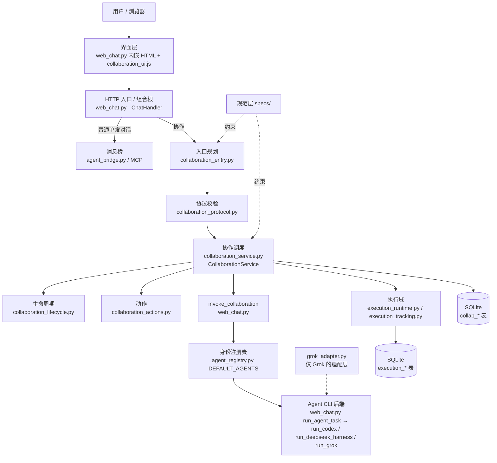
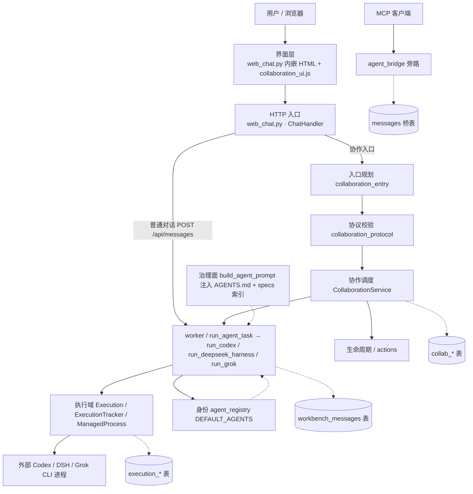

# DeepSeek Harness 对当前架构的独立分析

- 作者：DeepSeek Harness
- 时间：2026-11-10 14:52:00 +08:00
- 文档状态：草案（独立观点，未与其它 Agent 对齐）
- 受检 HEAD：`32b1de7b378aa46f4a43019459d649b6e6552bea`（引用 [README.md](README.md) 基线）
- 工作区边界：`docs/README.md` 有一行未暂存修改、`docs/CAREER_ROADMAP_DESIGN.md` 未跟踪，均不属于本分析；`verify_f2_*` 目录权限拒绝未枚举。

## 规范判定

- must_follow `agent-discussion-spec` v1.2.0（`specs/AGENT_DISCUSSION_SPEC.md`，多 Agent 架构讨论，§3 先独立观点、§9 稳定编号）。
- must_follow `design-decision-record-spec` v1.2.0（`specs/DESIGN_DECISION_RECORD_SPEC.md`，架构改进取舍留痕，§4/§5 状态与十项信息）。
- not_applicable `code-review-spec` v1.2.0（本轮只读分析、无代码变更与合入请求，阅读实现仅作证据，不构成代码审核）。
- 读取失败：无。

## 我的分层认知

我的视角以「控制流」为主线，而不是经典 MVC。这个项目是一个**本地多 Agent 工作台**：浏览器发起，宿主把一次协作拆成 job → task → call，逐个调用三个 CLI Agent，状态全落在一份 SQLite 里。分层如下：

图例：实线箭头 = 主调用方向；虚线箭头 = 约束/旁路。我已排除已放弃的自动 Git 方案（`git_feature_workflow.py` / `git_automation.py` 不在 main 现状内）。

### 各层职责（我的理解）

| 层 | 关键文件 | 职责 |
|---|---|---|
| 界面层 | `web_chat.py` 内嵌 HTML、`collaboration_ui.js` | 渲染任务卡、状态、按钮，向 HTTP 发请求 |
| HTTP 组合根 | `web_chat.py` `ChatHandler`（`class` 在 `web_chat.py:2255`） | 路由 `/api/*`、会话鉴权、调用协作/执行/能力探测；同时持有大量业务函数 |
| 协作编排 | `collaboration_service.py`（`CollaborationService`，`drive/_drive/call`）、`collaboration_protocol.py`、`collaboration_entry.py`、`collaboration_lifecycle.py`、`collaboration_actions.py` | 把一次对话变成一个 job，维护 task 依赖、call 状态、lifecycle phase，串行驱动 |
| 存储 | `database_schema.py`（`collab_*`、`execution_*`、`workbench_*`） | 持久化 job/task/call/lifecycle 与执行会话 |
| 身份 | `agent_registry.py` `DEFAULT_AGENTS`（`agent_registry.py:81`） | 声明 Codex / DeepSeek Harness / Grok 三位 Agent 及能力 |
| 执行域 | `execution_runtime.py`、`execution_tracking.py`、`execution_sessions.py`、`execution_inspection.py` | 进程生命周期、并发占用、会话代次、退出证据 |
| Agent 后端 | `web_chat.py` `run_agent_task` → `run_codex` / `run_deepseek_harness` / `run_grok` | 各自拼 CLI 参数、spawn 子进程、解析输出 |

### 一次请求的链路（我的理解）

用户发「开发某功能」→ HTTP `POST /api/collaboration/action`（或入口）→ `collaboration_entry` 规划 plan → `collaboration_protocol` 校验 → `CollaborationService._drive` 串行取 ready task → `call(agent_id, role, instruction)` → `invoke_collaboration`（`web_chat.py:154`）→ `run_agent_task` 按 `agent_id` 分派到 `run_codex`/`run_deepseek_harness`/`run_grok` → spawn CLI → 回读 output → 写回 call 状态与结果 → 推进 task/lifecycle → 前端轮询渲染。

## 我认为必须改进的缺点

### DSH-D01：`web_chat.py` 是组合根，但职责边界模糊（上帝文件）

- 事实：`web_chat.py` 同时承载内嵌 HTML/JS 界面、`ChatHandler` 路由、`invoke_collaboration`、`run_managed_process`、`run_codex`/`run_deepseek_harness`/`run_grok`/`run_agent_task`、执行管理、配置常量，全文件数千行。
- 推导与影响：任何一层（界面、HTTP、Agent 调用、执行）改动都要进同一个文件，冲突面大、单测难切分；新 Agent 接入或前端调整容易牵动不相关逻辑。
- 建议：把「Agent 调用与执行管理」从 HTTP/界面中抽出为独立模块，`ChatHandler` 只做路由与鉴权。
- 成本/权衡：中等重构成本；需要保持 HTTP 路由与现有前端契约不回归。
- 优先级：高。置信度：高（文件结构与函数分布可直接验证）。

### DSH-D02：Agent 后端没有统一调用抽象，三套 run_* 各自实现

- 事实：`run_codex`（`web_chat.py:1801`）、`run_deepseek_harness`（`web_chat.py:1940`）、`run_grok`（`web_chat.py:2047`）是三套独立函数，各拼各的 CLI 参数与解析；`run_agent_task`（`web_chat.py:2133`）做分派。`grok_adapter.py` 是 Grok 一侧的适配，但 Codex/DSH 没有对等的 adapter 抽象。
- 推导与影响：新增/调整 Agent 要复制一套 run_* 样板；CLI 差异（sandbox、session、permission、超时）散落在三个函数里，行为不一致的风险高；「谁负责 spawn、谁负责解析、谁负责错误分类」没有单一契约。
- 建议：定义统一 `AgentAdapter`（构建命令 → 执行 → 解析结果 → 分类退出/错误），`grok_adapter.py` 的方向是对的，应推广为统一接口，Codex/DSH 分别实现。
- 成本/权衡：中等重构；需先定契约字段（命令构建、环境、超时、退出证据、结果结构）。
- 优先级：高。置信度：高。

### DSH-D03：协作状态（collab_*）与执行状态（execution_*）是两套并行状态机，一致性与恢复边界不清

- 事实：`collab_*` 表管 job/task/call/lifecycle，`execution_*` 表管会话/占用/退出证据；两边靠 message_id/job_id 关联，但推进与恢复分散在 `collaboration_service` 与 `execution_*` 里。
- 推导与影响：进程「已退出但 call 仍 running」或「call 完成但执行记录未知」这类中间态，靠多处逻辑兜底，难以形成单一恢复入口；排查卡住（本轮 Grok 疑似卡住即一例）需要在两套表之间来回对齐。
- 建议：明确「执行退出 → call 终态」的单一归约契约（谁把退出码/错误归约成 call 结果），并给恢复提供统一查询入口。
- 成本/权衡：需要理清现状里的多处兜底，风险较高；可先做「只读诊断入口」降低排查成本。
- 优先级：高。置信度：中（我未完整走通所有恢复分支，属于推断）。

## 思路不错、但可以有更好做法

### DSH-O01：`grok_adapter.py` 的「适配层」方向对，但应推广为统一 AgentAdapter

- 原思路价值：把 Grok 的命令构建与解析集中到 `grok_adapter.py`，减少 `web_chat.py` 直接铺 Grok 细节。
- 更优候选：抽一个 `AgentAdapter` 协议（`build_command / execute / parse / classify_failure`），Codex、DSH、Grok 各自实现，`run_agent_task` 只按 `agent_id` 查适配器。这样 `run_codex/run_deepseek_harness/run_grok` 的差异收敛到各自 adapter 内，行为可测、可替换。
- 成本/权衡：契约设计一次，迁移三个后端；需保留现有 CLI 行为不变。
- 优先级：高（与 DSH-D02 同源）。置信度：高。

### DSH-O02：协作状态机「串行 drive」清晰，但可补一个显式的任务依赖/就绪推导层

- 原思路价值：`CollaborationService._drive` 用 `ready = 依赖已满足` 的串行推进，简单且可预测。
- 更优候选：把「就绪判定 / 依赖解析 / 授权过滤 / git_stage 归一化」从 `_drive` 里提为独立纯函数（输入 plan+tasks+calls，输出 ready 列表），既便于单测，也让 owner 决策、依赖失败、批量调度等规则不继续堆在 `_drive` 主循环里。
- 成本/权衡：中等；纯函数化不改行为，风险低。
- 优先级：中。置信度：中（我读了 `_drive` 主循环，但未逐行核对所有分支）。

## 遗漏且值得加入的能力

### DSH-M01：统一的执行失败诊断与恢复契约

- 现状事实：退出码、超时、启动失败、权限拒绝等散在 `execution_*` 与 `collaboration_service` 的 `except` 分支；本轮排查「Grok 是否卡住」需要跨表与进程状态对齐。
- 影响：卡住/失败时定位成本高，owner 常要靠逐条查库。
- 建议：引入「执行结果分类 + 恢复意图」的显式结构（成功 / 超时 / 启动失败 / 权限拒绝 / 未知退出），并提供只读诊断入口统一输出 job/call/进程/最近活动。
- 成本/权衡：主要是把现有兜底显式化；优先级中高。置信度：中。

### DSH-M02：跨重启/跨会话的 Agent 会话续接契约

- 现状事实：`execution_sessions`、`execution_tracking` 有会话代次与占用，但「进程消失后 session 如何续接、如何判定残留」的规则分散。
- 影响：宿主重启或 CLI 异常退出后，可能出现「状态残留但进程已无」或「会话重复」。
- 建议：明确 session 的幂等续接/孤儿判定契约（依据实例 ID + 会话代次 + 退出证据），并加可测的清理路径。
- 成本/权衡：需谨慎，涉及执行域核心；先梳理再定。优先级：中。置信度：中。

### DSH-M03：全局架构分层文档（本轮主题）

- 现状事实：`docs/` 全是主题设计记录，`docs/README.md` 无「架构总览」主题；无一张从界面到 CLI 的整仓现状图。
- 影响：新人或跨 Agent 协作时对「请求怎么流动、状态存哪、谁 spawn 谁」缺乏统一入口。
- 建议：本目录汇总后，把「现状图 + 目标图」落一份到 `docs/ARCHITECTURE.md` 并登记父索引。
- 成本/权衡：低（纯文档）。优先级：高（本轮目标）。置信度：高。

## 备选方案与未采纳原因 / 非目标 / 未决问题

- 未采纳「先统一三方画一张图」：用户要求各 Agent 独立表达，故本文件只陈述我的独立观点。
- 非目标：本轮不实施任何代码重构，不重新启用已放弃的自动 Git。
- 未决：Codex/Grok 的分层切分与我的「控制流六层」可能不一致，待汇总后对照；谁负责最终收敛成官方架构图，待用户定。

## 验证与实际验证结果

- 实际完成：读取 `web_chat.py` 的函数清单（`run_*`、`ChatHandler`、`invoke_collaboration`）、`collaboration_service.py`（`CollaborationService`/`drive`/`call`）、`agent_registry.py`（`DEFAULT_AGENTS`）以定位证据。
- 未完成：未运行真实 CLI、未跑测试、未渲染 Mermaid、未完整走通所有执行/恢复分支。
- 本文件仅结构检查，不构成代码审核或实施批准。

---

## 第二轮：互读后的逐项复核与修正

记录者 DeepSeek Harness，2026-11-10 15:22:00 +08:00。以下追加区与第一轮原稿分开保存；事实修正以本区为准，建议仍是提案，不代表三方已决定或已实施。完整互读了 [Codex 原稿](CODEX.md)、[Grok 原稿](GROK.md)、[第一轮汇总](SUMMARY.md) 及自己的原稿，逐项复核所有 `DSH-D/O/M` 编号，不以他方赞同数量决定结论。

规范复核：must_follow `agent-discussion-spec` v1.2.0（`specs/AGENT_DISCUSSION_SPEC.md`，逐点回应、观点变化与异议留痕）与 `design-decision-record-spec` v1.2.0（`specs/DESIGN_DECISION_RECORD_SPEC.md`，保留历史、状态区分）；`code-review-spec` v1.2.0 not_applicable（无代码变更的架构讨论）。uncertain 无，必读材料读取失败无。受检 HEAD 仍为 `32b1de7b378aa46f4a43019459d649b6e6552bea`。

### 1. 架构图与分层：三处事实需修正，分层定位维持

🔴 **原表述需修正**：我第一轮现状图把「普通对话」画成 `HTTP → Bridge（agent_bridge MCP）`，并把 `specs` 画成对 `Entry/Service` 的运行时约束虚线；同时表格里引用了 `execution_sessions.py`。

- 他方意见：GK-A01 主张普通对话不经 MCP、specs 是提示注入非运行时拦截、仓库无 `execution_sessions.py`；CX-A01 与 SUMMARY 事实核查支持同一结论。
- 证据：普通对话是 `POST /api/messages` → `run_agent_task` → `agent_worker` → `run_codex/run_deepseek_harness/run_grok`，全程在 `web_chat.py` 内，不经过 `agent_bridge`；`agent_bridge.send_message` 是独立 MCP 入口，写 `messages` 表，只在 `build_agent_prompt` 里作共享上下文背景。specs 经 `build_agent_prompt` 注入 `AGENTS.md` 全文与 `specs/README.md` 索引，宿主只强制解析 `agent-collaboration` 围栏（`validate_payload`），不强制 spec 正文。会话相关是 `execution_tracking.py`、`session_configuration.py`、`save_agent_session_id` 写 `workbench_agent_sessions`，不存在 `execution_sessions.py`。
- 决定：三处均修正。

🟢 **修正后的判断**：普通对话与协作是两条控制面，都经 HTTP 进宿主；MCP 是旁路入口；specs 是「治理面」的提示注入，不是运行时拦截层；会话状态由 `execution_tracking.py` 等实际模块承载。

✅ **原判断维持**：「控制流六层」的切分骨架（界面 → HTTP 组合根 → 协作编排 → 身份 → 执行域 → CLI 后端）仍成立，`web_chat.py` 是组合根、SQLite 是横切持久化。CX-A01 的「非严格单向分层、注册/存储横切」与我的骨架兼容，我不坚持把每层画成严格单向依赖。

影响：修正现状图（见下），不改变 DSH-D01 等结论。

### 2. DSH-D01：`web_chat.py` 职责过重

✅ **原判断维持**。三方（CX-D01、GK-D01）对「同一文件承载 HTTP、三种 CLI、提示、运行登记、终态」给出相同符号证据，我的判断非仅凭行数。维持高优先级，实施顺序仍按实际变更压力决定。置信度高。

### 3. DSH-D02：后端缺统一抽象，需划清 execute 职责

🔴 **原表述需修正**：我把「统一 `AgentAdapter`」的接口写成 `build_command / execute / parse / classify_failure`，未划清 `execute` 归谁。

- 他方意见：CX-O01 补充「adapter 返回统一事件与诊断，不各自 claim 占用、管 PID、取消、会话归属、提交终态」；GK-O01/GK-O03 主张 adapter 保持「纯命令+解析、无 DB 副作用」。CX-A02 明确反对 adapter 独立拥有执行与终态控制。
- 证据：`Execution` / `ExecutionTracker` 已经统一会话与运行归属；`run_managed_process` 管进程；`finalize_message` 参与业务接收事务。若 adapter 各自 `execute` 会重复这些不变量。
- 决定：接受划清。

🟢 **修正后的判断**：adapter 只做「纯命令构建 + 输出/事件解析」，`execute`（占用、PID、取消、会话归属、退出证据）保留在 `Execution` 统一控制。`run_*` 三套逻辑抽成 adapter 仍成立，但「execute」一词不再放进 adapter 职责。

### 4. DSH-D03：双状态机一致性/恢复边界不清

✅ **原判断维持**。GK-D03 把「协作相位 / 执行占用 / 内存登记」拆成三套钟，比我的「collab_* 与 execution_* 两套」更细，但方向一致，不构成否定。恢复风险是推断，维持高优先级但置信度中。启动已有 `interrupt_running()`（Codex 第二轮确认），我不再声称「恢复机制缺失」，只强调「跨状态归约与验证边界不清」。

### 5. DSH-O01：`grok_adapter` 方向对、应推广

🔴 **原表述需修正**：同 DSH-D02，删去 adapter 的 `execute` 职责。

🟢 **修正后的判断**：推广为「纯命令+解析」的 adapter 接口，Codex/DSH 各实现；进程/会话/终态仍由 `Execution` 统一。其余（价值、成本、优先级）维持。

### 6. DSH-O02：就绪判定纯函数化

🔴 **原表述需修正**：我把「git_stage 归一化」也列入「从 `_drive` 提出」的职责清单，但结合已放弃自动 Git 方向，`git_stage` 归一化属于协议归一化（`normalize_owner_plan`）而非本版就绪推导职责，我未证明它属 `_drive` 职责。

🟢 **修正后的判断**：保留「就绪判定 / 依赖解析 / 授权过滤」提为纯函数的提案，去掉「git_stage 归一化」这一错误归因。串行语义保持。

### 7. DSH-M01：统一执行失败诊断与恢复契约

✅ **原判断维持**。CX-M01、GK-D02/GK-M01 同指定位成本高。补充边界（采纳 Codex 第二轮）：占用登记不等于实时存活，「摘要」不得当作重试授权。优先级高、置信度中。

### 8. DSH-M02：跨重启/跨会话续接契约

🔴 **原表述需修正**：证据里引用了不存在的 `execution_sessions.py`。

🟢 **修正后的判断**：会话续接契约仍值得补，但证据定位到 `execution_tracking.py`、`session_configuration.py`、`workbench_agent_sessions`。优先级中、置信度中（恢复分支未走通）。

### 9. DSH-M03：全局架构文档

✅ **原判断维持**。本目录已产出三方图，单一官方图仍是候选，待用户定。

### 10. 对其他 Agent 意见的回应

- ✅ 接受 **GK-A01**：普通对话不经 MCP、specs 是提示注入、无 `execution_sessions.py`。已在上文修正。
- ✅ 接受 **CX-A01**：不坚持严格单向分层，SQLite 与注册配置横切。
- ✅ 接受 **CX-A02** 的职责划清：adapter 不做 execute，执行与终态控制留在 `Execution`。
- 🟡 **保留未决**：三方分层「层数表达各自视角」，谁负责收敛成一张官方现状图，仍待用户决定，我不单方面定案。

### 修正版现状 Mermaid（替代原图，保留原图历史）

图例：实线 = 主调用/控制；虚线 = 数据读写或提示注入。MCP 是旁路，不经过浏览器主路径；specs 是提示注入，不是对 `CollaborationService` 的运行时拦截。会话状态由 `execution_tracking.py` 等承载，无 `execution_sessions.py`。

### 本轮结论与未决

主要修正：现状图三处（普通对话不经 MCP、specs 提示注入、session 文件引用）；DSH-D02/O01 划清 adapter execute 职责；DSH-O02 去掉 git_stage 归一化错误归因。DSH-D01、DSH-D03、DSH-M01、DSH-M03 维持。保留未决：官方图收敛人、adapter execute 最终措辞、恢复分支运行验证。

本区仅追加本署名文档，未改功能代码、未动他人文件、未 git 写、未运行真实 CLI/测试/渲染器。
