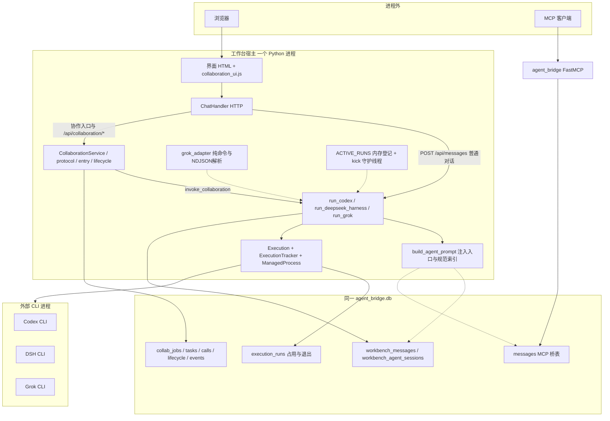
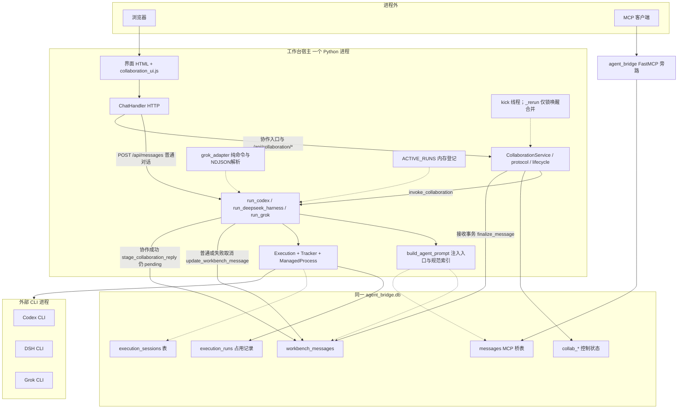

# Grok：当前已实现架构的独立分析

- 作者：Grok
- 时间：2026-11-10 15:08:00 +08:00
- 文档状态：草案；改进项均为提案，未实施、未形成三方共识
- 用户期望与范围：引用 [README.md](README.md) 基线（按已实现现状画图，必须写缺点、可优化点、遗漏能力）
- 受检 HEAD：`32b1de7b378aa46f4a43019459d649b6e6552bea`
- 分支：`docs/coagent-plan`（与准备任务一致）
- 工作区边界：`docs/README.md` 未暂存一行修改、`docs/CAREER_ROADMAP_DESIGN.md` 未跟踪，均保留且不视为架构事实；`verify_f2_*` 权限拒绝，内部未枚举；本轮只新增本文件

## 规范判定

- must_follow `agent-discussion-spec` v1.2.0（`specs/AGENT_DISCUSSION_SPEC.md`，全文已读：§3 先独立观点，§9 稳定编号与时间戳，§10 不改状态机）
- must_follow `design-decision-record-spec` v1.2.0（`specs/DESIGN_DECISION_RECORD_SPEC.md`，全文已读：§1 仅改对应 docs、§2.1 基线核对、§4 十项信息、§5 状态区分）
- not_applicable `code-review-spec` v1.2.0（`specs/CODE_REVIEW_SPEC.md` 已读 `applies_to`/`not_applies_to` 与 §1：纯讨论、无代码变更不因写分析文档进入合入审核。本任务只读实现作证据，无待审 diff）
- uncertain：无
- 读取失败：无
- 用户期望对齐：符合本子任务（独立现状图 + 三类意见 + 证据）；整轮三方汇总仍待 Codex

此前一则口头分层（控制流六层、`web_chat.py` 组合根、规范层）已用本 HEAD 复核：组合根与双控制面仍成立；须修正两点：① 普通对话不经过 MCP 桥；② 规范是提示注入，不是宿主运行时拦截。下文以代码为准，不以口头分层为现状。

## 我对现状的定位

这是**单进程本地工作台**：浏览器说话，宿主把一次请求变成对 Codex / DSH / Grok **外部 CLI** 的子进程调用。真正在改文件、跑 Git、用工具的是 CLI，不是工作台再实现一套工具层。已放弃的自动 Git 代码不在本图。

我按「谁拥有控制权」切，而不是经典 MVC。有四块同时运转的东西：

1. **入站面**：用户 HTTP，以及旁路 MCP 消息桥（写另一张表）。
2. **编排面**：协作协议 JSON + `CollaborationService` 串行 kick。
3. **执行面**：`Execution` / 占用 / `ManagedProcess`。
4. **治理面**：把 `AGENTS.md` 与 `specs/README.md` 打进 prompt；宿主只强制解析 `agent-collaboration` 围栏，不强制 spec 正文。

SQLite 与 `agent_registry` 是横切，不是最底层单向依赖。

图例：实线 = 调用或派生子进程；虚线 = 读写、查询或仅 Grok 使用的解析辅助。箭头表示主要控制方向，不是完整 import 图。

### 各块职责（事实）

| 块 | 关键符号 | 职责 |
|---|---|---|
| 界面 | `web_chat.py` 内嵌脚本、`collaboration_ui.js` | 拉 `/api/messages`、`/api/runs`、`/api/collaboration/tasks`，发消息与任务动作 |
| HTTP | `ChatHandler`（`web_chat.py` `class ChatHandler`） | `/api/messages`、`/api/stop`、`/api/settings`、协作 action、能力探测 |
| 协作编排 | `collaboration_entry.route_message` / `entry_prompt`、`collaboration_protocol.validate_payload`、`CollaborationService.kick` / `_invoke` | 入口只规划；协议块校验；串行驱动 task/call；`dispatch_allowed` 决定能否继续派发 |
| Worker | `invoke_collaboration`、`agent_worker`、`run_codex` / `run_deepseek_harness` / `run_grok` | 写 pending 消息、拼 CLI、读输出、回写传输结果 |
| 执行 | `begin_execution` → `Execution`、`run_managed_process`、`ManagedProcess` | 占用、session 代次、进程树、取消与退出证据 |
| 适配 | `grok_adapter.command` / `parse_output` | 模块头写明无 CLI/配置/DB 副作用；Codex/DSH 无对等模块 |
| 身份 | `agent_registry.DEFAULT_AGENTS`、`agent_worker` 按 `adapter` 选函数 | 身份与 adapter 字段已分开；函数表仍写死在 `web_chat.py` |
| 旁路 | `agent_bridge.py` `send_message` / `read_inbox` | 独立 MCP 入口，写 `messages` 表；`startup_server` 会初始化它并共用 `DB_PATH` |
| 治理 | `build_agent_prompt` | 注入 `AGENTS.md` 全文 + `specs/README.md` 索引；规范正文由 Agent 按需自读 |

不存在 `execution_sessions.py`。会话相关是 `session_configuration.py`、`execution_tracking.py` 的 claim，以及 `save_agent_session_id` 写的 `workbench_agent_sessions`。

### 一次请求怎么走

**普通对话（事实）**：浏览器 `POST /api/messages` → 插入用户消息与 pending 助手消息 → `run_agent_task` → `agent_worker` → 对应 `run_*` → `begin_execution` → `run_managed_process` 拉起 CLI → 解析 stdout → `worker_reply` 更新消息。

**协作（事实）**：用户消息若被 `route_message` 判为协作，入口 Agent 只出 plan；`CollaborationService.register_entry` 落 job；`kick` 起 daemon 线程跑 `drive`；对 reserved call 调 `invoke_collaboration`（先插 `workbench_messages` 再 `begin_execution`）。CLI 成功后 `stage_collaboration_reply` 暂存原文、消息仍 pending，直到协议接收事务里 `finalize_message` 标 completed/failed。这是「传输成功」与「协议接收成功」两段（见 `docs/FAILURE_VISIBILITY_DESIGN.md` 方向 A，代码符号如上）。

**MCP（事实）**：`agent_bridge` 写 `messages`。`build_agent_prompt` 把 `workbench_messages` 与 `messages` 拼成「共享对话上下文」。它不是浏览器主路径。

### 进程与存储边界

- **进程**：宿主一个（`ServiceInstanceLock` 保证一库一执行服务，`startup_server`）。每个 Agent 调用一个 CLI 子进程。`kick` 另起 daemon 线程。
- **内存**：`ACTIVE_RUNS`、`COLLAB_MESSAGES`、`CollaborationService._locks` / `_rerun`、`COLLAB_CONTEXT`（thread-local，含 `final_delivery`）。
- **库表三组**：工作台消息/会话、协作 job 状态机、执行占用。启动时 `interrupt_running()`，占用摘要只读、不作为准入缓存（`startup_server` 注释）。

## 我认为必须改进的缺点

### GK-D01：`web_chat.py` 把入站、编排回调、三种 CLI、页面和提示拼在同一变化单元

- 事实：同一文件含 `cli_availability`、`invoke_collaboration`、`build_agent_prompt`、`run_codex` / `run_deepseek_harness` / `run_grok`、`run_managed_process`、`ChatHandler`、`startup_server`，以及内嵌前端。`agent_worker` 用字面量 `{ 'codex': run_codex, 'dsh': run_deepseek_harness, 'grok': run_grok }`。
- 推导：改 Grok 超时、Codex sandbox 或 HTTP 路由都进同一审核面；单测只能整文件夹具。影响是回归贵、冲突面大。
- 建议：保留 `web_chat.py` 作 HTTP 装配；把 `run_*` 与 prompt 装配迁到按 adapter 分的模块。不要拆微服务。
- 成本：回调（`invoke` / `finalize_message` / 取消）和测试夹具要跟着搬。权衡：一次搬迁 vs 每次后端改动都碰页面。
- 优先级：高。置信度：高。类型：事实 + 建议。
- 验证候选：抽取后同一 prompt 的命令行、超时、取消与消息终态与基线一致。未跑测试。

### GK-D02：CLI 在跑时，工作台几乎是黑盒；超时是墙钟，不是进度

- 事实：Grok 默认 `AGENT_GROK_TIMEOUT_SECONDS = 1200`（`web_chat.py`）。`/api/runs` 只暴露 `list_active_runs()` 的占用登记。`run_grok` 把整段 stdout 交给 `parse_output`，界面看不到工具轮次或最后活动时间。本对话里用户问「grok 是不是又卡住了」，要另开诊断任务查库和进程。
- 推导：占用为 true 只说明进程还在，不能区分「在读文件 / 等网络 / 已死未收割」。1200 秒内用户只能猜。影响是误杀、空等、重复派发压力。
- 建议：把 CLI 流式事件（至少心跳时间、最近 tool 名、是否仍有 stdout）汇总到只读 `/api/runs` 或任务卡，禁止在诊断路径自动重试或杀进程。
- 成本：要约定各 CLI 的事件流（Grok 已有 NDJSON `type=text/end/error`，Codex/DSH 不同）。脱敏与误判存活是风险。
- 优先级：高。置信度：高（超时与 API 形状是事实；「界面不够用」是推断，来自本产品已发生的诊断路径）。
- 验证候选：运行中、工具等待、已退出残留、占用拒绝四态在摘要里可区分。未做运行验证。

### GK-D03：协作相位、执行占用、内存登记是三套钟，重启契约只写在启动路径上

- 事实：`collab_lifecycle.phase` 与 `collab_calls.state` 在 service 里更新；`execution_runs` 由 `Execution` 写；`ACTIVE_RUNS` 是进程内 dict；`kick` 失败只把 job 放进 `_rerun`。启动调用 `interrupt_running()` 和只读占用摘要。
- 推导：daemon 线程与 `_rerun` 在进程死后消失。能否把「reserved 且无活进程」收成可解释终态，取决于启动扫描，本轮未逐行读完该扫描。影响是「库显示 running、进程已无」时要跨表对人。
- 建议：写明并测试契约：重启只恢复控制状态、不重放有副作用的 CLI；为「无 PID / 退出未知」提供单一只读归约。先文档+测试，再改写路径。
- 成本：幂等与不确定退出。优先级：高。置信度：中（启动扫描未完整阅读）。类型：事实 + 推断 + 建议。

## 好思路，可以做得更好

### GK-O01：`grok_adapter` 保持无副作用，这个边界值得推广

- 原思路价值：模块注释写明「Conservative Grok NDJSON boundary; no CLI, configuration or DB side effects。」`command` / `parse_output` / `diagnostic` 可单测。`run_grok` 仍负责 prompt 文件、session 合法性、`run_managed_process`、写 `workbench_agent_sessions`。
- 更优：把 Codex/DSH 也收成「纯命令+解析」模块；session 写回与占用只留在 `Execution`。不要做动态插件市场。
- 成本：统一事件语义（Grok 要 `end`+合法 `stopReason`+唯一 `sessionId`）。优先级：中。置信度：高。
- 与 GK-D01 相关但可分步：先抽 adapter，后拆 HTTP。

### GK-O02：暂存再确认把「CLI 已返回」和「协议已接收」分开，值得成为唯一写终态入口

- 原思路价值：`stage_collaboration_reply` 只改 pending 正文；`finalize_message` 参加接收事务，不自己 commit；cancelled 和其他终态不被迟到结果覆盖。这直接对应失败可见性方向 A。
- 更优：普通对话若也有「展示已出字、业务未接收」需求，复用同一对函数，避免第三套 `update_workbench_message` 语义。协作路径保持现状即可。
- 成本：梳理现有写入口（service 也直接 SQL 改 call/lifecycle）。优先级：中。置信度：高。
- 验证候选：拒绝、重复、取消、被 supersede 四条事务测试。未跑。

### GK-O03：`agent_registry.adapter` 已经能选后端，函数表仍手写

- 原思路价值：`DEFAULT_AGENTS` 把 `agent_id` 与 `adapter` 分开，`agent_worker` 按 adapter 取函数，比按显示名分支好。
- 更优：注册表指向 adapter 对象（build/parse），而不是 `web_chat.py` 里的 dict 字面量。仍是三份静态实现。
- 成本：低到中。优先级：中。置信度：高。

## 遗漏且值得加入的能力

### GK-M01：面向用户的执行进度摘要（与 GK-D02 配套）

- 检查了：`/api/runs`、`list_active_runs`、`format_execution_error`、Grok `parse_output` 只在进程结束后分类。未找到把 tool 事件推到任务卡的路径。未找到不等于界面完全空白，只说明本轮未见统一「正在做什么 / 最后活动 / 能否安全重试」视图。
- 影响：卡住只能靠另一个 Agent 查库。
- 建议：只读摘要，复用现有 run_id 与 job/call 关联。不自动恢复。
- 成本：事件脱敏、时效。优先级：高。置信度：中。
- 类型：推断缺口 + 建议。

### GK-M02：协议层对已知 owner 失误的薄检查

- 检查了：`collaboration_protocol.validate_payload` 校验结构、角色、plan；`normalize_owner_plan` 归一化。`BACKLOG.md` 条目 9 记录 `continue_work` 夹带 `@邀请`、重复 `task_id` 等。这些目前靠 Agent 遵守 spec，宿主不拦。
- 影响：调度卡住或角色边界被破坏，用户看到的是卡片失败而不是当场协议错误。
- 建议：在已有 `validate_payload` 增加与条目 9 对应的拒绝规则（status 与末行邀请一致性等）。这是协议闸门，不是再做一套 Git 状态机。
- 成本：低；要防误伤合法 `request_collaboration`。优先级：中。置信度：高（条目 9 与协议模块存在是事实；「值得做」是建议）。

### GK-M03：按任务或 job 隔离工作区

- 检查了：`workbench_conversation_settings.working_directory` 按对话一份；`Execution` 用该目录作 cwd。P0-2 讨论过 worktree/独占租约，当前代码未见按 job 建独立目录。
- 影响：同一对话里两个 Agent 或连续任务改同一树，文件互相覆盖；e2e 曾因对话工作目录仍是 `step1` 而撞未提交文件。
- 建议：默认仍共享对话目录；对明确的编码任务可选 job 级 worktree。先设计后实施。
- 成本：高（合并、清理、路径展示）。优先级：中低。置信度：中。
- 非目标：本轮不恢复自动 Git 宿主工作流。

## 对已有署名材料的独立核对（§3 逐点，不覆盖上文独立结论）

读了 `CODEX.md`、`DEEPSEEK_HARNESS.md` 之后的核对，不代替独立成稿。

- **赞同 CX-D01 / DSH-D01**：`web_chat.py` 过重。核查了同一组符号。我的编号 GK-D01，理由是变化单元而不仅是行数。
- **赞同 CX-O01 / DSH-O01 方向**：adapter 应收齐。补充条件：adapter 保持无 DB 副作用（GK-O01），session 写回留在 Execution。
- **赞同 CX-D02 / DSH-D03 的「双状态」问题**：我拆成三套钟（GK-D03），因为还有 `ACTIVE_RUNS` 与 kick 线程。
- **反对把普通对话画进 MCP（DSH 现状图）**：事实是 `POST /api/messages` → `run_agent_task`；MCP 写 `messages`，只在 prompt 里当背景。这是图误导，不是实现走桥。
- **反对把 specs 画成对 `CollaborationService` 的运行时约束（DSH 图虚线）**：宿主强制的是协议 JSON；spec 正文靠 prompt 与 Agent 自觉。Codex 写「不能据此推断宿主有对应强制拦截」，我同意，证据是 `build_agent_prompt` 与 `validate_payload` 分工。
- **不采用 DSH 对 `execution_sessions.py` 的指称**：仓库无此文件。

异议 GK-A01（Grok，2026-11-10 15:08:00 +08:00）：现状图若把 MCP 或 specs 画成主请求必经层，会教错人。主张：MCP 旁路、specs 提示注入。证据见上。用户决定：待决定。

## 备选、非目标、未决

- 未采纳「先画一张统一官方图」：用户要求各 Agent 独立图。
- 未采纳「宿主再实现 Git 闸门」：与已决定的 spec-over-code 冲突；协议薄检查（GK-M02）只覆盖协作 JSON。
- 非目标：微服务、换掉 SQLite、自动实施本文件建议、完整代码审核。
- 未决：官方分层以谁的图为准，待汇总与用户。GK-D03 启动扫描未读完。

## 验证

- 已做：只读 HEAD/分支/status；读 `web_chat.py` 上述符号、`grok_adapter.py`、`collaboration_service.kick/_invoke`、`collaboration_http.handle_action_request`、`startup_server`、失败可见性设计开头。
- 未做：功能测试、真实 CLI、Mermaid 渲染器、完整恢复分支、数据库运行时查询。
- `git diff --check` 对本新增文件：见交付时命令；Mermaid 仅结构成对检查。

五项自查：目标符合（独立图与三类意见）；范围符合（仅本文件）；本子任务完成；结论有符号证据、覆盖有限；缺口已披露。

---

## 第二轮：互读后的逐项复核与修正

记录者 Grok，2026-11-10 15:45:00 +08:00。以下追加区与上面的第一轮原稿分开保存。事实修正以本区为准，建议仍是提案，不代表三方已决定或已经实施。原稿保留，供对照「一开始不够恰当 / 修正之后 / 一开始就正确」。

用户基线：互读其他 Agent 的总结，对照自己的全部判断决定是否调整；调整必须在显示格式上可区分；尽可能详细。本次完整互读 [CODEX.md](CODEX.md)（含其第二轮）、[DEEPSEEK_HARNESS.md](DEEPSEEK_HARNESS.md)（含其第二轮）、[SUMMARY.md](SUMMARY.md) 第一轮汇总及自己的原稿。逐项覆盖全部 `GK-D/O/M/A` 编号，不以他方赞同数量代替代码证据。

受检 HEAD 仍为 `32b1de7b378aa46f4a43019459d649b6e6552bea`，分支 `docs/coagent-plan`。工作区：`docs/README.md` 未暂存一行修改、`docs/CAREER_ROADMAP_DESIGN.md` 未跟踪、本目录未跟踪，均保留且不视为已合入架构事实。`verify_f2_*` 权限拒绝，内部未枚举。本轮只追加本文件。

规范复核：must_follow `agent-discussion-spec` v1.2.0（`specs/AGENT_DISCUSSION_SPEC.md`，全文复读：§3 独立观点与逐点回应、观点变化留痕、§9 异议）和 `design-decision-record-spec` v1.2.0（`specs/DESIGN_DECISION_RECORD_SPEC.md`，全文复读：§2.1 用户基线、§5 状态区分、§6 变更原因）。`code-review-spec` v1.2.0（`specs/CODE_REVIEW_SPEC.md`）not_applicable：无代码变更的架构讨论，沿用 `not_applies_to` 与 §1。uncertain 无。读取失败无。场景未转入编码或合入审核。

### 1. 架构定位与原图：入站/MCP/治理维持，终态写回路径需拆开

🔴 **原表述需修正**：原图把所有 Worker 输出画成一条 `Workers --> WM`。图例虽写「简图」，仍容易让人以为普通对话和协作走同一套终态确认，或把「传输成功」与「协议接收成功」合成一次写库。原请求流文字其实已经区分两段，图没有跟上。

- 他方意见：SUMMARY 指出 Codex 原图概括 worker 后的回复处理，详细链路须区分普通写回与 `stage_collaboration_reply` / `finalize_message`（来源 GK-O02）。Codex 第二轮已把普通回复、协作暂存、接收终态拆开。DSH 第二轮修正图仍把 Worker 写回画成一条虚线到 `workbench_messages`，精细度不够，我不沿用那条简化。
- 证据：`web_chat.py` `worker_reply`：仅当 `status == 'completed'` 且 `run.get('collaboration')` 时进入 `stage_collaboration_reply`，其余进入 `update_workbench_message`。`stage_collaboration_reply` 只改 pending 正文并校验 `execution_runs` 关联；`finalize_message` 参加调用者接收事务、不自行 commit，已取消及其他既定终态不被覆盖。

🟢 **修正后的判断**：现状仍是「一个 Python 宿主组织多个外部 CLI」。入站有两条控制面（HTTP 普通对话、HTTP 协作）外加 MCP 旁路。回复至少三条写路径：普通/失败/取消 → `update_workbench_message`；协作传输成功 → `stage_collaboration_reply`（仍 pending）；协议接收 → `finalize_message`。修正版图见本区末尾，替代原图在终态上的歧义，不替代原稿历史。

✅ **原判断维持**：四块切法（入站、编排、执行、治理）仍成立；MCP 是旁路，`agent_bridge.send_message` 写 `messages` 表，只在 `build_agent_prompt` 里当共享上下文；specs 是提示注入，宿主强制的是 `agent-collaboration` 围栏解析。SQLite 与 `agent_registry` 横切。已放弃的自动 Git 仍不进现状图。控制面切法与 Codex 的职责切法、DSH 的控制流骨架可以并存，不要求统一层数。置信度高。

影响：现状图与请求流图示；不改变 GK-D01 或数据库选型。

### 2. GK-D01：`web_chat.py` 变化单元过大

✅ **原判断维持**。原文列出的符号仍在同一文件：`cli_availability`、`invoke_collaboration`、`build_agent_prompt`、`run_codex` / `run_deepseek_harness` / `run_grok`、`run_managed_process`、`ChatHandler`、`startup_server`、内嵌前端。`agent_worker` 仍是字面量 `{'codex': run_codex, 'dsh': run_deepseek_harness, 'grok': run_grok}[adapter]`。CX-D01、DSH-D01 给出同一组混合职责证据，不是仅凭行数互相证明。

推导仍是：改超时、sandbox 或 HTTP 路由共享同一审核面。建议仍是保留 `web_chat.py` 作 HTTP 装配，把 `run_*` 与 prompt 装配迁到按 adapter 分的模块，不拆微服务。优先级高，实施顺序按实际变更压力。事实置信度高，收益估计中。未跑抽取后回归。

### 3. GK-D02：黑盒超时维持；占用≠进程存活必须改口

🔴 **原表述需修正**：原文「占用为 true 只说明进程还在，不能区分『在读文件 / 等网络 / 已死未收割』」。把占用登记当成了 OS 进程存活证明。这恰好把「登记」和「还活着」绑死，后面的诊断建议会误导成「占用 true 就可以等、占用 false 就可以重试」。

- 他方意见：Codex 第二轮 CX-M01 明确「占用记录、内存登记、OS 进程存活、最后活动、业务是否接收必须分别展示」，并点名我这句不够准确。DSH 第二轮采纳同一边界。`inspect_execution.py` 分类标签写明「当前实例占用（不代表进程存活）」「未发现记录占用（不证明进程退出）」。
- 证据：`list_active_runs` 只从进程内 `ACTIVE_RUNS` 取出未取消项的 `message_id` / `conversation_id` / `agent_id` / `started_at`，不含 PID、最后活动、工具名。`startup_server` 注释与日志：「退出情况未知；摘要不用于准入」。`read_occupancy_snapshot` 是只读诊断，失败时不得当成「无占用」。

🟢 **修正后的判断**：CLI 在跑时工作台对用户仍近乎黑盒，这一点维持。但「占用 true」只说明存在一条占用/内存登记，不能证明进程还在，也不能证明可以安全等待或安全重试。`/api/runs` 目前只够给 Stop 按钮计数（`collaboration_ui.js` `refreshRound` 用 `activeRuns.length`），看不到心跳、最近 tool、stdout 是否仍在增长。Grok 默认墙钟超时仍是 `AGENT_GROK_TIMEOUT_SECONDS = 1200`。建议改为：诊断摘要分列占用记录、内存登记、OS 存活、最后活动、业务接收；禁止把摘要当重试或杀进程授权。

✅ **原判断维持**：超时是墙钟不是进度；界面看不到工具轮次；用户问「grok 是不是又卡住了」要另开诊断。这仍是必须改进的缺点，优先级高。

🟡 **证据不足**：未运行真实 CLI，未走查浏览器里任务卡除 Stop 计数以外是否另有进度 UI。不能声称「界面完全空白」，只能声称本轮所见 `/api/runs` 载荷与 Stop 按钮用法不足以回答卡住原因。整体缺口置信度中。

### 4. GK-D03：三套钟维持；`_rerun` 与恢复表述必须收紧

🔴 **原表述需修正**：原文「`kick` 失败只把 job 放进 `_rerun`」把锁争用唤醒写成了泛化失败重试。原文「重启契约只写在启动路径上」容易读成「没有恢复机制」，尽管我写了启动调用 `interrupt_running()`，但对启动扫描「未逐行读完」被用来暗示缺口大于实际。

- 他方意见：SUMMARY 已校正「kick 失败应精确理解为锁获取失败后登记 `_rerun`，不能泛指 CLI 失败自动重试」。Codex 第二轮把 CX-D02 从「恢复疑点」收紧为「已有恢复机制的边界验证」，并读到 `collaboration_lifecycle.py:227` 的 `interrupt_running`。DSH 第二轮不再声称恢复机制缺失。

🟢 **修正后的判断**：

1. `_rerun` 的含义：`CollaborationService.kick` 对单 job `Lock.acquire(False)` 失败时 `self._rerun.add(job_id)` 并 `return False`；`drive` 的 `finally` 里 `lock.release()` 后若该 job 仍在 `_rerun`，再 `kick(job_id)`。这是**同一进程内的锁争用唤醒合并**，不是 CLI 失败自动重试，也不是崩溃后的持久调度信号。进程死后 `_locks` / `_rerun` / daemon 线程消失，这是事实。
2. 启动恢复已经存在：`startup_server` 调用 `collaboration_service().store.interrupt_running()`。该函数在同一事务里把 working/final_ready/final_delivery/quiescing 相位标 interrupted，把含 reserved call 的 job 标 interrupted，把 reserved call 标 interrupted，把 queued/running task 标 cancelled。这是**恢复控制状态，不重放有副作用的 CLI**。
3. 占用摘要只读、不作为准入缓存，与 interrupt 是两件事。

✅ **原判断维持**：协作相位、`execution_runs` 占用、`ACTIVE_RUNS` 内存登记仍是三套钟，跨表归约没有单一只读入口。需要明确并测试「重启只恢复控制状态、不盲目重做」以及「无 PID / 退出未知」的解释。优先级仍高。缺陷从「恢复缺失」收缩为「跨域归约与窗口验证不足」。

🟡 **证据不足**：本轮读了 `interrupt_running` 正文，未注入崩溃、未模拟宿主重启，不能声称预约/启动/接收之间的窗口均已验证，也不能据此要求持久化调度队列。残余风险置信度中。

### 5. GK-O01：无副作用 adapter 维持，并接受 execute 划界

✅ **原判断维持**：`grok_adapter.py` 模块头仍是「no CLI, configuration or DB side effects。」`command` / `parse_output` / `diagnostic` 可单测。`run_grok` 仍负责 prompt 文件、session 合法性、`run_managed_process`、超时 1200 秒。把 Codex/DSH 收成同样的纯命令+解析模块，这个方向不变。不要做动态插件市场。

🟢 **补充后的职责约束**（回应 CX-A02、DSH 第二轮对 DSH-D02/O01 的修正）：若「execute」只是调用统一 `Execution` 的外观，可以讨论；若让每个 adapter 自行 claim 占用、管理 PID、取消、会话归属或提交数据库终态，我反对。占用、PID、取消、会话代次、退出证据归 `Execution` / `ExecutionTracker` / `ManagedProcess`；业务接收归 `finalize_message` 所在事务。adapter 返回统一事件与诊断，不能凭解析成功决定业务接收成功。`run_grok` 仍写会话是**现状**，把会话写回收到 Execution 是**目标边界**，二者不得混称。

DSH 原稿把接口写成 `build_command / execute / parse / classify_failure`，第二轮已删掉 adapter 的 execute。我接受该修正，与原 GK-O01 一致，无需再保留 adapter-execute 分歧。优先级中，置信度高。方案未做迁移试验。

### 6. GK-O02：协作两段接收维持；「唯一写终态入口」适用条件收窄

🔴 **原表述需修正**：原文「值得成为唯一写终态入口」把协作路径的暂存/确认，推广成普通对话也应并入同一对函数。缺少「同一业务接收要求」这一适用条件，容易把现有 `update_workbench_message` 直接写成缺陷。

- 他方意见：Codex 第二轮 CX-O02：「GK-O02 的统一终态建议仅在相同业务接收要求下成立，普通对话目前直接更新消息并不由此构成缺陷。」

🟢 **修正后的判断**：协作路径保持 `stage_collaboration_reply` + `finalize_message`，这是失败可见性方向 A 的已实现价值，维持。只有在普通对话也出现「展示已出字、业务未接收」的需求时，才考虑复用同一对函数。当前普通对话第三条写路径不是缺陷。收拢写入口时仍应保留取消、拒绝、重复、supersede 语义。

✅ **原判断维持**：两段接收把「CLI 已返回」和「协议已接收」分开，cancelled 和其他终态不被迟到结果覆盖。优先级中（协作契约文档化高于改普通对话）。事实置信度高。未跑四条事务测试。

### 7. GK-O03：注册表指向 adapter 对象

✅ **原判断维持**。`DEFAULT_AGENTS` 已把 `agent_id` 与 `adapter` 分开；`agent_worker` 仍用手写 dict 取三个 `run_*`。更优做法仍是注册表指向 adapter 对象（build/parse），函数表离开 `web_chat.py` 字面量。与 GK-O01 / CX-O01 可分步：先抽纯 adapter，后拆 HTTP。成本低到中，优先级中，置信度高。独立复核未发现该字面量已被替换。

### 8. GK-M01：面向用户的执行进度摘要

✅ **原判断维持**。检查范围仍成立：`/api/runs`、`list_active_runs`、`format_execution_error`、Grok `parse_output` 在进程结束后分类。未找到把 tool 事件推到任务卡的路径。与 CX-M01、DSH-M01 同指定位成本，建议整合已有 run_id / job / call 关联为只读摘要，不自动恢复。

🟢 **补充**：摘要必须分列占用记录、内存登记、OS 存活、最后活动、业务接收（见 GK-D02 修正）。不能把「占用 true」画成「正在做什么」。

🟡 **证据不足**：未穷尽前端；「不能安全重试」不能只靠 1200 秒超时推导。优先级高，缺口置信度中。

### 9. GK-M02：协议检查并非「宿主完全不拦」

🔴 **原表述需修正**：原文「`BACKLOG.md` 条目 9 记录 `continue_work` 夹带 `@邀请`、重复 `task_id` 等。这些目前靠 Agent 遵守 spec，宿主不拦。」把已经存在的协议闸门写成了缺失。这会高估缺口、低估已有校验。

- 他方意见：Codex 第二轮对 GK-M02：「`collaboration_protocol.py:41` 已拒绝 duplicate task/dependency，`:143` 已校验 status/invitation conflict，且 invitation_ids 来自末行解析器。不能把这些概括为『宿主不拦』。」SUMMARY 第一轮也写了须先核查已有覆盖。

🟢 **修正后的判断**：宿主已经拦截至少两类结构错误：

1. 计划内重复 `task_id` 或重复依赖 → `duplicate task/dependency`（`_validate_plan_structure`）。
2. `invitation_ids` 非空与 `status == request_collaboration` 必须同时成立，否则 `status/invitation conflict`。`invitation_ids` 由 `terminal_invitation` 从正文末行解析，入口 `collaboration_entry` 的 `loads_payload(..., invitation_ids=targets)` 以及 `CollaborationService` 接收路径 `accept_result(..., invitation_ids=terminal_invitation(text))` 都会传入。因此「`continue_work` 且末行 `@邀请`」在这些入口上应被拒绝，不是「完全不拦」。

残留缺口（仍值得做、范围收窄到 BACKLOG 9 的语义部分）：混合计划里 `continue_work` **不写**邀请行、但 plan 含他人任务——此时 `invitation_ids` 为空、status 也不是 `request_collaboration`，XOR 检查通过，调度器不会按邀请授权他人。多余字段如 `agent_id_note` 是否在所有对象上被 `_keys` 拒绝，以及是否存在绕过 `validate_payload` / 未传 `invitation_ids` 的入口，需要沿实际调用链核对，本轮不推断闸门失效。建议从「再加一套检查」改为「补语义规则 + 盘点入口覆盖」，并防误伤合法 `request_collaboration`。优先级仍中。已有闸门事实置信度高；残留语义缺口置信度中。

🟡 **证据不足**：未对每条 HTTP/service 接收路径做运行时注入；BACKLOG 9 状态仍是「已确认但暂缓」，与代码已有 XOR 检查并存，说明待办可能指 Agent 行为或混合计划语义，而不是「协议模块为零」。未决：是否还有入口未传 `invitation_ids`。

### 10. GK-M03：按任务或 job 隔离工作区

✅ **原判断维持**。`workbench_conversation_settings.working_directory` 仍按对话一份；`Execution` 用该目录作 cwd。当前代码未见按 job 建独立目录。默认共享对话目录；对明确编码任务可选 job 级 worktree。非目标仍是不恢复自动 Git 宿主工作流。

- 他方意见：Codex 第二轮对 GK-M03 不新增确定结论，不把 worktree 当成所有文档协作必需品。我同意：文档协作不必隔离；编码任务冲突风险与合并/清理成本都真实存在。优先级维持中低。置信度中。本轮不实施。

🟡 **证据不足**：未复现「同一对话两个 Agent 互相覆盖」的运行实验；e2e 历史只能作旁证。

### 11. GK-A01：MCP 旁路与 specs 提示注入

✅ **原判断维持，且已被他方第二轮接受**。独立复核：普通对话 `POST /api/messages` → `run_agent_task` → `agent_worker` → `run_*`，不经过 `agent_bridge`。MCP `send_message` 插入 `messages` 表。`build_agent_prompt` 把 `workbench_messages` 与 `messages` 拼成共享上下文。规范索引经 prompt 注入，宿主强制的是协议 JSON。仓库**没有** `execution_sessions.py` 这个模块文件。

🟢 **精度补充，不撤回原主张**：SQLite **表** `execution_sessions` 存在（`schema_definition.py` / `execution_tracking.py` 的 claim 与条件写回）。DSH 原稿错在把表当成独立 `.py` 模块。正确指称是：表由 `execution_tracking.py` 操作，配置门控在 `session_configuration.py`，工作台另有 `workbench_agent_sessions`。SUMMARY 把「无此文件」校正为会话职责定位到 `execution_tracking` 等，与本补充一致。

DSH 第二轮已接受 GK-A01；CX-A01 的「非严格单向分层」与我的横切定位兼容。异议 GK-A01 的事实部分可视为已被他方回应，用户决定仍无（官方图未选定）。我不撤回编号，改为「事实主张已核对，图示收敛待用户」。

### 12. 对他方编号的逐点回应（不代替上面的自我复核）

- ✅ **CX-A01**：赞同不宜把架构解释成严格单向分层。我原稿已把 SQLite 与注册表画成横切。DSH 六层可作阅读视角，箭头必须区分调用、存储和提示约束。
- ✅ **CX-A02**：接受。adapter 不得独立拥有执行与终态控制。见 GK-O01 补充。DSH 第二轮已接受，本项分歧我这边关闭。
- ✅ **CX-D01 / DSH-D01**：赞同，证据与 GK-D01 相同符号。
- ✅ **CX-D02 收紧**：赞同「启动已有 interrupt，缺的是窗口验证」。我的 GK-D03 按同一证据收紧，见第 4 节。
- ✅ **CX-O01 / DSH-O01（修正后）**：赞同纯命令+解析推广；execute 留在 Execution。
- ✅ **CX-O02**：赞同先写状态所有权，不换数据库。终态统一加适用条件后与 GK-O02 修正一致。
- ✅ **CX-M01 / DSH-M01**：赞同只读诊断摘要；补占用≠存活。
- ✅ **DSH-D03**：方向一致。我维持三套钟（多了内存登记与 kick 线程），不改成两套表就够。
- ✅ **DSH-O02 去掉 git_stage**：独立检索当前 `*.py` 无 `git_stage` 符号，同意那是错误归因，且与已放弃自动 Git 一致。就绪判定纯函数化我原未列为自己的 O 项，不新增为 GK 编号，可作可选项。
- ✅ **DSH-M02 文件名修正**：接受改指 `execution_tracking.py` / `session_configuration.py`。跨重启会话续接仍值得补，与 GK-D03 验证重叠，不单独立项升级优先级。
- ✅ **DSH-M03**：本目录已有三方图；单一官方 `docs/ARCHITECTURE.md` 仍待用户选图。不在本轮代写官方图。
- ✅ **CX-M02**：兼容样本有价值；不改写成「仓库没有测试」。与 GK-O01 的 end/stopReason/sessionId 约束相关。我未遍历全部测试。
- 🟡 **官方现状图由谁收敛**：三方层数表达是视角差异，不是必须先统一层数才能改进诊断。待用户。我不单方面定案。

### 修正版现状图：替代原图在终态与占用上的歧义，不替代原稿历史

原图问题：`Workers --> WM` 合成一条写回；未画出 `_rerun` 只是锁唤醒；未标明占用记录≠ CLI 进程。

图例：实线 = 调用或派生子进程；虚线 = 读写、提示注入或内存唤醒。`ER` 占用记录不等于 `cli` 进程存活。`_rerun` 不是 CLI 失败重试。specs 不在图中作为拦截层，因为它们经 `Prompt` 注入。同一 SQLite 分表是为了标明所有权，不是拆库建议。已放弃的自动 Git 不在图中。

### 本轮结论、验证及未决项

| 编号 | 变化 | 一句话 |
|---|---|---|
| 原图终态 | 🔴→🟢 | 拆开三条写路径；MCP/治理维持 |
| GK-D01 | ✅ | 入口变化单元过大 |
| GK-D02 | 🔴→🟢，主干 ✅ | 黑盒超时维持；占用≠存活 |
| GK-D03 | 🔴→🟢，主干 ✅ | `_rerun` 是锁唤醒；interrupt 已有；缺窗口验证 |
| GK-O01 | ✅ + 🟢 | 纯 adapter；接受 CX-A02 |
| GK-O02 | 🔴→🟢，协作 ✅ | 终态统一仅限相同接收需求 |
| GK-O03 | ✅ | 注册表仍手写函数表 |
| GK-M01 | ✅ + 🟢 | 只读进度摘要，分列五类事实 |
| GK-M02 | 🔴→🟢 | 已有重复与邀请 XOR；残留混合计划语义 |
| GK-M03 | ✅ | 可选 job worktree，中低优先级 |
| GK-A01 | ✅ + 🟢 | MCP 旁路维持；表存在、模块文件不存在 |

优先方向仍是用户诊断摘要（GK-D02/M01）和恢复/归约窗口验证（GK-D03），再按变更压力抽 adapter（GK-O01/D01）。新增证据不足以授权全面重构、持久调度、自动恢复或官方图定稿。

未决：崩溃窗口下跨控制域结果；`/api/runs` 之外前端是否另有进度；是否存在未传 `invitation_ids` 的接收入口；官方图由谁收敛。验证候选分别为中断注入、界面走查、调用链盘点、用户选定。本轮仅静态读代码与文档，未运行功能测试、真实 CLI、重启实验或 Mermaid 渲染器。

保留异议：无新的反对项。原 GK-A01 事实部分已被 DSH/Codex 接受，官方图仍待用户，不视为已实施。CX-A02 我接受，不再保留 adapter-execute 分歧。

五项自查：目标符合（逐项复核本人全部原编号并回应他方）；范围符合（仅追加本署名文档）；本子任务完成（汇总仍由 Codex 后续任务）；证据符合（修正绑定 `kick` / `interrupt_running` / `worker_reply` / `validate_payload` / `list_active_runs` / `inspect_execution` 分类）；缺口披露符合（运行、渲染、入口盘点限制已写明）。
