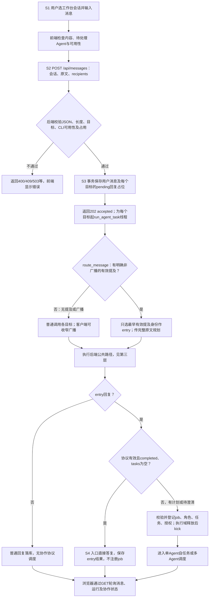
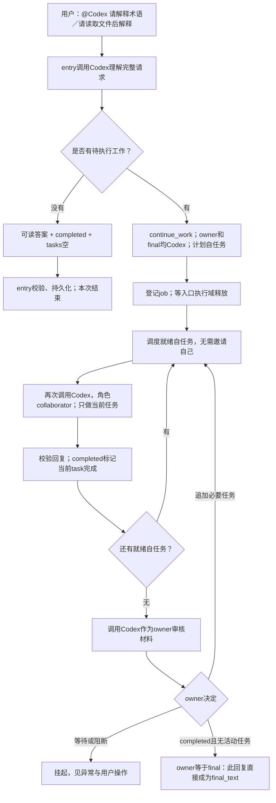
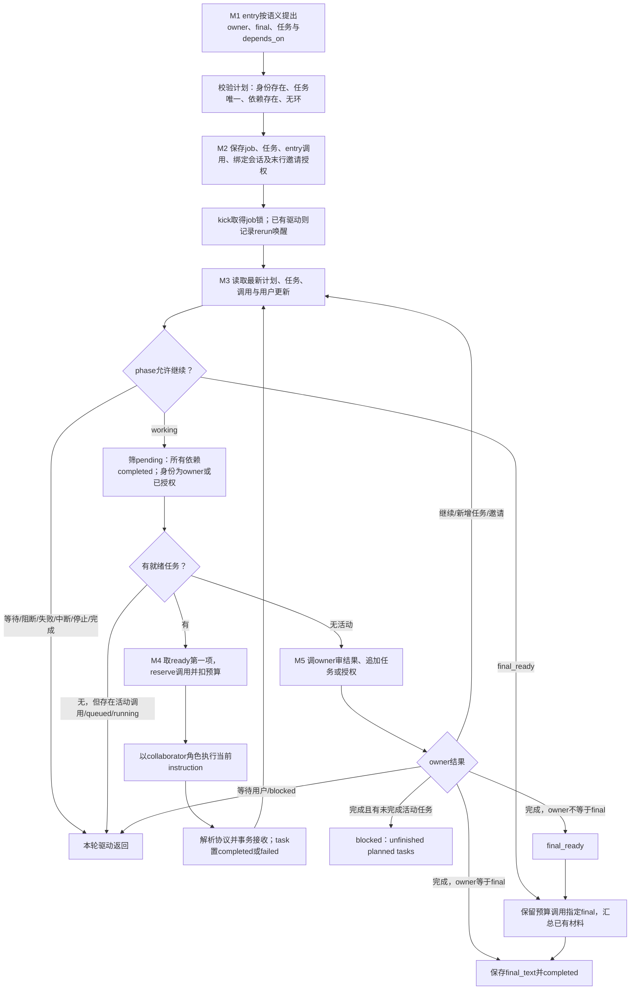
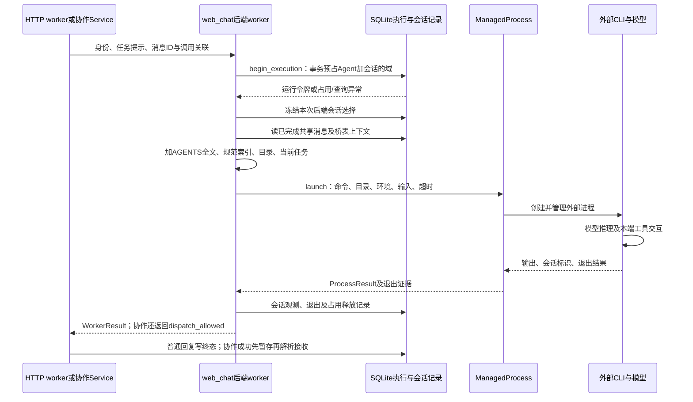
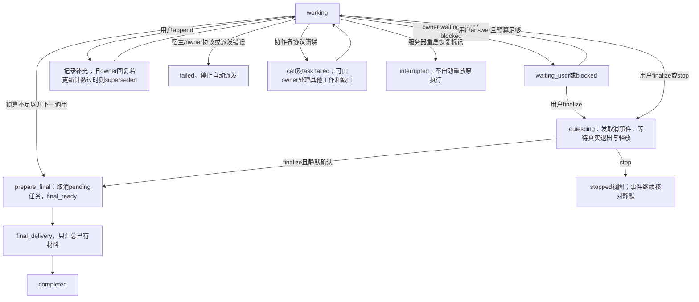

# 工作台调用流程：Codex 独立原稿

作者：Codex。日期：2026-11-11。状态：草案，待三端互审，尚非共识稿。

## 1. 阅读目标与证据边界

用户要求三端各自说明“调用单个 Agent”和“多个 Agent 协作”，画详细图、解释给新读者，再互审汇总。本稿仅完成 Codex 独立原稿，不读取另两端本轮原稿。

代码基线：HEAD `209446f0408d32fc005b7036543ab79a2c2d53f3`。以下行号来自本轮本地工作树静态阅读；未比对工作树全部源码与 HEAD 的差异，因此该提交是版本定位，不是源码无修改的保证。既有[架构记录](../../architecture/ARCHITECTURE.md)用于定位，具体流程以本轮源码为准。本轮没有运行真实模型、浏览器、故障注入或 Mermaid 渲染。

本文采用分层图：先看入口，再看单次后端执行，最后看协作调度与异常。这样可以保留细节而不把全部节点挤进一张图。以下图示是当前实现说明，不是新架构实施提案。停止条件：两类路径有可核对源码、可供下一阶段互审。

### 术语先读

| 名称 | 含义与例子 |
|---|---|
| Agent 身份 | Codex、DeepSeek Harness、Grok，决定调用哪个后端 |
| 逻辑角色 | entry 负责理解与规划；collaborator 执行某项任务；owner 审核并安排后续；final 汇总已有成果 |
| 同一个身份、多种角色 | Codex 可以先做 entry，再以 collaborator 执行自己的任务，之后以 owner 审核 |
| conversation_id | 工作台会话标识，关联消息、目录与后端会话 |
| job_id | 一次有计划协作的任务组，例如 `entry-2903`；不是后端 CLI 会话 ID |
| task_id / depends_on | 计划中的任务及前置任务；前置任务必须 completed 才能就绪 |
| call_id | 一次实际协作调用的标识；一次任务组可有多个调用 |
| run / execution domain | 实际执行记录，以及按 Agent、工作台会话划分的占用域 |
| handoff | 回复里的六项交接信息，由 JSON 协议传给宿主；不是另一个 Agent 的直接网络调用 |
| CLI | 宿主启动的外部命令行程序，它与模型交互并管理本端工具调用 |

工作台调度 Agent 的一次调用，与模型在 CLI 内部决定读文件或运行工具，是不同层次。工作台不会把每次模型工具调用都当成一个 `collab_task`。普通 HTTP 对话也不先经过 MCP；`agent_bridge` 的桥消息是共享上下文的另一来源。

## 2. 第一层：用户消息怎样进入工作台

1. S1–S2：前端提交后不等待模型完成；HTTP 202 只表示已接收。前端用后续刷新读数据库结果，不等于 CLI token 实时直通浏览器。
2. S3：数据库占位避免重复提交；还检查内存活动登记，真正启动时另做持久执行域准入。UI 可用性提示不替代后端检查。
3. 路由会屏蔽代码块、行内代码及 URL 中的提及。当前 `route_message` 选择最早有效提及作为入口，是机械路由；入口再按完整语义确定 owner 和 final_responder，两者不要混为“按提及顺序分工”。
4. 无提及或 `@all` 是普通广播，不自动产生一个协作计划。多个普通回复不等于有负责人、依赖和交接的协作。客户端 recipients 可收窄普通广播，但不能把定向入口改派给别人。
5. S4：带 `@Codex` 的简单问答仍会经过 entry；入口可以直接 completed + 空任务结束。有实质读取、执行或审核则应规划任务，再由调度器执行。

证据：`web_chat.py:953` 提交、`:2391` HTTP入口、`:2483` 校验与收件人、`:2538` 占用检查、`:2571` 落库、`:2600` 接收与起线程、`:2133` entry执行及登记；`collaboration_entry.py:12` 路由、`:32` 入口提示、`:65` 单协议块解析；`grok_adapter.py:58` 收件人约束；`web_chat.py:861` 刷新与 `:2321` GET接口。

## 3. 单 Agent：直接答复与同一身份执行计划

关键点：单 Agent 并不等于只有一次 CLI 调用。自任务采用的同一协作框架可以产生 entry → 一个或多个 collaborator → owner。owner 自己做计划工作也使用 collaborator 角色，以免把执行任务和 owner 决策混在一次角色调用里。

示例一：`@Codex 你好`，无需查证时入口直接结束。示例二：`@Codex 读取某文档并解释`，入口只规划；自任务调用实际读取，返回证据；owner 再核对并交付。此处是说明路径的例子，不是本轮另行执行。

有些普通单身份调用也可由客户端将广播目标收窄为一个身份，此时走普通 worker 而不走 entry。以上带提及的自任务路径是更容易被误解的分支。

证据：`web_chat.py:2200` 空任务直接返回、`:2227` 释放后派发；`collaboration_service.py:221` 主循环、`:245` 授权过滤与自任务、`:270` owner调用；`collaboration_lifecycle.py:50` 角色预算、`:173` 起的 owner完成判断（具体分支位于 accept_result 末段）。

## 4. 多 Agent：计划、授权、依赖、审核循环

### M1–M5 逐步解释

1. M1 中的计划是一个有向无环依赖图。比如 A=Codex查证，B=DSH查证，C=Grok互审且依赖A、B。B没有依赖不表示一定并发；只表示它具备依赖资格。
2. M2 的邀请是调度授权，不是 CLI 内启动别人。plan 内有任务还不够：非owner身份需要最近已接收的授权名单。entry 初始化该名单；owner 返回 request_collaboration 时替换授权目标。协作者不能自行发邀请或改计划。
3. M3 每次取得最新材料。调用提示包含 view（请求、计划、状态、用户更新等）、全部任务与既有调用材料；不是只把上一个 Agent 的一句话转发。
4. M4 **当前 `CollaborationService._drive` 在同一个 job 内串行**，明确选择 `ready[0]`，同步等调用结束后才继续。底层 `execute_batch(... parallel=True)` 有线程池能力，不代表当前服务主链启用了它。普通广播可起多个线程、不同job也可能同时运行；另受Agent锁和执行域保护。不要把这些层次都画成“多Agent任务自动并行”。
5. M5 只有无就绪任务且无活动工作时才调用 owner；不是每完成一个任务必然先回 owner。owner 可追加任务，旧定义和两个角色不可修改；省略旧任务表示保留，绝非删除。若一个 owner 决策后仍无可运行工作，驱动进入 blocked，避免空循环。
6. owner completed 时宿主检查 pending/queued/running 和reserved调用；失败task不属于这个活动集合。因此“代码允许收尾”与“原目标完成”不同，owner必须据证据披露失败与缺口，不能把结构校验当质量审核。
7. owner与final相同且正常完成时可以直接完成，不保证另起一轮final调用。身份不同时先 final_ready，再 final_delivery；预算或用户提前收尾也可进入专门final阶段。

新手例子：用户让Codex组织两端分别评估，再汇总。entry给两端各一个任务与邀请；服务先执行其中一项再执行另一项；依赖两者的汇总任务随后就绪。汇总任务完成后 owner审核，若有遗漏可追加有界检视任务并重新授权；否则按上述final分支交付。多个参与者共同工作不需要让模型互相启动进程。

证据：`collaboration_protocol.py:23` 结构与 `:46` DAG校验、`:68` 增量计划合并、`:95` 角色与邀请校验；`collaboration_service.py:41` 登记、`:59` 授权、`:82` job锁、`:175` 调用材料、`:221` 主循环；`collaboration_batches.py:126` 另有批执行工具；`web_chat.py:164` Agent锁。

## 5. 公共子流程：一次后端调用的完整边界

这是一张职责时序概览：worker_reply的内容暂存发生在worker返回前，finish_execution发生在外围finally；上图“退出与释放记录”与“暂存接收”应按以下精确顺序理解，不能把概览当逐行代码：CLI返回 → 观测会话 → worker解析并暂存/写回复 → finish_execution确认释放 → Service解析与接收。普通调用回复写终态不需要协作接收事务。

### 输入与续接

- `build_agent_prompt` 读取同会话、当前消息之前的completed工作台消息，以及桥表最近消息；过滤本身份自己的工作台历史及已直达本身份的用户消息，按时间排序、限条数、对长消息头尾截断。它不是完整无损聊天记录；CLI resume会话是另一层历史。
- 每轮读工作目录里的 `AGENTS.md` 和 `specs/README.md` 全文；专项正文由Agent按适用性读取，并没有全体正文自动常驻保证。
- `prepare_execution_session` 有配置resolver与legacy两条分支。resolver缺失时选择legacy会话；有resolver时须有命名空间依据并验证配置，然后claim。不能仅凭存在execution_sessions表就宣称生产已全切新机制。
- Codex：`exec`/`exec resume`，提示经stdin，JSON记录取thread_id，最终正文从临时answer文件读取。
- DSH：profile、headless patch、JSON、stdin，可能带 `--session-id`；解析session事件与最终回复。桌面runtime命令构造仍在宿主，不是三个后端都已抽成同构独立adapter。
- Grok：独立 `grok_adapter.command/parse_output`，提示临时文件，streaming-json，可能 `--resume`；解析text、end、stopReason、sessionId和error。解析不接受仅有文本却无正常结束证据的“成功”。

### 输出、占用与业务接收

成功至少涉及不同事实：CLI退出与输出符合worker要求、执行域可释放、协议及事务接收成功。它们不能互相替代。

普通/失败/取消回复走 `update_workbench_message`；成功协作回复经 `stage_collaboration_reply` 保存内容但保持pending。`parse_entry_response` 要求恰好一个协议围栏块，之后仅允许末行邀请；验证角色、状态、handoff非空、任务和邀请一致性。`accept_result` 在事务中重验当前计划/更新计数并调用 `finalize_message`；accepted→completed，rejected→failed，cancelled/superseded→cancelled。已有终态不能被迟到回复覆盖。

`Execution.finish` 以 `confirmed` 或 `not_started` 退出证据决定释放；unknown不视为可继续。Service `_invoke` 收到 `dispatch_allowed=False` 就停止后续派发。内存ACTIVE_RUNS、占用域、OS进程存活与协议业务终态是四种观察，不能仅凭一个登记表断言进程还活着或任务成功。

证据：`web_chat.py:1319` 三类回写、`:1350` 暂存、`:1362` finalizer、`:1385` worker_reply、`:1415` Execution准入、`:1599` 会话选择、`:1624` 受管执行、`:1717` 提示、`:1801` Codex、`:1940` DSH、`:2047` Grok；`execution_runtime.py:63` Execution、`:123` 会话观察、`:170` launch、`:198` finish；`execution_tracking.py:112` 域预占；`managed_process.py:118` 进程管理；`collaboration_service.py:152` 派发闸门与`:198`协议接收。

## 6. 等待、失败、取消、预算与重启

| 分支 | 实际处理及不能推定的内容 |
|---|---|
| 等待用户 | owner的questions必填；answer写用户更新、恢复working并唤醒。入口缺计划的澄清另建系统占位`__clarify_entry__`，核对原entry来源后replan，可在澄清阶段替换该临时计划 |
| blocked | 可提交answer；一次owner决定后仍无就绪任务也可进入blocked。不是任何失败都会自动重试 |
| append | 保存补充，不是撤销已发生文件修改；owner接收比较用户更新计数，过时结果不得结束job |
| 协作者失败 | task不completed，其依赖不就绪；可继续其他就绪任务，之后owner审核。无自动无条件重跑机制 |
| entry失败 | parse/persistence/registration失败写失败说明；带任务却声称入口completed属不兼容旧协议，不自动执行/重试，以免重复副作用 |
| 超时/取消 | worker记录失败/取消并提示可能已有文件修改；不自动回滚。取消通过Execution/ManagedProcess处理真实子进程，不只是改UI状态 |
| stop/finalize | 用户操作有operation_id幂等记录；取消现有call/task并写outbox事件。cancel_collaboration等待退出和释放，失败则保留待处理事件并停止驱动；stop的stopped视图不等于已验证所有OS进程退出 |
| 预算 | round_limit默认20，used初始化含entry一次；reserve在启动前扣调用，尝试也计数。collaborator要留2次容量，owner同final时不额外留final，异身份留1；final只在final_ready可reserve。界面“轮”实际是调用次数 |
| 调整额度 | set_limit为2..100且新值大于used，不清零累计；失败/interrupted阶段不接受普通answer/set_limit等恢复动作，不能画万能“恢复”按钮 |
| 重启 | startup_server先实例锁与数据库初始化，然后interrupt_running：活动生命周期变interrupted、reserved调用变interrupted、queued/running任务cancelled。并不因此接管旧域或证明旧进程已退出；旧占用可阻断新执行，需核验 |
| 重复调用 | 同job/call执行关联存在时尝试回取原消息，不重新启动CLI；迟到冲突回复被拒绝，不能覆盖终态 |

证据：`collaboration_actions.py:29` 操作校验、`:50` 状态门控、`:70` 取消outbox、`:106` 静默确认；`collaboration_service.py:110` 消费事件、`:221` 调度、`:284` 澄清来源与`:306` replan；`collaboration_lifecycle.py:33` 预算、`:50` reserve、`:99` 接收、`:191` 提前收尾、`:227` 启动中断；`web_chat.py:138` 退出等待、`:154` 重复调用、`:1564` stop、`:1881` Codex错误分支、`:2239` entry错误、`:2619` 启动；`execution_runtime.py:159` cancel和`:198`释放。

## 7. 交付与规范记录

本轮仅新增本文件。索引由计划中的统一稿阶段集中更新，以避免三端原稿同时写共享索引；当前可从任务计划路径发现。本稿待互审，不声称三端一致或用户已批准。未修改代码、配置或Git，未读取他端本轮原稿，未调用模型探测。

适用性：must_follow `agent-discussion-spec`1.2.0、`design-decision-record-spec`1.2.0、`document-management-spec`1.0.0、`task-execution-spec`1.0.0，路径分别为 `specs/AGENT_DISCUSSION_SPEC.md`、`specs/DESIGN_DECISION_RECORD_SPEC.md`、`specs/DOCUMENT_MANAGEMENT_SPEC.md`、`specs/TASK_EXECUTION_SPEC.md`，本轮均全文读取。落实独立观点、用户基线、状态证据分离、保留原稿、范围和停止条件。not_applicable：`code-review-spec`1.2.0，无代码修改，本轮源码阅读用于流程说明。uncertain：无适用性未决；读取失败：无。

本job预算快照used=2/20，本调用结束预计3/20；实际累计以调度器为准。当前两类流程已具备互审材料，停止继续扩展。限制：Mermaid语法和布局未渲染验证；真实浏览器、CLI权限边界、取消和重启行为未本轮实测；具体部署环境的session resolver选择未确认。后续互审应优先检查概览图与精确时序、主调度串行与广播线程、正常owner直接交付与专门final阶段的区别。
