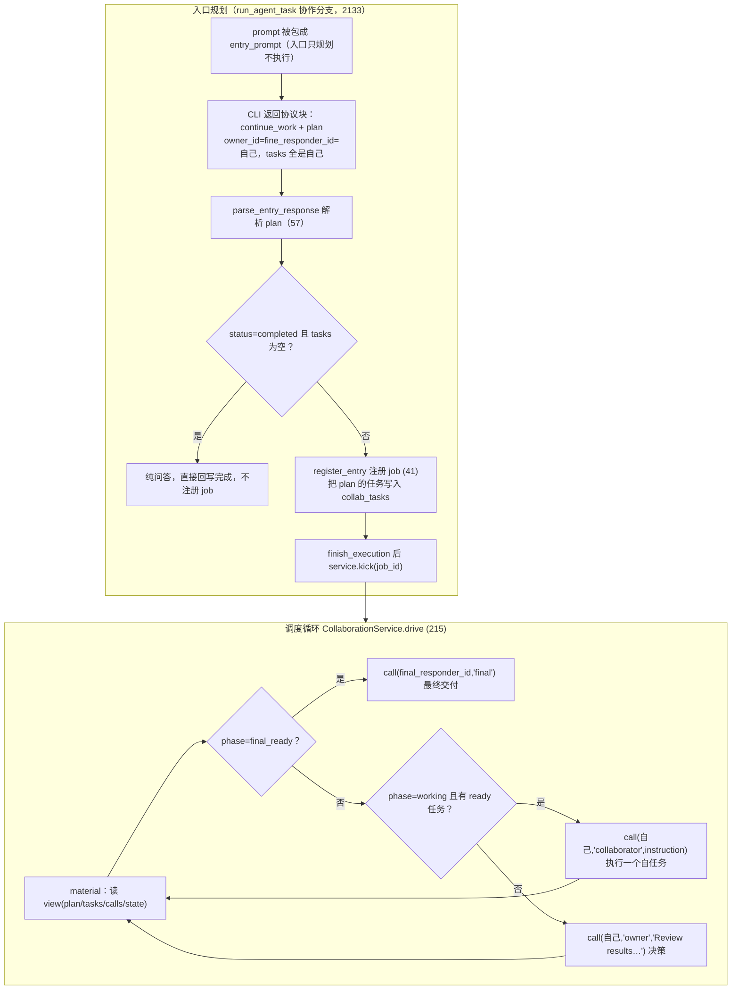
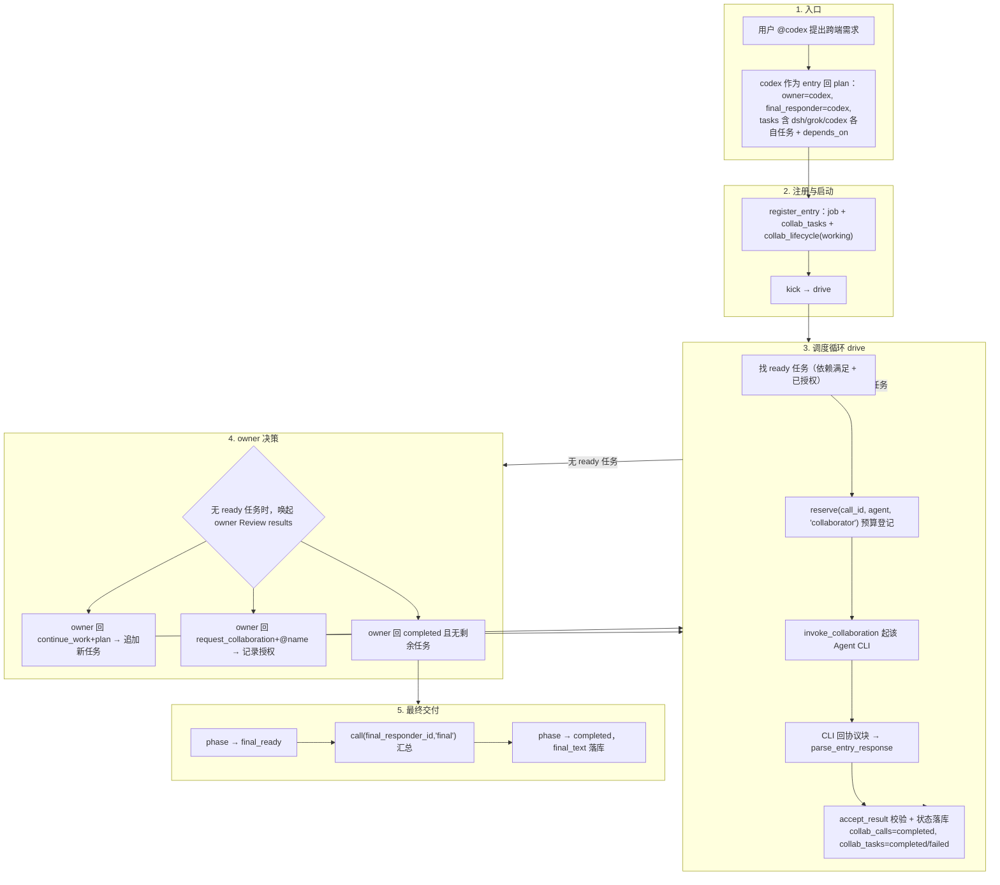
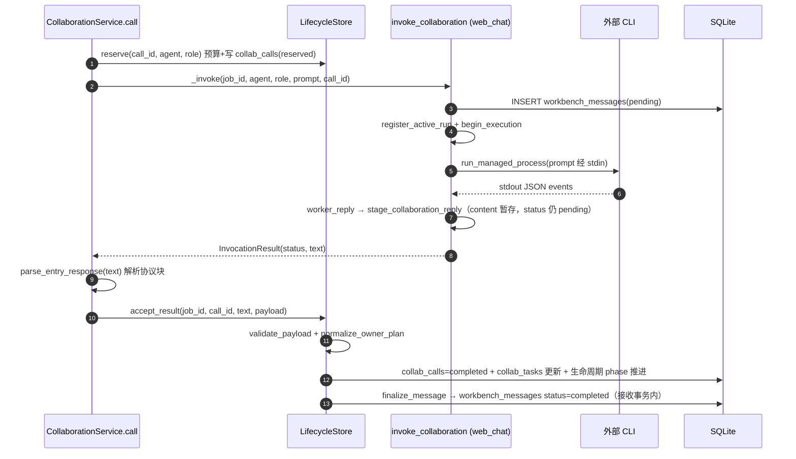
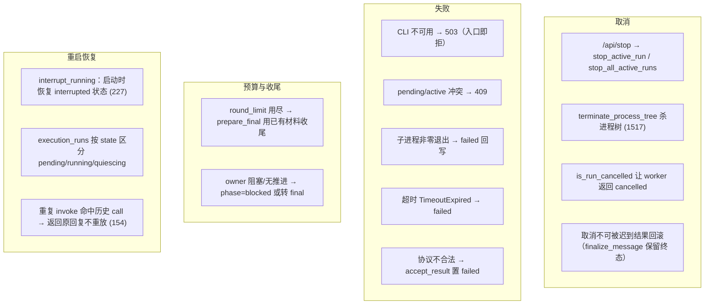

# 工作台调用流程 — DeepSeek Harness 独立原稿

> 作者：DeepSeek Harness。独立绘制，未参考另外两端的本轮原稿。
> 基线：HEAD `209446f`（删除失效路线索引后）。源码行号按当前工作树记录；未核对运行态，均以「未验证」标注。

本文用「产品运行链」和「Agent 内部工具调用」两层说明。产品运行链是工作台（`web_chat.py` 等 Python 进程）的真实执行路径；Agent 内部工具调用是 CLI 模型在收到 prompt 后自己读写文件、跑命令的行为，工作台只看到它的最终文本输出，看不到中间步骤。

---

## 1. 组件与术语

| 术语 | 含义 | 代码依据 |
|---|---|---|
| 工作台 | 本项目的 `web_chat.py` HTTP 服务，组合根，负责接收、调度、回写、进程管理 | `web_chat.py` |
| 逻辑角色 | 一次协作里的 owner / final_responder / collaborator / entry，与「哪个物理 Agent」无关 | `collaboration_protocol.py` |
| 物理 Agent | 实际运行的后端：codex / dsh / grok，各对应一个 CLI 进程 | `agent_registry.py` |
| 入口（entry） | 被 `@` 的那个 Agent，先做语义规划，产出 `plan` | `collaboration_entry.py:29` |
| 协作任务（task） | plan 里带 `task_id / agent_id / instruction / depends_on` 的最小执行单元 | `collaboration_protocol.py:23` |
| 调用（call） | 工作台对某个 CLI 的一次实际唤起，记录于 `collab_calls` | `collaboration_lifecycle.py:50` |
| 协议块 | CLI 回复末尾的 ` ```agent-collaboration ` JSON，含 status/handoff/questions/plan | `collaboration_entry.py:59` |
| 阶段（phase） | 一次协作的生命周期状态：working / waiting_user / blocked / final_ready / final_delivery / completed / failed / stopped | `collaboration_lifecycle.py` |

**核心区别（新手最容易混淆）**：一个「物理 Agent」可以同时是「入口」「owner」「final_responder」「collaborator」中的多个。比如 `@DeepSeek Harness 帮我归类文档`，DSH 既做入口又做 owner 又做 final_responder，它自己给自己规划任务、自己执行、自己收尾——这叫「自任务」。多 Agent 协作只是把 plan 里的某些 task 指派给别的 Agent。

---

## 2. 图一：单 Agent 调用（纯问答 / 普通消息）

这是最简路径：用户直接问一个 Agent，或广播给所有 Agent，不产生协作计划。

```mermaid
flowchart TB
  subgraph UI["用户浏览器"]
    U["输入消息，点击发送"]
  end

  subgraph HTTP["工作台 web_chat.py · do_POST (2391)"]
    P1["解析 /api/messages 的 content 与 conversation_id"]
    P2["resolve_message_recipients + route_message<br/>确定 recipients（@谁 / 广播 / 默认全部）"]
    P3["校验 CLI 可用性<br/>grok/codex/dsh 各自 resolve_xxx_command"]
    P4["检查该对话是否已有 pending 或 active_run<br/>冲突则 409 拒绝"]
    P5["写 workbench_messages：<br/>user 消息=completed，每个 Agent 一条 pending"]
    P6["返回 202 accepted"]
  end

  subgraph RUN["后台线程 run_agent_task (2133)"]
    R1["route_message 再次判定 collaboration"]
    R2{"collaboration 为真？"}
    R3["begin_execution 登记 execution_runs"]
    R4["worker = run_codex / run_deepseek_harness / run_grok (2128)"]
    R5["build_agent_prompt (1717)：<br/>注入 AGENTS.md + specs/README.md + 工作目录 + 共享历史"]
    R6["run_managed_process 启动外部 CLI 子进程<br/>stdin=prompt，stdout=JSON events"]
    R7["解析 CLI 输出，worker_reply (1385)<br/>→ update_workbench_message 回写 content+status"]
    R8["finish_execution + unregister_active_run"]
  end

  subgraph CLI["外部 CLI 进程（模型本体）"]
    C1["读 prompt → 模型推理 →（可选）自己读写文件/跑命令"]
    C2["输出最终文本"]
  end

  subgraph DB["SQLite"]
    D1["workbench_messages"]
    D2["execution_runs"]
  end

  U --> P1 --> P2 --> P3 --> P4 --> P5 --> P6 --> U
  P6 -.起 daemon 线程.-> R1
  R1 --> R2
  R2 -->|是：@单个 Agent| R3
  R2 -->|否：广播/无 @| R3
  R3 --> R4 --> R5 --> R6 --> CLI
  CLI --> C1 --> C2 --> R7
  R7 --> R8
  P5 --> D1
  R3 --> D2
  R7 --> D1
  U -.轮询 fetch_messages.-> D1
```

**逐点说明**

1. 工作台先确定「这条消息该给谁」：`route_message`（`collaboration_entry.py:11`）用正则找 `@名称`，支持 `@all/所有人/全部` 广播；有 `@具体Agent` 时返回单个 Agent 并标记 `collaboration=True`。
2. 写库时先落一条 `sender=user, status=completed` 的用户消息，再给每个接收 Agent 落一条 `status=pending` 的空消息——前端据此显示「正在处理」。
3. 每个接收 Agent 独立起一个线程跑 `run_agent_task`，互不等待。
4. **纯问答 vs 协作入口的分叉**：`run_agent_task` 里 `route_message` 若返回 `collaboration=True`，prompt 会被包成「入口规划」提示（`entry_prompt`），要求 Agent 回协议块；否则用原始 prompt 直接调用。
5. `build_agent_prompt` 每次都会重新读盘注入 `AGENTS.md` 与 `specs/README.md` 全文，并拼上该会话最近 N 条已完成消息作为共享上下文。
6. CLI 以子进程方式运行，工作台通过 stdin 送入 prompt，从 stdout 逐行解析 JSON event，取 `type=final` 的文本作为最终回复。

---

## 3. 图二：单 Agent 自任务（入口规划 → owner 循环执行自己）

当 `@某Agent 做一件具体的事` 时，该 Agent 作为入口先规划，再自己执行自己的计划。逻辑角色都是它自己，物理上只起该 Agent 一个 CLI。



**逐点说明**

1. 入口 Agent 收到的是「你是本次协作的入口，只规划不执行」的提示，所以它第一轮只回 `plan`，不动手。
2. 工作台解析出 `plan` 后调用 `register_entry`，把 `tasks` 逐条 INSERT 进 `collab_tasks`，初始 state=pending。
3. `kick` 触发 `drive` 循环：先找「依赖都已完成的 pending 任务」（`ready`），按顺序串行执行（`ready[0]`，代码注释明确是「共享工作区保守串行」，不是并行）。
4. 自任务的 owner 决策：当没有 ready 任务时，工作台以 `owner` 角色唤起 owner，让它「Review results」并返回 `continue_work`（保留/新增任务）或 `request_collaboration`（授权他人）或 `completed`。
5. 直到 owner 回 `completed` 且没有未完成任务，阶段转到 `final_ready`，再以 `final` 角色唤起最终答复者收尾。

---

## 4. 图三：多 Agent 协作（完整调度主链）

入口 Agent 规划出「分给其他 Agent 的任务」，工作台按依赖串行调度，中间 owner 决策循环推进。



**逐点说明**

1. **授权是显式的**：只有 owner 在 `request_collaboration` 里 `@` 了某个 Agent，且该 Agent 在 plan 里有任务，工作台才会把任务派给它（`collab_lifecycle.py:167-168` 写入 `collab_authorizations`）。这是「末行独立 @名称」规则的落点。
2. **串行不是并行**：`drive` 里 `ready[0]` 只取一个任务执行；同一 job 内同一时刻只有一个协作 call 在 `reserved` 状态（`reserve` 会拒绝「已有 reserved call」）。
3. **每步都要预算**：`reserve` 会累计 `used` 并和 `round_limit` 比较，超了抛「insufficient budget」，`drive` 捕获后转 `prepare_final` 用已有材料收尾。
4. **协议强校验**：`accept_result` 里 `validate_payload` 校验字段、角色、邀请；`normalize_owner_plan` 保证 owner 不能改角色、不能改已有任务定义，只能新增任务或补依赖。
5. **任务状态机**：`pending → (被选中执行) → completed/failed`；owner 决策可能追加新任务，回到循环。

---

## 5. 图四：一次协作 call 的传输与接收（invoke → accept）

这是图三里 `C2→C5` 的展开，说明「工作台如何起 CLI、CLI 输出如何变成已接收的协议结果」。



**关键点**：CLI 回复先「暂存」在 `workbench_messages.content`，status 仍是 pending；只有 `accept_result` 判定协议合法后才在同一事务里 `finalize_message` 把 status 置为 completed/failed/cancelled。协议不合法则 `finalize_message` 置 failed 并追加 `[协作回复未接收]`。这就是「CLI 成功 ≠ 协议接收成功」的代码依据。

---

## 6. 图五：异常、取消与恢复分支



**说明**：取消、失败、预算、恢复四条线都围绕「不覆盖已建立的终态」这个不变量：`finalize_message` 对非 pending 状态直接返回，`accept_result` 对 `cancelled/stopped/quiescing` 直接返回 cancelled。重启恢复通过 `execution_runs` 与 `collab_calls` 的状态判断，不重新起 CLI。

---

## 7. 新手实例：一句话走通

**场景 A（单 Agent 纯问答）**：用户在 `@Codex 这个报错是什么意思` → 工作台识别 codex 为唯一接收者 → 写一条 pending 消息 → 起 codex CLI，注入 AGENTS/specs/历史 → codex 回复文本 → 回写 completed → 前端显示。

**场景 B（单 Agent 自任务）**：`@DeepSeek Harness 把 docs 里的设计文档归类` → DSH 收到「入口规划」提示 → 回 `continue_work + plan（自己 owner/final，tasks 只有自己）` → 工作台注册 job → `drive` 依次执行 DSH 的自任务 → DSH 以 owner 决策「任务完成」→ 以 final 收尾。

**场景 C（多 Agent 协作）**：`@Codex 组织三端讨论并汇总` → codex 入口回 `request_collaboration + plan（含 dsh、grok 的评议任务）`，末行 `@DeepSeek Harness @Grok` → 工作台注册并授权 dsh、grok → 先跑依赖满足的任务 → dsh、grok 各回 `completed` → codex 作为 owner 决策 → 最后 codex 以 final 汇总交付。

---

## 8. 代码依据与验证边界

**代码依据（已静态核对）**

| 环节 | 位置 |
|---|---|
| HTTP 入口 / 消息路由 / 起线程 | `web_chat.py:2391` `do_POST`、`web_chat.py:2607` |
| 消息接收者识别 / 入口提示 / 协议块解析 | `collaboration_entry.py:11,29,57` |
| 单 Agent 执行与协作入口分叉 | `web_chat.py:2133` `run_agent_task` |
| 协作调用传输与暂存 | `web_chat.py:154` `invoke_collaboration`、`web_chat.py:1350,1362,1385` |
| prompt 构造（AGENTS/specs/历史注入） | `web_chat.py:1717` |
| 调度循环 / 单任务调用 | `collaboration_service.py:175,215` |
| 预算 / 状态转换 / 最终交付 | `collaboration_lifecycle.py:50,99,191` |

**未验证边界（本稿不宣称）**

- 未运行 Mermaid 渲染器，图形语法未经工具校验。
- 未运行真实 CLI、浏览器、取消、超时、重启注入测试；异常路径依据代码静态推演。
- 未确认部署环境 session resolver 对多会话续接的实际选择。
- `drive` 依赖「完成事件回调再 kick」的闭环（`call` 完成后 `events`/`action_changed` 触发下一轮），该回调链未逐行追到前端。

（本稿仅 DSH 独立原稿；统一稿由负责人阶段合并。）
