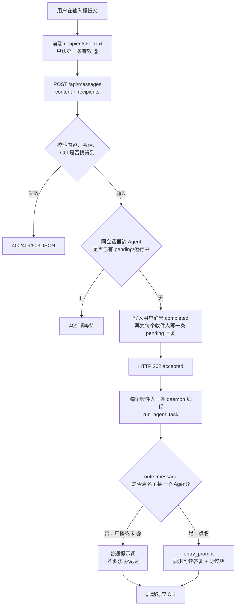
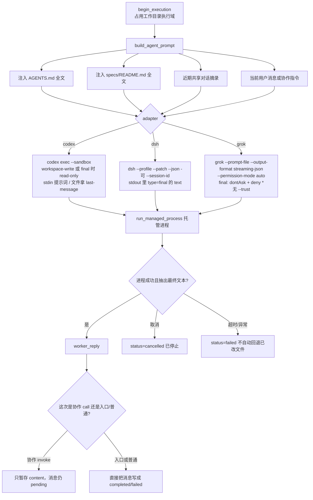
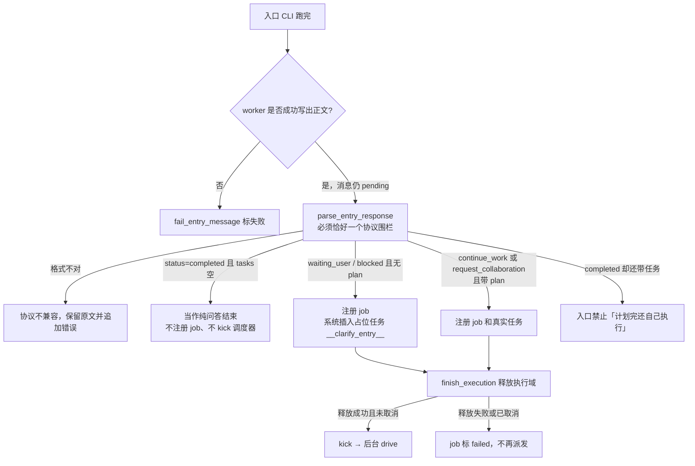
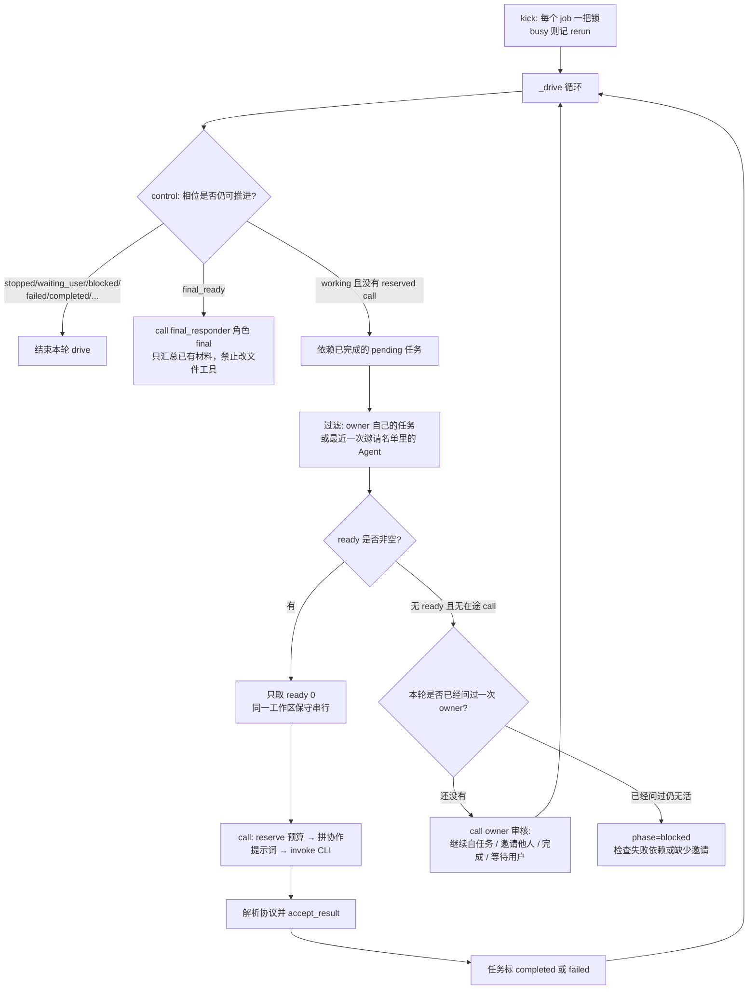

# 工作台调用流程（Grok 独立原稿）

| 字段 | 值 |
|---|---|
| 作者 | Grok |
| 状态 | 讨论中独立原稿，供互审；尚未与另外两端对齐，也未做浏览器/真实 CLI 验证 |
| 代码基线 | git HEAD `209446f0408d32fc005b7036543ab79a2c2d53f3`（`main`） |
| 方法 | 静态阅读当前源码；未读本轮他端原稿；未改代码/配置/Git；未启动 Agent、未跑模型探测 |
| 用户期望 | 分两类画出「调用单个 Agent」和「多个 Agent 协作」；图尽量细，并配解释，让不熟悉项目的人能看懂 |

本文描述**工作台产品运行链**（浏览器 → HTTP → 调度器 → 子进程 CLI → 回写数据库 → 前端刷新）。Agent 进程内部的工具调用（读文件、搜代码等）属于各 CLI 自己的循环，工作台只把它当成一次黑盒执行。

---

## 1. 先分清三个容易混的词

| 词 | 含义 | 例子 |
|---|---|---|
| **物理 Agent** | 一台真实后端，有自己的 CLI | `codex`、`deepseek-harness`、`grok` |
| **逻辑角色** | 某次协作 job 里这个物理 Agent 被安排做什么 | `entry`（入口规划）、`collaborator`（执行一条任务）、`owner`（审核/追加计划）、`final`（向用户汇总） |
| **会话消息** | 聊天区里的一条气泡 | 用户一条、每个被叫到的 Agent 各一条 pending 回复 |

同一个物理 Agent 可以先后当 entry、collaborator、owner。`owner_id` 和 `final_responder_id` 也可以是同一个人：这时 owner 说「全部完成」后，**不再**单独开一轮 `final` 调用。

三类入口（都从网页输入框发出）：

1. **点名一个 Agent**（`@Codex` / `@Grok` / `@DeepSeek Harness`）：走协作协议。可以是纯问答，也可以变成自任务或多 Agent 计划。
2. **广播**（`@all` / `@everyone` / 不写 `@`）：工作台给每个可用 Agent 各开一条独立线程，**不走**协作协议，彼此不调度。
3. **已经存在的协作 job**：用户在任务卡片上点「回答 / 补充 / 停止 / 收尾 / 改预算」，走 `/api/collaboration/action`。

下文「单 Agent」主要指第 1 类里只涉及一个物理 Agent 的路径；「多 Agent 协作」指第 1 类里计划包含多个物理 Agent，并由调度器串行执行。第 2 类单独标成「并行独立答复」，避免和新手以为的「协作」混在一起。

---

## 2. 图 A：从网页到是否进入协作



**逐步说明**

1. 浏览器 `composer` 提交时带上 `recipients`（`web_chat.py` 内嵌脚本约 953–970 行；`recipientsForText` 约 534–541 行）。代码围栏和 URL 里的 `@` 不算点名。
2. `ChatHandler.do_POST`（约 2391 行）只接受本机 Host。消息入口是 `/api/messages`。
3. 服务端再用 `route_message`（`collaboration_entry.py` 11–26 行）核对点名：第一条有效 `@某人` 只选中那一个人；`@all`/`@everyone`/`所有`/`全部` 或完全没有 `@` 则发给全部已启用 Agent。客户端不能把「点名 Codex」改投给别人（`grok_adapter.requested_recipients` 58–68 行）。
4. Grok CLI 找不到时：若名单里只有 Grok，或客户端明确只要 Grok，返回 503；若是广播，则悄悄去掉 Grok，Codex/DSH 继续（`web_chat.py` 2509–2517 行）。
5. 同一会话、同一物理 Agent 不能重叠运行（内存 `ACTIVE_RUNS` + 库里 `pending` 消息，2538–2568 行）。
6. 先提交 202，再后台跑 CLI。前端靠轮询 `/api/messages`、`/api/runs`、`/api/collaboration/tasks` 刷新，不是这条 POST 的响应体里带最终答案。

---

## 3. 图 B：一次 CLI 调用（三后端对照）

工作台对三个后端用同一套包装：登记运行 → 拼提示词 → 子进程 → 解析最终文本 → 回写。差别只在命令行和如何从 stdout 抽出「给用户看的那一段」。



**提示词里有什么（`build_agent_prompt` 1717–1797 行）**

- 项目入口 `AGENTS.md`、规范索引 `specs/README.md`、当前工作目录。
- 共享上下文：本对话里**其他** Agent / 消息桥的近期完成消息。会丢掉「当前这个 Agent 自己刚说过的」以及「用户专门发给它的」，避免把同一句用户话再喂一遍。
- 协作调度时，用户原文之外还会再包一层「当前角色 / 当前任务 / 完整材料 JSON」（见第 5 节）。

**三后端差异（静态代码，非本轮实测）**

| | Codex | DeepSeek Harness | Grok |
|---|---|---|---|
| 适配函数 | `run_codex` 1801 | `run_deepseek_harness` 1940 | `run_grok` 2047 |
| 提示词怎么进进程 | stdin | stdin | 临时文件 `--prompt-file` |
| 最终文本从哪来 | `--output-last-message` 文件 | NDJSON `type=final` | NDJSON `type=text` 拼接，且必须有 `end`+`end_turn`/`EndTurn` 和唯一 `sessionId`（`grok_adapter.parse_output`） |
| 会话续聊 | `resume thread_id` | `--session-id` | `--resume sessionId` |
| 权限/沙箱 | `--sandbox workspace-write`；`final` 角色改 `read-only` | 不显式传 sandbox；用固定 profile + headless 登录 patch | `--permission-mode auto`；`final` 为 `dontAsk` + `--deny *` + `--disable-web-search`；**没有** `--trust` / `--allow Bash` |
| 超时默认 | 1200 秒，环境变量可改 | 同左 | 同左 |
| 同一物理 Agent | `COLLAB_AGENT_LOCKS[agent_id]`：协作调用时同一 Agent 同时只跑一个 CLI | 同左 | 同左 |

超时文案都写明「可能已有文件修改，未自动回退」。

---

## 4. 图 C：单 Agent 点名后的两条出路

点名某个 Agent 后，工作台把它当成 **entry（入口）**：只允许规划或直接答完，不允许在这一枪里把计划里的修改做掉。



**纯问答（单 Agent、没有后续任务）**

新手例子：用户发 `@Grok 1+1 等于几？`

1. 前端只把 Grok 放进 `recipients`。
2. `run_agent_task` 发现 `route_message` 的第二返回值是「点名」，于是喂 `entry_prompt`（`collaboration_entry.py` 29–54 行）：「有要执行的任务用 continue_work；纯问答直接答复，plan.tasks 用 `[]`，status=completed。」
3. Grok 写出给人看的答案，再附一个 `agent-collaboration` JSON。
4. `run_agent_task` 2174–2201 行：校验通过且 `tasks == []` 就 **return**，不调用 `register_entry`。聊天区这条回复变成 completed。没有任务卡片上的后续调度。

**自任务（仍然是单物理 Agent）**

新手例子：用户发 `@Grok 只读盘点 docs 目录，不要改文件。`

1. 入口仍是 Grok。它返回 `continue_work`，`plan.owner_id = grok`，`final_responder_id = grok`，tasks 里只有自己的任务；**不要**末行 `@Grok`（自任务禁止邀请自己）。
2. `register_entry`（`collaboration_service.py` 41–57 行）建 job，`job_id` 形如 `entry-{入口消息id}`，绑定当前会话，入口那一枪记为 `collab_calls.call_id='entry'`。
3. 默认预算 `round_limit=20`，入口已经占用 `used=1`（`collaboration_lifecycle.initialize` 33–39 行）。
4. 执行域释放成功后 `kick` 开一条 drive 线程。因为授权名单是空的，**只有** `agent_id == owner_id` 的任务能进入 ready（246–249 行）。Grok 会再被调用一次，角色变成 `collaborator`，只执行那一条 instruction。
5. 任务做完后 drive 再请 **owner** 审核。Grok 若认为做完了，返回 `completed` 且不再追加任务。因为 owner 和 final 是同一个人，生命周期直接 `completed`，不再开 `final` 枪（lifecycle 186–188 行）。

---

## 5. 图 D：多 Agent 协作主循环（drive）



**调度规则（容易误读的点）**

- **串行，不是并行。** `task = ready[0]` 写明 conservative serialization（249 行）。即使两个任务互不依赖、分属两个 Agent，也一次只派一个。
- **依赖。** `depends_on` 必须是已 `completed` 的 task_id；环和未知 id 在 `validate_plan` 就会拒绝。
- **邀请才授权协作者。** 末行单独一行 `@Codex @Grok`（`terminal_invitation`）。散文、代码块、引用里的 `@` 不算。被邀请的人必须在当前 plan 里有任务，否则协议失败。owner 自己的任务不需要邀请。
- **协作者不能改计划。** `continue_work` 或携带 `plan` 会在 `validate_payload` 被拒（protocol 112–113 行）。要加任务只能 owner 在下一次审核里用「只含新增任务的 plan」（旧任务必须原样出现或省略表示保留，不能改定义）。
- **预算。** 每一次 `reserve` 的 call 都计入 `used`。协作者批次要预留 2 个空位（还要能再问 owner、必要时再 final）；owner 续跑在 owner≠final 时预留 1 个 final 空位。不够会 `prepare_final`，取消还没开始的 pending 任务，进入 `final_ready`，用已有材料收尾（lifecycle 50–93、191–205 行）。
- **owner 完成时若还有 pending/queued/running 任务**，不会当成成功，而是 `blocked: unfinished planned tasks`（180–184 行）。

**一次 `call` 传给模型的东西（175–190 行）**

固定中文协议说明 + `当前角色` + `当前任务`（那条 instruction）+ JSON：`view`（相位、原请求、plan、用户补充）、`tasks` 表、`calls` 表。这就是「完整材料」。模型内部再怎么搜代码，工作台都不感知。

---

## 6. 图 E：CLI 成功 ≠ 协议接收成功

```mermaid
sequenceDiagram
  participant D as drive/call
  participant S as collab_calls reserved
  participant I as invoke_collaboration
  participant W as 对应 CLI
  participant M as workbench_messages pending
  participant A as accept_result
  D->>S: reserve 扣预算
  D->>I: 调运输
  I->>M: 插入空 pending 气泡
  I->>W: 跑 CLI
  alt CLI 失败/取消/超时
    W-->>I: WorkerResult failed/cancelled
    I-->>D: dispatch_allowed 取决于 finish_execution
  else CLI 抽出最终文本
    W-->>I: 暂存 content，状态仍 pending
    I-->>D: state=completed 文本=原文
    D->>D: parse_entry_response
    D->>A: accept_result
    alt 协议合法
      A->>M: pending → completed
      A->>S: call completed + payload
    else 协议非法
      A->>M: pending → failed，正文后追加错误
      A->>S: call failed；非协作者会使 job failed
    else 用户中途补充导致过期
      A->>M: superseded → cancelled 气泡
    end
  end
```



入口那一枪也是「先暂存、再校验」：`update_workbench_message` 在 `validating_entry` 时故意把 completed 写成仍 pending，只有 `entry_reply_received` 为真才去解析（1319–1337、2174–2183 行）。运输成功只表示「磁盘上有一段模型输出」，不表示调度器承认这份协议。

---

## 7. 等待用户、失败、取消、重启

```mermaid
flowchart TD
  subgraph wait [等待]
    WU[owner/entry: waiting_user + questions]
    BL[blocked + blocked_reason]
    UI["任务卡片 POST /api/collaboration/action"]
    WU --> UI
    BL --> UI
    UI -->|answer| RW[phase 回到 working<br/>事件 resume_owner → replan 或 drive]
    UI -->|append| AP[只追加用户文本到 updates<br/>可能让进行中的 owner 回复 superseded]
    UI -->|set_limit| LIM[2..100，且必须留下收尾空位]
  end
  subgraph stop [停止]
    BTN[停止本条 / 停止全部 / 任务 finalize 或 stop]
    BTN --> Q[phase=quiescing，取消 reserved/pending]
    Q --> EV[cancel_then_stop 或 cancel_then_finalize]
    EV --> KILL[events() 调 cancel 确认进程退出]
    KILL -->|stop| ST[job stopped]
    KILL -->|finalize| FR[final_ready 再用已有材料汇总]
  end
  subgraph rec [恢复]
    BOOT[启动 startup_server]
    BOOT --> INT[interrupt_running:<br/>working/final_* / reserved → interrupted]
    INT --> HUMAN[不自动重跑，需人看占用摘要]
  end
```

用户动作在 `collaboration_actions.operate`（29–85 行），HTTP 边界在 `collaboration_http.py`。`answer` 只能在 `waiting_user`/`blocked`；预算不够续跑会要求先 `finalize` 或 `set_limit`。

协作气泡的「停止」会把 message_id 对上 `COLLAB_MESSAGES`，从而 `store.operate(..., stop)` 并 `action_changed` → `kick` 处理事件（2455–2466 行）。

启动时 `interrupt_running`（lifecycle 227–233 行）把进行中的 job 标成 interrupted，**不会**接着自动 drive。这是「进程没了、状态还在库里」的恢复策略。

---

## 8. 新手三条走通

**场景 1 — 只问一句**  
`@Codex 这个仓库用什么语言？`  
点名 → 入口协议 `completed` + 空 tasks → 聊天区一条 Codex 回复 → 结束。没有任务面板调度。

**场景 2 — 一个人把活做完**  
`@DeepSeek Harness 把 docs/README 里失效的某一行删掉并提交。`  
入口 `continue_work` 自任务 → kick → DSH 以 collaborator 执行 → DSH 再以 owner 声明完成 → 因 owner=final，job 直接 completed。全程一个物理 Agent，多轮 CLI。

**场景 3 — 三人协作（当前这次任务就是）**  
`@Codex 三端各自画流程图，互审后汇总。`  
入口 Codex 给出 plan：三端绘图、三端互审、Codex 统一稿、两端终审、Codex 收口；status=`request_collaboration`，末行 `@DeepSeek Harness @Grok`。drive 按依赖串行：先 Codex 原稿，再 DSH/Grok 原稿（仍一次一个），再互审……owner 在缺口处审核或追加任务。最后若 `final_responder_id` 仍是 Codex，由 Codex 再打一枪 `final`（只汇总、工具拒绝/只读）。

广播 `@all 大家打个招呼` **不是**场景 3：那是三条互不相干的普通 CLI，没有 plan，也没有 owner。

---

## 9. 源码索引（本轮读过的位置）

| 环节 | 文件:行号（约） |
|---|---|
| 前端发送 / 点名解析 | `web_chat.py` 534–541, 953–970 |
| HTTP 入口、落库、起线程 | `web_chat.py` 2391–2612 |
| 入口 vs 普通、注册 job、kick | `web_chat.py` 2133–2236 |
| 提示词注入 | `web_chat.py` 1717–1797 |
| 三后端 CLI | `web_chat.py` 1801–2125；`grok_adapter.py` 13–55 |
| 运输层协作调用 | `web_chat.py` 154–213, 1362–1394 |
| 点名与入口提示/解析 | `collaboration_entry.py` 11–75 |
| 协议字段 | `collaboration_protocol.py` 8–149 |
| 调度循环 | `collaboration_service.py` 41–103, 175–282 |
| 预算与接收 | `collaboration_lifecycle.py` 50–205 |
| 用户动作 | `collaboration_actions.py` 29–85；`collaboration_http.py` 8–42 |
| 末行邀请 | `collaboration_invitation.py` 7–34 |
| 身份表 | `agent_registry.py` 81–89 |
| 启动打断 | `web_chat.py` 2618–2635；`collaboration_lifecycle.py` 227–233 |

---

## 10. 未核实边界（明确不是本轮证据）

- 未在浏览器点发送，未跑真实 Codex/DSH/Grok CLI，未注入取消/超时/重启。
- 未用 Mermaid 渲染器出图（本机是否有 `mmdc` 未查）。
- `drive` 完成后前端如何靠轮询画成「协作中 / 已交付」，只核对了 API 与 `collaboration_ui.js` 的 action 入口，没有逐步跟一次 DOM 更新。
- 部署环境的 session resolver（续聊 id 实际选哪条记录）未核对。
- 任务表里的 `queued`/`running` 出现在取消与打断路径；正常 drive 成功路径是 `pending` → `completed`/`failed`。未动态观察是否还有写入 queued 的代码路径。
- 工作树里已有他端本轮原稿文件名，**本文件撰写时未打开**，以免被带偏。

索引：按本任务指令只写这一份署名原稿；`docs/README.md` / `docs/drafts/README.md` 留给统一稿阶段集中更新。
)
